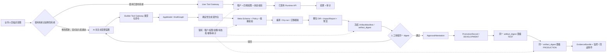

# 阶段 0：KVVI 可微 · AI 原生业务系统平台 —— 产品需求文档（PRD · 合并版）

| 项目 | 内容 |
| --- | --- |
| 文档名称 | 阶段 0 · KVVI 可微 AI 原生业务系统平台（骨架）产品需求文档 |
| 产品品牌 | **KVVI 可微** |
| 产品定位 | **AI 原生业务系统平台** |
| 英文名称 | **KVVI AI-Native Business Application Platform** |
| 核心描述 | 企业系统生成、治理与演进平台 |
| 品牌标语 | **说出业务，生成系统，持续演进。** |
| 文档版本 | **v1.11（Go-0 c14n 全输入边界修复：BOM、非标准常量与巨大指数）** |
| 文档日期 | 2026-08-31 |
| 文档状态 | **独立复评通过 · Go-0 已签署（2026-08-31）** |
| Go-0 签署 | **Codex 独立复评：PASS；经用户明确授权签署，允许启动 0A 契约试验** |
| 独立复评记录 | [`Codex v1.11 复评.md`](<../评审/Codex v1.11 复评.md>) |
| 关联文档 | `PRD-全链路内部SaaS系统.md` |
| 决策结论 | **有条件立项（Conditional Go）** |
| 核心原则 | 可复用 · 去行业化 · 契约优先 · AI 受控 · 难的锁死 · 失败可恢复 |
| 交付形态 | 一套可供不同公司独立复用的地基 + 受限协议运行时 + AppModel/依赖图控制面 + AI 双网关 + 不可变发布与证据化验收方法 |

> **本文档是阶段 0 的唯一权威依据**，合并了两个来源：
> - 工程与边界（源自 codex 的 v0.5「范围收敛与安全边界版」）；
> - 定位与愿景（源自 v0.4「四条路、AI 无代码平台、对照氚云」）。
>
> 主 PRD 与本文档冲突时，阶段 0 的范围、模块边界和验收以本文档为准。

---

## 1. 定位与愿景

### 1.1 做系统的四条路，我们走第四条

| 路线 | 谁来做 | 成本 | 门槛 | 灵活性 |
| --- | --- | --- | --- | --- |
| 1. 找程序员 | 程序员 | 最贵 | 老板不用懂 | 高（但慢、要沟通） |
| 2. 买现成系统 | 软件公司 | 中 | 不用懂 | 低（用着别扭） |
| 3. 低代码平台自搭 | 自己（半个技术员） | 中 | 要学拖拽配置 | 中（有天花板） |
| 4. **AI 生成 + KVVI 可微平台地基** | **AI** | 低 | **说人话就行** | **高** |

前三条的共同点：都得有「人」去吭哧吭哧做系统。我们走第四条——把「人」换成「AI」。

> **核心定位**：以前做系统只有三条路——找程序员（贵）、买现成的（僵）、低代码自己拖（累还要学）。我们走第四条：**用 AI 生成系统，再由「KVVI 可微」提供受控地基**——老板只说人话，AI 在地基上把系统搭出来，不写代码、不学低代码、不被现成系统绑死。

### 1.2 KVVI 可微是什么

**KVVI 可微**是产品品牌，正式定位为**AI 原生业务系统平台**，英文名称为 **KVVI AI-Native Business Application Platform**。“AI 无代码平台”保留为技术类别描述，不再作为产品正式名称。平台面向企业系统的生成、治理与持续演进，而不只负责第一次生成。

| 平台类型 | 操作平台的人 | 「界面」是什么 | 本项目是否采用 |
| --- | --- | --- | --- |
| 低代码平台 | 人（半技术） | 拖拽 + 少量代码 | 否 |
| 无代码平台 | 人（零技术） | 点选配置面板 | 否 |
| **KVVI 可微（AI 原生业务系统平台）** | **AI** | **规范 + 双网关 ToolSpec + AppModel + Schema/AppSpec + 护栏** | **是** |

AI 不依赖人的拖拽界面，它只认「规范 + ToolSpec + 机器契约 + 护栏」。老板不需要拖拽字段或编写代码，只需描述业务意图；AI 是平台的「操作员」，但必须先进入 User/Builder 中的一扇受控网关。修改系统时，AI 先通过类型化命令操作 `AppModel/DraftGraph`，再确定性生成正式契约。业务数据结构由 `BusinessSchema` 描述，页面和组件树由 `ViewSchema` 描述，应用组合由 `AppSpec` 描述；三者不得混成一个可执行大对象。

### 1.3 对照氚云的取舍

基于氚云界面截图，明确三类处理：

| 处理 | 内容 | 具体项 |
| --- | --- | --- |
| ✅ **照学（进地基）** | 通用技术能力，任何系统都要 | 控件库、流水号、关联表单、汇总计算、公式、子表、数据权限、字段权限、流程设计、导入导出、API 集成 |
| ❌ **故意不做（差异化核心）** | 氚云「人的操作界面」，我们砍掉 | 图形化拖拽设计器、字段拖拽、点选配置面板、代码面板 |
| 🏠 **进模板（行业业务）** | 某行业独有字段/流程 | 家具电商的报货单、排单、计抛运费、提成、月结等 |

> **关键发现**：氚云已在做「AI 推荐字段」「AI 识别」「AI 审批建议」，但那是**点状辅助**（AI 帮人做某一步）；我们的定位是 **AI 直接建系统**（说人话 → 生成整个表单/系统）。
> **品牌标语**：**说出业务，生成系统，持续演进。**
> **一句话差异化**：氚云是「人用 AI 辅助」，我们是「AI 直接干活」。

---

## 2. 决策摘要

### 2.1 阶段 0 要解决的问题

阶段 0 要验证的不是「AI 能不能写代码」，而是：

> 老板或业务人员用自然语言描述需求，AI 能否先给出可审阅蓝图，再经 Builder Gateway 的类型化命令生成 AppModel/DraftGraph 和可验证的 `BusinessSchema + ViewSchema + AppSpec` 变更包，并在影响分析、人工批准和同包环境晋级后发布为可运行的内部业务系统；同时，日常使用只能通过权限隔离的 User Gateway。

阶段 0 结束时应得到一套可继续承载自家 ERP、并具备跨行业复用证据的**平台骨架**，而不是一个已经可以大规模对外销售和运营的完整 SaaS 产品。

### 2.2 已锁定的关键决策

| 决策项 | 结论 |
| --- | --- |
| 平台定位 | KVVI 可微是给 AI 使用的受控业务系统平台；老板说人话，AI 先出蓝图并通过 Builder 类型化命令生成受限 BusinessSchema、ViewSchema 和 AppSpec 变更包 |
| 运行路线 | **元数据运行时**；阶段 0 不采用「每个表单生成一套前后端代码」 |
| 架构 | NestJS 模块化单体 + PostgreSQL + Docker Compose |
| 前端 | Vue 3 + Element Plus，复用现有交互资产并去行业化 |
| 公司模型 | 一层模型：`tenant` 即公司主体和数据隔离边界；不再增加集团/工作区数据层 |
| 登录与切换 | 一个账号可加入多家公司；登录后选择一家合法公司，并建立唯一的活动租户上下文 |
| 多租户 | 每家公司使用独立可信租户上下文 + PostgreSQL RLS + 复合约束 + 负向测试 |
| 权限 | 四维权限：表单 / 字段 / 数据范围 / 流程；RBAC 与数据范围策略分开实现 |
| 跨公司能力 | 阶段 0 不提供跨公司汇总、统一经营看板、跨公司下钻或跨公司导出 |
| 表单数据 | 固定平台列 + `JSONB` 业务数据的混合模型；BusinessSchema 声明索引 |
| 业务数据契约 | `business-schema/v1` 采用可信注册外壳 + 受限 `spec`；未知属性拒绝；字段、规则、索引、版本和错误码均机器可校验 |
| 页面搭建契约 | `view-schema/lce-safe-v1` 参考阿里 LowCode Engine 1.1.0 的节点树与协议分层，但排除任意 JavaScript、任意数据源、任意包和任意 CSS；不宣称完整兼容 |
| 组件资产 | 组件由服务端 `ComponentRegistry/MaterialRegistry` 白名单解析；AI 只能选择已登记组件和动作，不能提交 npm、CDN、URL 或运行代码 |
| AI 双网关 | `User Tool Gateway` 只操作已发布业务能力；`Builder Tool Gateway` 只提交类型化搭建命令和草稿；两者权限、工具、审计和风险等级完全隔离，不得隐式互调 |
| 草稿编辑模型 | `AppModel/DraftGraph` 是唯一可变的编辑工作区；AI 不直接补丁正式 Schema JSON，而是调用带稳定 ID、基线版本和审计记录的类型化命令 |
| 应用依赖治理 | `AppContextGraph` 是由契约、注册表和发布记录派生的依赖索引，用于作用域、反向引用、变更影响和血缘分析；它不是第二份权威配置 |
| 应用作用域 | 公司 `tenant` 仍是唯一数据隔离边界；`app/module scope` 只负责应用资产的命名空间与归属，不新增集团/工作区数据层 |
| 环境与晋级 | 固定 `DEVELOPMENT → TEST → PRODUCTION`；跨环境身份唯一取自不可变 ArtifactManifest 的 `artifact_digest`，每次环境动作产生追加式 PromotionRecord；环境配置绑定只进入 PromotionRecord，密钥不得进入协议或发布包 |
| 质量规则 | Linter 之上增加版本化 `Policy Checker` 规则集、严重级别和环境策略；规则版本进入 ArtifactManifest，检查结果进入 EvidenceBundle |
| AI 权限 | AI 只起草，不能直接修改核心代码、生产库或自动发布生产变更 |
| 发布权 | 阶段 0 所有平台契约与 ArtifactManifest 均需人工审批；审批只签署 `artifact_digest`，环境晋级另产生 PromotionRecord |
| 支付 | `payment-core` 与渠道适配器分离；阶段 0 仅 Fake/沙箱，不上线真金自动付款 |
| 可复用证明 | 必须以第二个非家具行业样例验证，不再使用「100% 复用」口号代替证据 |

### 2.3 有条件立项

允许进入阶段 0，但必须遵守以下条件：

1. 按 0A → 0B → 0C → 0D 顺序推进，不把 13 项能力同时并行开发；
2. 先锁定全部公开协议的 Meta-Schema（明细见 0A）、最小 AppSpec 组合外壳、最小 Permission/Workflow Spec 外壳、AppModel/DraftGraph 类型化命令、AI 双网关 ToolSpec、AppContextGraph、环境晋级、组件注册表、公司即租户的一层上下文、成员/角色关系、四维权限、事件包和付款状态机契约；
3. 真金支付、47 张业务表和历史数据全量迁移不进入阶段 0；
4. 每阶段以自动测试和证据包退出，不以「页面能打开」作为完成证明；
5. 现有 taobao 系统保持稳定，作为 legacy reference/adapter，不在原系统内直接改造成新底座。

---

## 3. 三层模型与边界

### 3.1 地基、模板、实例

| 层 | 职责 | 换公司是否修改 | 例子 |
| --- | --- | --- | --- |
| **地基层** | 通用、安全、稳定的技术能力 | 不应修改 | 租户、认证、权限、金额、状态机、事件、审计 |
| **模板层** | 某行业可复用的 BusinessSchema、ViewSchema 与规则 | 换行业时替换 | 家具电商报货模板、餐饮门店维修模板 |
| **实例层** | 某一家公司的配置与组织数据 | 每家公司不同 | 审批人、阈值、店铺、字段显示与编号前缀 |

### 3.2 分层铁律

1. 地基不得出现家具电商、餐饮或任何客户专属术语；
2. 模板只能调用地基公开契约，不得绕过服务直接写地基表；
3. 实例配置不得改变地基状态机、金额精度、租户策略或权限校验；
4. 渠道适配器可以依赖地基接口，地基不得依赖支付宝等具体渠道；
5. AI 工具只能调用受控的校验、预览、审批和发布接口；组件解析、数据查询和动作执行必须经过服务端注册表与权限校验。

### 3.3 能力归属判断（决策口诀）

- 不同行业都需要且安全边界一致 → **地基**；
- 同一行业普遍需要 → **行业模板**；
- 只有某家公司需要 → **企业实例**；
- 依赖第三方产品或渠道 → **适配器**。

### 3.4 去行业化自查

> 把地基代码拿给一个「做餐饮系统的」看，如果里面有任何一个他看不懂的家具电商词，就是越界了。

禁止进地基：报货单、已排单、供应商-报货单、计抛运费、月结账单、客服外包服务费 1.5%、客服提成公式、店铺利润公式、具体店铺/公司/供应商名、「吴明审批」等具体审批链——这些一律进「家具电商模板」或「实例」。

### 3.5 组织与权限模型（一层公司 + 四维权限）

#### 3.5.1 组织层级（一层：公司即租户）

```text
统一账号 account
  └─ 公司 tenant（= 公司主体，也是隔离边界）
      ├─ 店铺 store
      ├─ 部门 department
      └─ 成员关系 membership → 角色 role
```

| 层级 | 职责 | 关键规则 |
| --- | --- | --- |
| 统一账号 | 登录身份，一个人只保留一个基础账号 | 账号本身不自动拥有任何公司数据权限 |
| 公司（`tenant`） | 独立经营与核算上下文，也是隔离边界 | 不同公司之间由 RLS 硬隔离；业务记录带 `tenant_id` |
| 成员关系 | 连接账号、公司与角色 | 同一账号在不同公司可拥有不同角色；停用成员关系后立即失去访问权 |
| 角色 | 管理一组可复用权限 | 管理者配置角色权限，再把角色分配给公司成员 |

> **边界定义**：`tenant` 就是公司主体，一层到底，不拆「集团 / 客户工作区 + 公司主体」两层。

#### 3.5.2 一次登录与公司选择

```text
账号登录
  → 查询本人有权进入的公司
  → 用户选择公司
  → 服务端校验成员关系
  → 建立 active_tenant_id + permission_version
  → 进入该公司系统
```

约束：

1. 请求体、查询参数、前端缓存和 AI 输出都不能直接决定最终 `tenant_id`；
2. 切换公司必须重新校验有效成员关系、账号状态和角色状态；
3. 每个 HTTP 请求、后台任务、事件、导入导出和 AI 工具调用都必须携带可信租户上下文；
4. 切换公司、切换失败和非法公司访问均写安全审计；
5. 权限版本变化后，旧会话不得继续使用过期权限缓存。

#### 3.5.3 四维权限

| 权限维度 | 回答的问题 | v1 最小能力 |
| --- | --- | --- |
| **表单权限** | 能进入哪个表单、能做什么 | `read`、`create`、`update`、`delete`、`import`、`export`、`approve`、`admin` |
| **字段权限** | 在表单内能看到和修改哪些字段 | 隐藏、脱敏、只读、可编辑；服务端同时执行读写过滤 |
| **数据范围** | 能操作表单里的哪些记录 | 本人、所属店铺、部门、部门及下级、公司全部 |
| **流程权限** | 在当前状态下能执行什么动作 | 发起、提交、撤回、审批、驳回、关闭、重新打开；同时受流程状态机约束 |

五档数据范围固定编码：

| 编码 | 中文 | 规则 |
| --- | --- | --- |
| `SELF` | 本人 | 仅记录拥有者、创建人或明确分配给本人的记录 |
| `STORE` | 所属店铺 | 仅用户被授权店铺集合内的数据 |
| `DEPARTMENT` | 部门 | 仅用户当前部门的数据 |
| `DEPARTMENT_AND_CHILDREN` | 部门及下级 | 当前部门与组织树下级部门的数据 |
| `COMPANY` | 公司全部 | 当前公司内全部获授权表单数据 |

权限判定顺序必须固定：

1. 租户隔离；
2. 有效成员关系与角色；
3. 表单动作权限；
4. 数据范围；
5. 字段读写策略；
6. 流程动作与当前状态。

任何一层拒绝，最终结果都必须拒绝。默认无权限；菜单隐藏只改善体验，不能代替接口和数据库层校验。

授权判定代数（固定顺序，避免不同 Runtime 行为分裂）：

1. 多角色权限先计算各角色允许项的**并集**；
2. 再应用**显式拒绝剔除**（deny overrides）：任一角色对某资源显式拒绝时，从并集中剔除该权限，最终结果拒绝该操作；
3. 字段权限冲突优先级：拒绝 > 隐藏 > 脱敏 > 只读 > 可编辑；
4. 数据范围组合取**并集**（如同时授权 `STORE` 与 `DEPARTMENT` 时取两者并集）；`SELF` 的归属判定固定为 owner OR creator OR assignee（任一命中即属本人）；
5. 权限版本变更后，正在执行的请求、任务和工具调用立即按新版本重新校验，旧权限缓存失效；
6. 三类管理边界：tenant 管理员只能批本租户资产、TEMPLATE 管理员只能批模板资产、平台管理员只能批平台级资产，三者不得互批；
7. 高风险结构变更（删除、字段类型收窄、唯一约束、流程状态变化）要求创建人与审批人分离。

#### 3.5.4 管理者授权规则

1. 管理者先创建或选择角色，再配置表单、字段、数据范围和流程权限；
2. 用户加入某家公司后，由管理者分配该公司的角色；同一用户在不同公司可分配不同角色；
3. v1 默认不开放零散的个人权限覆盖，特殊需求必须显式启用、说明原因并接受审计；
4. 管理者只能授予自己被委托管理的权限范围，不能借授权功能扩大自身权限；
5. 角色、权限和成员关系的新增、修改、停用都生成不可抵赖的审计记录和前后差异；
6. 权限变更必须生成新 `permission_version`，服务端据此使旧权限缓存失效。

#### 3.5.5 AI 权限继承

- AI 代表谁操作，就继承谁的账号、租户、角色、数据范围和字段权限；
- AI 可以起草角色和权限变更方案，但不能给自己或用户直接授权、不能批准自己的权限方案；
- AI 工具调用必须经过服务端完整授权，模型输出不是可信权限凭证；
- AI 生成权限方案时必须展示 diff、影响对象、潜在越权和回滚方式，由有授权能力的管理者批准后发布。

#### 3.5.6 最小验收样例

| 场景 | 期望结果 |
| --- | --- |
| 同一账号在公司 A 是老板、公司 B 是客服 | 切换公司后分别获得两套角色和权限，不串用缓存 |
| 客服拥有报货单读取权限，但数据范围为所属店铺 | 只能看到被授权店铺的报货单 |
| 客服可见订单金额、无权查看利润字段 | 接口与导出均不返回利润字段，不能靠手工请求绕过 |
| 财务对表单有读取权、对付款状态只有只读权 | 页面只读，直接调用更新接口同样被拒绝 |
| 管理者修改角色或停用成员关系 | 权限立即按新版本生效，并可查到前后差异和操作人 |
| 同一用户同时持有 `SELF` 与 `COMPANY` 两种数据范围角色 | 数据范围取并集即最宽档（公司全部），而非交集；此并集语义有专门正/负向用例钉死 |

#### 3.5.7 Builder 授权模型（搭建面授权）

四维权限只覆盖业务数据面；搭建面（谁能用 Builder Gateway 起草、在哪个范围起草）需要独立的 Builder 授权模型：

1. Builder 权限是独立维度，不并入业务四维权限；拥有业务管理员角色不代表拥有搭建权限；
2. 授予粒度为 `tenant / app / module` 三级，最小授予一个 `module`，不提供「全平台自动搭建权」；
3. 由拥有**目标作用域**管理与委派权的管理员授予；平台管理员不因平台身份自动获得租户 Builder 权限或租户数据访问权；AI 不能给自己或用户授予 Builder 权限，不能批准自己的搭建方案；
4. Builder 权限随 `permission_version` 一起版本化，权限变更后旧会话与在途工具调用立即失效；
5. AI 以委派身份操作：Builder 会话继承真实账号与租户，审计记录真实账号，不另设匿名服务账号。
6. 每次工具调用必须由网关生成不可伪造的 `DelegatedInvocationContext`，至少固定 `actor_id`、`tenant_id`、`app_id`、`module_id`、`permission_version`、`tool_code`、`tool_version`、`audience`、`issued_at`、`expires_at`、`idempotency_key` 与 `trace_id`。这些值由服务端会话、路由和已登记 ToolSpec 合成并使用服务端签名/MAC 防篡改，请求体、前端缓存和 AI 输出不得覆盖；网关在调用开始、产生副作用前及返回受保护结果前均按当前权限版本重新校验，`audience` 不匹配、过期或作用域漂移一律拒绝。

#### 3.5.8 `DelegatedInvocationContext.audience` 规范边界

`audience` 只标识允许接受并使用该委派上下文的**目标网关安全边界**，不是调用方、下游微服务名、工具类别、角色或任意标签。阶段 0 只允许以下两个大小写敏感的固定值：

| `audience` | 唯一允许接受的网关 | ToolSpec 的 `gateway` |
| --- | --- | --- |
| `USER_GATEWAY` | User Gateway | `USER_GATEWAY` |
| `BUILDER_GATEWAY` | Builder Gateway | `BUILDER_GATEWAY` |

以下规则共同构成规范性约束，不得由实现选择兼容分支：

1. `audience` 是单值必填枚举，禁止空值、数组、多受众、通配符、别名、自由字符串或大小写兼容；字段缺失、类型错误或值不在枚举内统一返回 `DELEGATED_CONTEXT_INVALID`。
2. 每个不可变 ToolSpec 必须有且只有一个服务端登记的 `gateway`，取值使用同一枚举；请求体、AI 输出、前端和 ToolSpec 输入参数不得声明或覆盖它。
3. 目标网关先从自身受控部署配置取得 `current_gateway_identity`，再从按 `tool_code + tool_version` 命中的已登记 ToolSpec 取得 `tool_gateway`。只有二者相等时才能生成上下文，并固定 `audience = current_gateway_identity = tool_gateway`；`audience` 必须进入签名/MAC 覆盖范围。
4. 调用开始、产生副作用前和返回受保护结果前的三次校验，都必须重新取得当前 `current_gateway_identity` 与 ToolSpec 快照，并同时满足 `context.audience = current_gateway_identity = tool_gateway`。两个合法枚举值之间发生任何不相等，统一返回 `DELEGATED_AUDIENCE_MISMATCH`。
5. 发生受众错误时禁止自动换网关、重签上下文、改写 `audience`、降级到另一工具或复用原 `idempotency_key` 重试。User Gateway 与 Builder Gateway 之间不得转发或复用同一个 `DelegatedInvocationContext`。
6. Builder 流程若确需读取真实业务记录，必须发起一条独立 User Gateway 调用，由 User Gateway 重新鉴权并签发 `audience=USER_GATEWAY` 的新上下文；原 `BUILDER_GATEWAY` 上下文不得升级、交换或嵌套使用。

最小验收用例固定如下：

| 用例 | 期望 |
| --- | --- |
| User Gateway + User ToolSpec + `USER_GATEWAY` | 通过受众校验后继续执行其余授权检查 |
| Builder Gateway + Builder ToolSpec + `BUILDER_GATEWAY` | 通过受众校验后继续执行其余授权检查 |
| Builder 上下文调用 User ToolSpec，或反向调用 | `DELEGATED_AUDIENCE_MISMATCH`，且不自动切换网关 |
| 上下文枚举合法，但与当前网关或 ToolSpec 任一方不一致 | `DELEGATED_AUDIENCE_MISMATCH` |
| `audience` 缺失、未知、大小写错误、通配或多值 | `DELEGATED_CONTEXT_INVALID` |

---

## 4. 阶段 0 范围

### 4.1 阶段 0 必须交付

1. NestJS 模块化单体、PostgreSQL、Docker Compose 和健康检查；
2. 统一账号、多公司会员关系、合法公司选择/租户切换和 PostgreSQL RLS；
3. 表单、字段、数据范围、流程四维权限与最小管理配置；
4. 本人、所属店铺、部门、部门及下级、公司全部五档数据范围；
5. 金额值对象、币种、精度和舍入规则；
6. 租户级并发安全单号；
7. 不可由请求伪造操作人的审计日志；
8. BusinessSchema Contract v1、机器可读 Meta-Schema、不可变版本、校验、迁移计划和回滚协议；
9. ViewSchema `lce-safe-v1`、机器可读 Meta-Schema、受控组件注册表、编译器与版本化页面运行时；
10. 最小 AppSpec 组合外壳、最小 `permission-spec/v1alpha1`/`workflow-spec/v1alpha1` 外壳，以及通用列表、详情、表单、CRUD、搜索和分页运行时；
11. AppModel/DraftGraph、稳定对象/节点 ID、类型化变更命令、基线冲突检测、命令审计和确定性契约编译；
12. AppContextGraph、应用/模块作用域、正反向依赖、版本血缘和发布前变更影响报告；
13. User Tool Gateway / Builder Tool Gateway 两套独立 ToolSpec、权限矩阵、风险分级、幂等和审计边界；
14. `DEVELOPMENT/TEST/PRODUCTION` 环境模型、版本化 Policy Checker、不可变 ArtifactManifest、ApprovalAttestation、追加式 PromotionRecord、EvidenceBundle、同包晋级、漂移检测和整包回滚；
15. 最小工作流、outbox、幂等消费和可恢复调度；
16. `payment-core` + Fake 支付适配器；具备条件时增加支付宝沙箱适配器；
17. AI 蓝图、类型化命令、DraftGraph、linter/Policy/依赖校验、dry-run、diff/影响预览、人工审批、同包环境晋级和回滚闭环；
18. 通用样例、家具电商样例和非家具行业样例；
19. 自动测试、跨租户负向测试、并发/重复/中断测试、备份恢复演练和验收证据包。

### 4.2 明确不在阶段 0 内

- 47 张业务表单全部交付；
- 2–3 年历史数据全量迁移、生产切换和旧系统下线；
- 真金自动付款、自动批量转账和生产支付授权；
- 完整公式/汇总计算引擎；
- 地理位置、手写签名、通用自定义按钮和任意工具执行；
- 图形化拖拽设计器、字段拖拽和面向人工的重型配置后台；
- `JSExpression`、`JSFunction`、任意脚本/HTML/CSS、任意数据源 URL/Header、任意 npm/CDN 包以及 AI 自行安装组件；
- 通用 RAG、老板问数、预测分析和完整 AI 助手；
- 覆盖全企业语义的知识图谱；阶段 0 的 AppContextGraph 只做应用资产依赖、作用域、血缘和影响分析；
- 把 User/Builder 合并成一套万能 AI 工具，或允许 Builder 以“搭建需要”为由默认读取生产业务记录；
- 对外多客户产品所需的计费、运营后台、在线升级、SLA 和客服体系；
- Redis、微服务或消息中间件的预先引入；只有证据证明单体内持久化方案不足时再评估。
- 跨公司汇总、统一经营看板、跨公司下钻和跨公司导出。

### 4.3 样例范围

| 样例 | 用途 | 最小内容 |
| --- | --- | --- |
| 通用事项登记 | 验证 BusinessSchema/ViewSchema 与 CRUD/页面运行时 | 文本、日期、枚举、金额、状态、搜索、权限 |
| 家具电商报货申请 | 验证现有业务能通过模板承载 | 主表、受限明细、审批、编号、附件 |
| 餐饮门店设备维修工单 | 验证第二行业复用 | 门店数据范围、图片、处理流程、费用和关闭状态 |

三个样例都不得修改地基内部代码。若需要扩展，只能增加受审的模板契约、登记组件资产或使用已定义扩展点。

---

## 5. 总体架构与依赖方向

```text
platform/
├─ core/                         # AI 禁止直接修改
│  ├─ tenant-auth/
│  ├─ authorization/
│  ├─ money/
│  ├─ sequence/
│  ├─ workflow/
│  ├─ event-outbox/
│  ├─ scheduler/
│  ├─ audit/
│  └─ payment-core/
├─ control-plane/                # 搭建、治理、发布控制面；不承载业务记录
│  ├─ app-model-draft-graph/
│  ├─ context-graph/
│  ├─ policy-checker/
│  └─ release-alm/
├─ runtime/
│  ├─ business-schema-registry/
│  ├─ view-schema-registry/
│  ├─ component-registry/
│  ├─ form-runtime/
│  ├─ view-runtime/
│  └─ file-io/
├─ adapters/
│  ├─ fake-payment/
│  ├─ alipay-sandbox/            # 有条件启用，不是阶段 0 退出前提
│  ├─ legacy-taobao/
│  └─ legacy-h3/
├─ templates/
│  ├─ furniture-ecommerce/
│  └─ restaurant-maintenance/
├─ instances/
│  └─ <tenant>/
├─ ai-gateways/
│  ├─ user-tool-gateway/         # 只调用已发布业务能力
│  ├─ builder-tool-gateway/      # 只提交类型化搭建命令/草稿
│  └─ tool-registry/
└─ ai-assets/
   ├─ prompts/
   ├─ contract-linter/
   ├─ golden-cases/
   └─ guardrails/
```

依赖方向必须满足：

```text
instances -> templates -> public platform contracts
adapters  -> public platform contracts
AI -> user-tool-gateway -> published runtime APIs
AI -> builder-tool-gateway -> typed AppModel commands -> validated contract bundle
context-graph <- contract/registry/release events（派生索引，不是权威配置源）
release-alm -> controlled validation/promotion/rollback APIs
user-tool-gateway -X-> draft/configuration/release APIs
builder-tool-gateway -X-> production business writes/core/runtime/self-approval
core/runtime -X-> templates/instances/specific providers
```

四条强制依赖规则：

1. `BusinessSchema/ViewSchema/AppSpec` 与其他正式契约的不可变发布版本仍是运行时权威来源；AppModel/DraftGraph 只是发布前的可变工作模型；
2. AppContextGraph 只能从权威契约、注册表和发布事件重建，不能反向覆盖契约正文；
3. AI 必须先进入一个明确网关；服务端不得因为某个工具不存在就从 User Gateway 自动降级/升级到 Builder Gateway；
4. ArtifactManifest 必须先冻结并生成稳定 `artifact_digest`，再以该摘要作为跨环境唯一身份；任何环境差异只能由 PromotionRecord 中的受控配置绑定表达，不能重新生成应用正文。

### 5.1 数据存储路线（元数据运行时）

通用表单采用混合模型：

- 固定平台列：`id`、`tenant_id`、`form_code`、`schema_version`、`status`、`owner_id`、`created_by`、`updated_by`、`created_at`、`updated_at`；
- 业务字段存入 `data JSONB`；
- BusinessSchema 必须显式声明可搜索、唯一和排序字段，由平台创建受控索引；
- 所有唯一约束都必须包含 `tenant_id`；
- 核心财务、支付、审计、工作流和 outbox 数据使用独立强类型表，不放入通用 JSONB 记录；
- 阶段 0 不按每张表单生成独立代码或实体表。

> **隐性张力（提前埋预期）**：JSONB 对「通用低代码」正确，但「利润核算/跨表汇总」在 JSONB 里做聚合会比强类型表难。到 P0 做「店铺利润汇总」时，大概率需要补一个报表层/物化汇总。核心财务已用强类型表规避此问题。

### 5.2 现有系统关系

当前 Fastify + SQLite 系统是业务行为参考、历史数据来源和适配器原型，不是新底座的安全基线。新平台使用独立目录、数据库和迁移通道；阶段 0 不原地替换现有生产数据链路。

### 5.3 竞品架构借鉴与不照搬边界

| 公开架构模式 | KVVI 借鉴 | KVVI 不照搬 |
| --- | --- | --- |
| [Microsoft Power Platform ALM](https://learn.microsoft.com/en-us/power-platform/alm/basics-alm)：环境、Solution、依赖和发布治理 | 开发/测试/生产环境、不可变发布内容、同包晋级、服务端行级/字段级权限 | 阶段 0 不引入复杂 Solution 分层和庞大企业 ALM 管理面 |
| [ServiceNow Application Scope](https://www.servicenow.com/docs/r/application-development/c_ApplicationScope.html)：应用作用域与默认拒绝 ACL | 应用/模块命名空间、明确跨作用域引用、表单/字段/动作服务端失败关闭 | 不引入全局作用域和大量可执行脚本式 ACL/业务规则 |
| [Mendix Maia Make](https://docs.mendix.com/refguide/maia-make/) 与元模型/部署包 | AI 修改正式元模型之前先操作结构化工作模型，再确定性生成不可变部署内容 | 不允许 AI 生成并混入任意 Java/JavaScript 实现 |
| [OutSystems Mentor](https://www.outsystems.com/low-code-platform/mentor-ai-app-generation/)：上下文图、蓝图、影响分析和人工签署 | 先出变更蓝图，建立最小依赖图，发布前展示直接/间接影响并由人确认 | 阶段 0 不建设覆盖全企业语义的庞大知识图谱 |
| [阿里 LowCode Engine 协议与模型](https://lowcode-engine.cn/site/docs/guide/design/specs)：搭建/物料/资产分层与 DocumentModel | 保持 `lce-safe-v1`，增加稳定 ID 的 DraftGraph 和类型化节点操作 | 不接收 `JSExpression/JSFunction`、任意数据源、包、CDN 或 React 运行时依赖 |
| [轻流 MCP](https://help-center.qingflow.com/docs/product-guides/qingflow-ai/pdwhowgks483t262/)：App User 与 App Builder 能力分离、身份/工作区上下文、操作前确认 | 拆分 User/Builder Tool Gateway；先只读、后受控写；高风险操作必须确认 | 不采用“AI 生成代码后人工接管代码”的主路线，KVVI 继续以元数据运行时为主 |

> 以上依据是竞品官方公开的产品/协议架构，不代表已知其数据库表结构或源码实现。KVVI 借鉴的是可验证的架构模式，不复制未公开内部实现。

---

## 6. 十三项地基能力地图

> 十三项能力是完整地图，不代表十三个可同时开工的项目。依赖顺序见第 11 章。

### 6.1 租户与身份上下文（tenant）

| 项 | 要求 |
| --- | --- |
| 职责 | 在 HTTP、后台任务、事件消费、导入导出和管理员工具中传播可信租户身份 |
| 核心接口 | `TenantContext.get()`、`TenantScope.run(tenantId, fn)` |
| 数据库护栏 | 业务表带 `tenant_id`；启用 RLS/必要时 FORCE RLS；应用角色不得拥有 `BYPASSRLS`；表所有者与应用角色分离 |
| 约束 | 请求体、查询参数和 AI 输出不得直接决定最终租户身份 |
| 验收 | A 租户无法查询、写入、关联、导入、导出或通过任务访问 B 租户数据 |

### 6.2 认证与账号（auth）

| 项 | 要求 |
| --- | --- |
| 职责 | 登录、会话、密码策略、账号状态和租户会员关系 |
| 核心接口 | `login(username, password)`、`verifySession(token)`、`switchTenant(tenantId)` |
| 约束 | 一个账号可属于多个租户；切换租户必须校验有效会员关系 |
| 验收 | 登录、登出、过期、停用、密码重置和非法租户切换测试通过 |

### 6.3 四维授权与数据策略（authorization）

| 项 | 要求 |
| --- | --- |
| 职责 | 分别回答「能操作哪个表单」「能看/改哪些字段」「能操作哪些记录」「在当前流程状态能做什么」 |
| 表单权限 | RBAC：角色—表单—动作，至少支持 `read/create/update/delete/import/export/approve/admin` |
| 字段权限 | 隐藏、脱敏、只读、可编辑；读取、写入、导入、导出和 AI 返回均执行同一字段策略 |
| 数据范围 | v1 固定支持 `SELF`、`STORE`、`DEPARTMENT`、`DEPARTMENT_AND_CHILDREN`、`COMPANY` |
| 流程权限 | 角色—流程动作 + 合法状态迁移双重校验，至少支持发起、提交、撤回、审批、驳回、关闭、重新打开 |
| 核心接口 | `hasFormPermission(subject, form, action)`、`buildFieldPolicy(subject, form)`、`buildDataPolicy(subject, form)`、`hasWorkflowAction(subject, process, action)`、`canGrant(grantor, permission)` |
| 管理 | 角色授权和成员分配必须版本化、可审计；v1 默认不开放零散个人覆盖；授权者不得授予超出自身委托范围的权限 |
| 验收 | 菜单隐藏只是体验；接口拒绝、查询策略、字段过滤、导入导出过滤、流程状态校验和授权审计同时生效才是安全证据 |

### 6.4 工作流核心（workflow-core）

| 项 | 要求 |
| --- | --- |
| 职责 | 管理流程定义、流程实例、节点任务、合法状态迁移和审批留痕 |
| 核心接口 | `startProcess(definitionKey, businessRef, variables)`、`approve(taskId, decision)`、`reject(taskId, reason)` |
| 约束 | 内核不包含收款户名、银行账号、供应商或业务金额等特定字段；这些属于模板变量 |
| 最小能力 | 单人审批、按条件选择审批链、通过、驳回、撤回和超时提醒 |
| 验收 | 非法状态迁移被拒；重复审批不重复生效；审批人与认证上下文一致 |

### 6.5 单号生成器（sequence）

| 项 | 要求 |
| --- | --- |
| 职责 | 生成租户内唯一且并发安全的业务单号 |
| 核心接口 | `nextNo(sequenceKey, tenantId, date)` |
| 规则 | 前缀、日期段、序列长度可配置；数据库原子递增和唯一约束兜底 |
| 验收 | 并发生成无重复，任务重试不会产生同一业务的第二个业务单号 |

### 6.6 事件与 Outbox（event-outbox）

| 项 | 要求 |
| --- | --- |
| 职责 | 在同一数据库事务内记录业务变化和待投递事件，实现最终一致性 |
| 事件包 | `event_id`、`event_type`、`event_version`、`tenant_id`、`aggregate_id`、`occurred_at`、`payload`、`trace_id` |
| 载荷约束 | `payload` 不是自由 JSONB：必须按 `event_version` 对应的事件 Meta-Schema 校验，未知/越权字段按失败关闭拒绝；阶段 0 可用最小事件契约兜底 |
| 语义 | 至少一次投递；消费者按 `event_id + handler` 幂等 |
| 核心接口 | `publish(event)`、`subscribe(eventType, handler)` |
| 验收 | 进程在提交后、投递前中断，恢复后事件仍可投递；重复投递只生效一次 |

### 6.7 任务调度（scheduler）

| 项 | 要求 |
| --- | --- |
| 职责 | 运行持久化、可重试、可观测的定时任务 |
| 核心接口 | `registerJob(definition)`、`runJob(jobId, tenantId)` |
| 约束 | 每次执行携带租户；使用任务锁；记录尝试次数、结果和下一次重试时间 |
| 验收 | 重启不丢任务；并发实例不重复执行；失败重试后保留完整证据 |

### 6.8 金额与对账（money-reconcile）

| 项 | 要求 |
| --- | --- |
| 职责 | 精确表达金额、执行统一计算规则并提供通用两方匹配能力 |
| 金额模型 | 金额 + ISO 4217 币种；存储使用高精度数值或最小币种单位整数，禁止浮点 |
| 计算规则 | 明确中间精度、四舍五入模式、发生时点、行级与单级差额处理 |
| 核心接口 | `Money.of(amount, currency)`、`add/subtract/multiply/allocate`、`reconcile(left, right, rules)` |
| 验收 | 精度、币种不匹配、舍入分摊和差异定位测试通过 |

### 6.9 付款核心（payment-core）

| 项 | 要求 |
| --- | --- |
| 职责 | 管理付款请求、审批关联、幂等键、合法状态、查单、回调、恢复和审计 |
| 渠道边界 | 支付宝签名、参数和产品能力只存在于 `adapters/alipay-*` |
| 核心接口 | `createPayment(request)`、`submit(paymentId)`、`query(paymentId)`、`applyProviderResult(result)` |
| 幂等 | 商户付款单号和业务幂等键必须唯一；并发提交只能有一个成功获得提交权 |
| 阶段 0 | Fake 适配器必须完成；支付宝沙箱按账号条件验证；禁止真金自动付款 |

最小付款状态机：

```text
DRAFT
  -> PENDING_APPROVAL
  -> APPROVED
  -> SUBMITTING
  -> PROCESSING / UNKNOWN
  -> SUCCEEDED
  -> FAILED_FINAL
  -> CANCELLED
```

规则：

- `UNKNOWN` 和 `PROCESSING` 不得创建新付款单重付；
- 必须用原商户单号和原幂等键查单恢复；
- 审批通过不等于付款成功；
- 回调、主动查单和人工复核必须通过同一状态机服务更新；
- 非法状态迁移必须被服务端拒绝并写入审计。

### 6.10 审计日志（audit）

| 项 | 要求 |
| --- | --- |
| 职责 | 对关键操作形成只追加、可查询、可关联的证据链 |
| 内容 | 认证操作人、租户、动作、目标、前后值摘要、时间、请求/任务追踪号 |
| 约束 | 操作人从认证或可信任务上下文获取，不接受请求体传入；普通应用路径不可更新或删除审计记录 |
| 核心接口 | `recordAudit(context, action, target, diff)` |
| 验收 | 付款、审批、权限、契约/组件注册表发布和数据导入均可追溯 |

### 6.11 文件与导入导出（file-io）

| 项 | 要求 |
| --- | --- |
| 职责 | 提供租户隔离的文件存储、下载授权、受控导入和列表导出 |
| 最小能力 | 文件/图片上传、病毒与类型/大小检查接口、短期授权下载、CSV/XLSX 导入校验、错误行回执 |
| 约束 | 元数据和存储路径包含租户；导出再次执行数据范围检查；不保存任意外部文件路径 |
| 核心接口 | `upload(context, file)`、`download(context, fileId)`、`import(schema, file)`、`export(schema, query)` |
| 验收 | 跨租户文件访问和越权导出被拒，错误行不写入正式数据 |

### 6.12 BusinessSchema / ViewSchema 注册表与运行时（contract/view-runtime）

| 项 | 要求 |
| --- | --- |
| 职责 | 将受限 BusinessSchema 发布为数据/CRUD 能力，将受限 ViewSchema 编译为列表、详情和表单页面；通过 AppModel/DraftGraph 产生正式契约，通过 AppContextGraph 计算依赖和影响，再由 AppSpec 组合版本、ArtifactManifest 固定不可变内容 |
| 核心接口 | `getMetaSchema(contractType, contractVersion)`、`applyDraftCommand(draftId, command)`、`compileDraft(draftRevision)`、`buildContextGraph(refs)`、`checkPolicies(bundle, ruleset)`、`dryRun(bundle)`、`diff(baseRefs, bundle)`、`compileView(viewRef)`、`publish(approvedEnvelope)`、`promote(releaseId, environment)`、`rollback(environment, releaseId)` |
| 版本规则 | 已发布契约、组件注册表、Policy Ruleset 和 ArtifactManifest 不可修改；ApprovalAttestation、PromotionRecord、EvidenceBundle 只允许追加新记录；跨契约引用必须固定版本与摘要并生成依赖图、diff、迁移计划、环境兼容性和回滚条件 |
| 运行规则 | 服务端重新校验类型、组件、绑定、动作、数据查询、权限、租户、状态和唯一约束；不能信任前端、AI 或协议正文 |
| 验收 | 类型化命令、基线冲突、BusinessSchema/ViewSchema 升级成功/失败、依赖引用冲突、Policy 规则、组件版本缺失、同包环境晋级、兼容读取和整包回滚均有自动证据 |

### 6.13 AI 建业务工具链（ai-tooling）

| 项 | 要求 |
| --- | --- |
| 职责 | 将 AI 能力拆为“使用已发布系统”和“修改系统设计”两条受控通路；自然语言先形成可审阅蓝图，再通过类型化工具执行 |
| User Gateway | 只允许发现已发布应用、读取获授权数据、执行获授权 CRUD/流程动作；继承活动租户、成员、四维权限和当前状态，不拥有任何搭建或发布工具 |
| Builder Gateway | 只允许读取已授权应用模型、提交 AppModel 类型化命令、运行校验/模拟/影响分析和提交审批；默认不读取生产业务记录，不拥有核心代码、正式数据直写、自授权、自审批和生产发布权 |
| ToolSpec | 每个工具固定 `tool_code/version`、所属网关、输入/输出 Meta-Schema、所需权限、风险等级、幂等规则、数据访问级别、确认/审批策略和审计事件 |
| 搭建流程 | 意图 → 变更蓝图 → 类型化命令 → DraftGraph → 确定性契约包 → Meta-Schema/Policy/依赖校验 → dry-run/编译 → diff/影响预览 → 冻结 ArtifactManifest → 人工审批 → 环境晋级 → 监控/回滚 |
| 禁止项 | 网关隐式互调、直接补丁正式 Schema JSON、直接写生产库、修改 core/runtime、绕过权限、生成任意 SQL/JavaScript/CSS/URL/包、生成任意执行按钮、自动批准自己的变更 |
| 资产 | ToolSpec 注册表、权限矩阵、协议规范、组件注册表、Policy Ruleset、命名规范、Prompt 库、黄金样例、禁止项清单、错误修复指南 |
| 验收 | 黄金需求重复运行产生稳定合法蓝图/命令/草稿；User/Builder 工具串用、越权和禁止能力均被服务端拒绝并可审计 |

---

## 7. BusinessSchema、ViewSchema 与搭建协议栈

### 7.1 定义、目标与规范用语

`BusinessSchema` 是**一个业务对象的机器可读、可校验、可版本化数据契约**。它描述该对象的数据字段、类型、约束、查询声明、默认表单布局快捷描述以及版本变化，但不承载完整页面树、租户身份、角色授权、工作流状态迁移、通知、外部集成或任意代码。

BusinessSchema Contract v1 必须同时满足：

1. 同一份合法 BusinessSchema 由不同运行实例读取时，得到语义一致的数据约束；
2. AI 只能使用登记过的属性、类型和操作符，未知属性默认拒绝；
3. 前端可依据 BusinessSchema 提供录入提示，但服务端是最终校验者；
4. 已发布版本不可原地修改，每次变更都能 diff、dry-run、审批、发布和回滚；
5. BusinessSchema 只能引用当前可信上下文允许的资源，不能自行声明或切换公司。

为保持前文章节和既有讨论可读，7.1～7.17 中未加前缀的「Schema」均指 `BusinessSchema`；页面结构必须明确写作 `ViewSchema`，应用组合必须明确写作 `AppSpec`，不得再用一个含糊的 Schema 同时代表三者。

本章使用以下规范用语：

- **必须 / 不得**：发布前必须满足的硬约束；
- **可以**：契约允许但不是每个 BusinessSchema 都必须使用；
- **BusinessSchema Contract 版本**：业务数据契约语法本身的版本，例如 `business-schema/v1`；
- **业务 Schema 版本**：某个业务对象的发布序号，例如「通用事项登记 v3」。两种版本不得混用。

### 7.2 三层结构与可信来源

一个已登记 BusinessSchema 由三层组成：

| 层 | 内容 | 谁可以写 |
| --- | --- | --- |
| **可信注册外壳** | `schema_id`、作用域、业务版本、生命周期、校验和、创建/审批/发布时间和操作人 | 仅服务端注册表 |
| **业务结构正文 `spec`** | 对象代码、名称、字段、约束、索引、记录规则和布局 | AI 通过 Builder 类型化命令表达变更；Draft 编译器生成；服务端校验；人工批准后发布 |
| **受控资源引用** | 单号策略、目标 BusinessSchema 等资源引用 | BusinessSchema 只能引用已登记资源，不能定义其内部实现；权限和工作流由独立契约反向引用 BusinessSchema |

可信注册外壳至少包含：

| 属性 | 类型 | 规则 |
| --- | --- | --- |
| `contract_version` | 字符串 | v1 固定为 `business-schema/v1` |
| `schema_id` | UUID | 首次登记时由服务端生成；跨版本保持不变 |
| `scope_type` | 枚举 | `TENANT`、`TEMPLATE` 或 `PLATFORM_CONTROL`；普通公司业务契约固定为 `TENANT`，平台级注册表/规则/组件/工具治理用 `PLATFORM_CONTROL`（不承载业务记录，非第二层租户） |
| `scope_id` | UUID/受控代码 | 从服务端路由和认证上下文取得，AI 和请求体不得决定最终值 |
| `source_ref` | `AssetRef`/空 | 租户 BusinessSchema 从模板实例化时，由服务端记录来源模板的 `AssetRef`（`asset_type: BUSINESS_SCHEMA`，含作用域、稳定 ID、版本与摘要）；AI 不得伪造 |
| `version` | 正整数 | 由注册表连续分配，不接受 AI 自行指定发布版本 |
| `base_version` | 非负整数 | 草案基于的活动版本；发布前必须再次匹配，避免覆盖他人修改 |
| `lifecycle` | 枚举 | `DRAFT`、`PENDING_APPROVAL`、`REJECTED`、`PUBLISHED`、`SUPERSEDED` |
| `checksum` | 字符串 | 即 `spec_digest`：对规范化后的 `spec` 正文（不含生命周期、审批人、发布时间、`trace_id` 等易变外壳字段）计算 SHA-256，用于防篡改和重放核验 |
| `canonicalization_profile` | 字符串 | 阶段 0 固定为 `kvvi-json-c14n/v1`，由服务端写入并与摘要一起保存；AI 不得选择、降级或覆盖 |
| 审计元数据 | 对象 | 创建人、审批人、发布人、对应时间和 `trace_id`；均取自可信上下文 |
| `spec` | 对象 | 第 7.3～7.10 节定义的业务结构正文 |

Draft 编译器可以生成 `contract_version + base_version + spec` 供预览和校验；公开 Builder Gateway 只接收第 7.26 节类型化命令，不接受 AI 直接提交整份 `spec`。AI 不得提交或覆盖 `scope_id`、`source_ref`、`version`、审批人、发布人、生命周期、`canonicalization_profile` 和审计时间。服务端收到这些伪造属性时必须拒绝，而不是静默采用。

校验和采用本平台定义的 `kvvi-json-c14n/v1`，不宣称兼容 RFC 8785 JCS。以下规则共同构成规范性算法，不得由实现自行选择序列化方式：

1. **输入域**：输入字节必须是无 BOM 的 UTF-8；检测到开头 UTF-8 BOM 必须返回 `CANON_JSON_INVALID`，不得由解析器选择忽略。随后按严格 JSON 语法解析，只允许 object、array、string、boolean、null，以及数学值位于 `[-9007199254740991, 9007199254740991]` 且为整数的 JSON number。`NaN`、`Infinity`、`-Infinity` 不是合法 JSON token，统一返回 `CANON_JSON_INVALID`；合法 JSON number 若数学值不是整数则返回 `CANON_NUMBER_UNSUPPORTED`，若整数超出安全范围则返回 `CANON_NUMBER_OUT_OF_RANGE`。小数、金额和其他非整数业务数值必须使用规范十进制字符串。
2. **对象键**：递归处理所有对象；键必须是有效 Unicode 标量序列且不得重复，解析器必须在键值覆盖或映射物化前检测重复键。排序时使用未转义键的 UTF-8 字节序列，按无符号字节逐位升序比较；前缀相同则较短者在前。不做 Unicode 规范化。
3. **数组**：保持元素原顺序，只递归规范化各元素；不得排序、去重或按集合处理。
4. **字面量与整数**：null、true、false 分别输出 ASCII `null`、`true`、`false`。整数输出最短十进制；零与负零统一输出 `0`，其他值不得带正号、前导零、小数点或指数。实现必须保留原始 JSON number 词法，拆分符号、系数数字、小数位数与十进制指数，用十进制字符串移位精确判断数学值；不得先经过二进制浮点，也不得把 `Decimal`、`BigDecimal`、`BigInt` 或解析库的实现范围变成协议边界。可以使用字符串算法或任意精度整数作为中间表示，但必须得到相同分类和结果。去除系数前导零后若系数为零，无论合法指数有多少位都输出 `0`；非零系数移位后仍有非零小数位返回 `CANON_NUMBER_UNSUPPORTED`，形成的整数超出安全范围返回 `CANON_NUMBER_OUT_OF_RANGE`。只有确认最终整数不超过 16 位且位于安全范围后，才可转换为可能舍入的固定宽度或二进制浮点数值类型。
5. **字符串**：按 Unicode 标量处理，孤立代理项或其他非法 Unicode 立即返回 `CANON_INVALID_UNICODE`。双引号和反斜线分别输出 `\"`、`\\`；U+0008/U+0009/U+000A/U+000C/U+000D 分别输出 `\b`、`\t`、`\n`、`\f`、`\r`；其余 U+0000～U+001F 使用小写十六进制 `\u00xx`；斜线 `/` 不转义；其余字符不使用 `\u` 转义，直接编码为 UTF-8。字符串首尾输出双引号。
6. **输出字节**：对象和数组分隔符之间不输出空白，不输出 BOM；完成上述序列化后整体编码为 UTF-8。
7. **摘要**：对最终 UTF-8 字节计算 SHA-256，输出 `sha256:<64 个小写十六进制字符>`。验证者必须同时校验 `canonicalization_profile`，未知版本按失败关闭拒绝。

本算法与 RFC 8785 的真实差异是键排序比较单元（本平台为 UTF-8 字节，JCS 为 UTF-16 code unit）以及本平台只接受安全整数 JSON number；两者都保持数组元素顺序。YAML 仅作展示格式，进入协议前必须先转换为严格 JSON，并拒绝重复键、标签、锚点、别名和不明确类型。

`kvvi-json-c14n/v1` 的最小黄金向量如下。Go-0 签署前必须把同一份共享机器向量分别交给至少两种语言的独立实现，从原始 JSON 文本开始解析和规范化，再逐字节比对规范化 UTF-8、SHA-256 与固定错误码；只对表格中的规范化结果重新做哈希不算双实现证据。v1.11 的版本化参考一致性套件固定为 [`vectors.json`](../protocol/kvvi-json-c14n/v1/evidence-sets/prd-v1.11/vectors.json)、[`Python 实现`](../protocol/kvvi-json-c14n/v1/evidence-sets/prd-v1.11/python/kvvi_json_c14n.py)、[`Node 实现`](../protocol/kvvi-json-c14n/v1/evidence-sets/prd-v1.11/node/kvvi-json-c14n.mjs)、[`黑盒测试`](../protocol/kvvi-json-c14n/v1/evidence-sets/prd-v1.11/tests/test_conformance.py)和[`机器证据`](../评审/证据/O1-kvvi-json-c14n-v1-prd-v1.11-双语言一致性证据.json)。目录名 `prd-v1.11` 只标识证据修订，规范化 profile 仍为 `kvvi-json-c14n/v1`；v1.10 的原参考套件与哈希保持不变。这些文件用于协议可实现性与复评证据；0A 仍须让真实平台实现消费同一向量并纳入 CI，不得把参考实现直接表述为生产运行时。

| 向量 | 合法输入示例 | 规范化 UTF-8 文本 | SHA-256（不含 `sha256:` 前缀） |
| --- | --- | --- | --- |
| C1 对象排序 | `{"b":2,"a":1}` | `{"a":1,"b":2}` | `43258cff783fe7036d8a43033f830adfc60ec037382473548ac742b888292777` |
| C2 数组保序 | `{"a":[3,1,2]}` | `{"a":[3,1,2]}` | `d934227f5a9f29b31bd6a8ceed3213dd498a07ce32bdfa9ae2488de0c0ab68f1` |
| C3 字符串转义 | `{"s":"line\u000a\/é"}` | `{"s":"line\n/é"}` | `d10309a9f292a5abf657a4d17a4b50dda10daceb0713f677c5d1168fa47adf6e` |
| C4 整数规范化 | `{"z":-0,"n":1e0}` | `{"n":1,"z":0}` | `11beb7b10beec1509e9c51e46aaa2445ba87a6134074c358144a087207082403` |
| C5 UTF-8 键排序 | `{"😀":1,"דּ":2}` | `{"דּ":2,"😀":1}` | `96c4e1b26f2ef1f5f03e115d3128f9306830bf5eaf2d523c0f7551d3424e4937` |
| C6 字面量 | `{"t":true,"f":false,"n":null}` | `{"f":false,"n":null,"t":true}` | `22e00dc2f7b01420f940fbdbfbdf34fa0667cc6500186495023ba37722cbd05e` |
| C7 巨大指数零值 | `0e99999999999999999999999999999999999999` | `0` | `5feceb66ffc86f38d952786c6d696c79c2dbc239dd4e91b46729d73a27fb57e9` |

共享机器文件中的负向向量固定为 N1 解码后重复键（`CANON_DUPLICATE_KEY`）、N2 非整数 JSON number（`CANON_NUMBER_UNSUPPORTED`）、N3 超范围整数（`CANON_NUMBER_OUT_OF_RANGE`）、N4 孤立代理项（`CANON_INVALID_UNICODE`）、N5 未知规范化版本（`CANON_PROFILE_UNSUPPORTED`）、N6 UTF-8 BOM（`CANON_JSON_INVALID`）、N7 `NaN`（`CANON_JSON_INVALID`）、N8 `Infinity`（`CANON_JSON_INVALID`）、N9 `-Infinity`（`CANON_JSON_INVALID`）和 N10 巨大正指数非零值（`CANON_NUMBER_OUT_OF_RANGE`）；两种实现必须逐项返回同一错误码且不得产生规范化结果或摘要。

摘要按用途拆分，不得混用：

- `spec_digest`：只覆盖规范化后的协议正文 `spec`，不含生命周期、审批人、发布时间等易变外壳字段（即可信外壳的 `checksum`）；
- `contract_set_digest`：覆盖 ArtifactManifest 中规范化契约集合与固定 Registry AssetRef，排除 MigrationPlan、该摘要字段本身及签名；集合数组必须先按 `(asset_type, scope_type, scope_id, app_id〔null 在前〕, module_id〔null 在前〕, asset_id/capability_code, version, digest)` 元组排序，字符串分量沿用 UTF-8 字节比较；MigrationPlan 的 `target_contract_set_digest` 必须与目标 ArtifactManifest 的该值相等；
- `plan_digest`：覆盖单条 MigrationPlan 的不可变计划正文，但排除 `plan_digest` 字段本身及其外部签名；
- `artifact_digest`：覆盖 ArtifactManifest 的完整不可变正文、`canonicalization_profile` 及固定依赖（见 7.24），但排除 `artifact_digest` 字段本身及其外部签名；
- `attestation_digest`：覆盖单条 ApprovalAttestation 的审批人、权限版本、审批时间、意见与被批准的 `artifact_digest`，但排除 `attestation_digest` 字段本身及其外部签名；
- `record_digest`：覆盖单条 PromotionRecord、EvidenceBundle 或 MigrationRunEvent 的最终不可变正文，但排除 `record_digest` 字段本身及其外部签名。

所有摘要均先按记录声明且受支持的 `canonicalization_profile` 规范化再计算；摘要字段和签名不得进入自身摘要前像，签名必须绑定计算后的摘要，避免循环定义。

生命周期从 DRAFT 推进到 PUBLISHED 时易变外壳字段会变化，因此内容摘要、审批证据摘要与 `spec_digest` 必须分别计算，不得混成一个校验和。

### 7.3 `spec` 根结构

`spec` 必须且只能使用下列根属性；未登记的根属性按失败关闭原则拒绝：

| 属性 | 必填 | 定义 |
| --- | --- | --- |
| `schema_code` | 是 | 稳定机器代码，匹配 `^[a-z][a-z0-9_]{2,63}$`；在作用域内唯一；首次发布后不可修改 |
| `field_type_registry_ref` | 是 | 第 7.27 节 `AssetRef`，`asset_type` 固定为 `FIELD_TYPE_REGISTRY`；声明本契约启用的类型集（含 v1.1 类型），校验器据此判断字段类型是否被允许 |
| `name` | 是 | 展示名称，1～80 个字符 |
| `description` | 否 | 业务说明，最多 500 个字符，不得包含密钥或执行指令 |
| `record_number` | 否 | 受控业务编号定义，只能引用已登记的单号策略 |
| `fields` | 是 | 业务字段数组，1～100 个；`field_code` 不得重复 |
| `indexes` | 否 | 受控普通/唯一索引声明，最多 20 个 |
| `record_rules` | 否 | 无副作用的跨字段校验规则，最多 50 条 |
| `layout` | 否 | 默认表单布局，只影响展示，不构成授权 |

`record_number` 的结构固定为：

```yaml
record_number:
  field_code: record_no
  label: 事项编号
  sequence_policy_ref:
    scope_type: TENANT
    scope_id: 11111111-1111-4111-8111-111111111111
    app_id: 22222222-2222-4222-8222-222222222222
    module_id: 33333333-3333-4333-8333-333333333333
    asset_type: SEQUENCE_POLICY
    asset_id: general_item_no
    version: 1
    digest: sha256:1111111111111111111111111111111111111111111111111111111111111111
```

运行时通过单号生成器把编号写入 `data JSONB` 中 `record_number.field_code` 指定的键，并将其视为平台管理的 `SYSTEM` 字段，默认允许搜索、过滤和排序，强制执行租户内唯一约束。AI 不得提供下一个号码、当前序列值或绕过单号服务直接写值。

### 7.4 固定平台列与系统字段

以下固定平台列由运行时维护，不进入 `data JSONB`，也不得在 `fields` 中重新声明：

| 字段 | 作用 | 写入者 |
| --- | --- | --- |
| `id` | 记录唯一标识 | 运行时 |
| `tenant_id` | 当前公司隔离键 | 可信租户上下文 |
| `form_code` | 对应 `schema_code` | 运行时 |
| `schema_version` | 创建/最后迁移时使用的业务 Schema 版本 | BusinessSchema 运行时 |
| `status` | 当前业务状态 | 工作流核心或受控状态服务 |
| `owner_id` | 数据负责人 | 授权后的业务服务 |
| `created_by` | 创建人 | 认证上下文 |
| `updated_by` | 最后修改人 | 认证上下文 |
| `created_at` | 创建时间 | 运行时 |
| `updated_at` | 最后修改时间 | 运行时 |

在 `fields[]` 中保留的代码包括上述固定列、`data`、`record_no` 以及所有以 `_platform_` 开头的名称；其中 `record_no` 只能通过 `record_number.field_code` 声明。BusinessSchema 可以在布局中引用系统字段并修改显示标签，但不得改变其类型、来源、写策略和安全含义。`status` 的合法迁移属于 Workflow Spec；BusinessSchema 只负责显示和读取，不得定义「谁能把状态改成什么」。

系统字段分两套，避免混淆：

| 系统字段类别 | 存储位置 | 示例 | 声明方式 |
| --- | --- | --- | --- |
| 固定平台列 | 独立数据库列，不进入 `data JSONB` | `id`、`tenant_id`、`form_code`、`schema_version`、`status`、`created_by`、`created_at` 等 | 运行时维护，不得在 `fields[]` 重新声明 |
| JSONB 内系统字段 | 写入 `data JSONB` 的受控键 | `record_no` | 只能通过 `record_number.field_code` 声明 |

### 7.5 通用字段定义

每个 `fields[]` 元素必须遵守统一结构：

| 属性 | 必填 | 定义 |
| --- | --- | --- |
| `field_code` | 是 | 稳定机器代码，匹配 `^[a-z][a-z0-9_]{2,63}$`（最小 3 字符，与 `schema_code`/`view_code`/`query_code` 等机器代码统一，保证可读性）；BusinessSchema 内唯一；首次发布后不可改名或复用 |
| `label` | 是 | 展示名称，1～80 个字符；允许修改，不作为数据键 |
| `description` | 否 | 字段帮助说明，最多 300 个字符 |
| `type` | 是 | 只能取已登记的 v1/v1.1 类型 |
| `required` | 是 | 创建时是否必须出现该字段 |
| `nullable` | 是 | 字段出现时是否允许为 `null`；`required: true` 必须搭配 `nullable: false` |
| `default` | 否 | 只能是与字段类型匹配的静态字面量；不得使用函数、表达式或环境变量 |
| `write_policy` | 是 | `MUTABLE`、`CREATE_ONLY` 或 `SYSTEM`；`SYSTEM` 只能绑定平台登记的生成器/核心服务 |
| `constraints` | 否 | 长度、范围、精度、格式和数量限制；必须与字段类型匹配 |
| `type_config` | 否 | 枚举选项、币种、关联目标等类型专属参数 |
| `query` | 是 | `searchable`、`filterable`、`sortable` 三个布尔值；默认均为 `false` |
| `deprecated` | 否 | 默认 `false`；发布后废弃字段先标记，不允许直接删除有数据字段 |

统一规则：

- 业务值存入 `data JSONB`，键名等于 `field_code`；缺失与显式 `null` 必须按 `required/nullable` 区分；
- 字段标签可以重名，机器代码不得重名；所有引用使用机器代码，不使用中文标签；
- `default` 在服务端创建记录时应用，不能依赖客户端或 AI 代填；
- 字段值处理顺序固定为：**输入规范化 → 应用 `default`（仅当字段缺失时）→ `required` 必填校验 → 类型与约束校验**；不同 Runtime 不得产生不同语义；
- `write_policy` 是全局数据不变量，不代替角色和字段权限；角色可见、只读、可编辑和脱敏仍由 Permission Spec 决定；
- 未声明属性、类型不匹配的约束、重复字段代码和保留代码必须被 linter 拒绝。

### 7.6 BusinessSchema v1 字段类型与值格式

| 类型 | JSON 交换格式 | v1 参数和硬约束 |
| --- | --- | --- |
| `short_text` | 字符串 | `max_length` 1～255，默认 255；可以声明 `min_length`、`trim` 和受限 `pattern` |
| `long_text` | 字符串 | `max_length` 1～20,000，默认 5,000；不得作为唯一索引或排序字段 |
| `boolean` | `true/false` | 不接受 `0/1`、`yes/no` 等隐式转换 |
| `integer` | JSON 整数 | 范围限定在 JavaScript 安全整数区间；可以声明整数 `minimum/maximum` |
| `decimal` | 十进制字符串 | 例如 `"12.50"`；`precision` 1～38，默认 18；`scale` 0～12，默认 2；禁止浮点传输和计算 |
| `money` | `{amount, currency}` | `amount` 为十进制字符串，`currency` 为 ISO 4217 代码；v1 仅允许 `FIXED` 币种模式；精度和舍入交给 money-core；可声明 `minimum/maximum`，作用于 `amount` 键、解析为精确 Decimal 后数值比较 |
| `date` | `YYYY-MM-DD` 字符串 | 不携带时区；可以声明最早/最晚日期 |
| `datetime` | ISO 日期时间字符串 | 服务端校验时区并规范化为 UTC；前端仅负责本地化显示 |
| `single_select` | 选项代码字符串 | 1～200 个选项；选项含稳定 `code`、`label`、`order`、`enabled` |
| `multi_select` | 不重复的选项代码数组 | 默认最多 20 项，硬上限 50；数组内不允许重复或未知代码 |

参数位置固定如下：文本长度、模式、数值范围、日期范围和集合数量放入 `constraints`；十进制精度/小数位、金额币种模式和枚举选项放入 `type_config`。金额 `minimum/maximum` 登记在 `constraints`，作用于 `amount` 键、解析为精确 Decimal 后数值比较（禁止 JavaScript 浮点数），不对 `currency` 键生效。`pattern` 最长 200 个字符，只允许平台安全正则子集，禁止后视、反向引用、递归和可能造成灾难性回溯的结构。除本章登记参数外，其余 `constraints/type_config` 属性按 `UNKNOWN_PROPERTY` 拒绝。

枚举选项代码必须匹配 `^[a-zA-Z0-9][a-zA-Z0-9_-]{0,63}$`。已被历史数据使用的选项不得删除或换码，只能设为 `enabled: false`；停用选项可以读取，但不能再写入新记录。

金额示例：

```json
{
  "amount": "15800.00",
  "currency": "CNY"
}
```

系统不得把金额转换成 JavaScript 浮点数后再参与保存、汇总、比较、分摊或付款。

### 7.7 默认表单布局快捷描述

`layout` 只是快速生成默认录入页的**快捷描述**，不描述列表、看板、菜单或权限，也不是页面的权威协议。平台首次发布 BusinessSchema 时，可以把它编译为一份独立、带稳定节点 ID 的 ViewSchema。`layout` 与 ViewSchema 的同步遵循三态规则：

1. **未单独发布**：ViewSchema 尚未被单独发布或修改时，每次 BusinessSchema 发布会从 `layout` 重新生成初始页面，并在 AppContextGraph 写入 `GENERATED_FROM` 边；
2. **已单独发布/修改**：一旦该 ViewSchema 被发布或单独修改，两者必须独立版本化；后续 BusinessSchema 的 `layout` 变化只产生 `INFO` 级提示，不再触碰该 ViewSchema，不得静默覆盖已发布页面；
3. **显式重新生成**：需要再次从 `layout` 生成时，必须走显式的「从 layout 重新生成」命令，并按完整发布流程（校验、diff、审批、晋级）处理，不得隐式覆盖。

结构为：

```yaml
layout:
  sections:
    - section_code: basic
      title: 基本信息
      description: 填写事项的基础内容
      columns: 2
      items:
        - kind: field
          field_code: title
          col_span: 2
        - kind: description
          text: 金额请填写含税金额
```

约束如下：

- 最多 20 个分组；每组 `columns` 只能为 1～4；`col_span` 不得超过列数；
- `kind` v1 只允许 `field` 和 `description`；分组标题来自 `section.title`；
- 同一个业务字段最多出现一次；未出现在布局中的字段由运行时放入「其他信息」分组；
- 描述和布局不进入业务数据，也不得包含脚本、HTML、外链执行指令或秘密信息；
- 布局中的隐藏或省略不等于无权限。字段读取、写入、导入、导出和 AI 返回仍由服务端字段权限决定。
- 编译后的组件必须来自当前 `ComponentRegistry`，字段引用必须能在 BusinessSchema 中解析；完整页面、列表和详情由第 7.20～7.25 节的 ViewSchema 定义。

### 7.8 BusinessSchema v1.1：阶段 0C 按样例启用

v1.1 类型与 v1 类型使用同一 `contract_version: business-schema/v1`。类型注册表按类型独立版本化，`spec` 根结构通过第 7.27 节完整 `AssetRef`（`asset_type: FIELD_TYPE_REGISTRY`，同时固定作用域、稳定 ID、版本与摘要）显式声明该契约启用的类型集（含 v1.1 类型）；校验器据此判断 v1.1 类型是否被允许，不得只靠「按样例启用」的隐式约定。启用 v1.1 类型不等于把 `contract_version` 升级为 `business-schema/v1.1`。

| 类型 | 交换值 | 必须参数与限制 |
| --- | --- | --- |
| `single_relation` | 目标记录 UUID | `target_schema_code`、`on_delete`；只能关联当前租户中有权访问的目标记录；`on_delete` 仅允许 `RESTRICT/SET_NULL` |
| `subtable` | 对象数组 | 只允许一层；最多 30 个子字段、每条主记录最多 200 行；子字段仅允许 BusinessSchema v1 基础类型 |
| `user_single` | 用户/成员 UUID | 必须是当前公司的有效成员；停用或离职后的历史值保留但不能新选 |
| `department_single` | 部门 UUID | 必须属于当前公司且在调用者数据范围内 |
| `file` | 文件 ID 数组 | 默认最多 5 个、硬上限 10 个；单文件上限 20 MiB；MIME 类型只能从平台白名单选择 |
| `image` | 文件 ID 数组 | 默认最多 5 张、硬上限 10 张；单图上限 20 MiB；必须通过文件服务校验 |

补充约束：

- `single_relation` 不允许跨公司，不允许 AI 直接提供目标表名、SQL 条件或物理外键；
- `required: true` 的关联不得使用 `SET_NULL`；linter 必须报告冲突；
- `subtable` 内不得再次使用 `subtable`、关系、人员、部门、文件或图片类型；
- 文件值只保存平台文件 ID，不保存本地路径、任意 URL、二进制正文或云存储密钥；
- 所有读取、写入、关联、预览、下载、导入和导出再次执行租户、数据范围与字段权限校验。

### 7.9 字段约束与跨字段记录规则

字段级 `constraints` 只能使用类型登记的参数；跨字段条件使用 `record_rules`。记录规则是**纯校验表达式**，只能返回通过/失败，不得写字段、发通知、调用外部服务或改变流程状态。

记录规则结构：

```yaml
record_rules:
  - rule_code: large_quantity_requires_notes
    when:
      field: quantity
      operator: gt
      value: 100
    assert:
      field: notes
      operator: not_empty
    message: 数量超过 100 时必须填写说明
```

v1 允许的比较操作符为 `eq`、`ne`、`gt`、`gte`、`lt`、`lte`、`in`、`not_in`、`is_empty`、`not_empty`；逻辑组合只允许 `all`、`any`、`not`。每条规则最多 20 个条件，嵌套深度最多 3 层。操作符必须按字段类型检查，不能拿日期与金额、文本与整数作隐式比较。

服务端在创建、更新、导入、工作流动作和 AI 工具调用时统一执行规则；前端校验只用于即时反馈。错误返回不得泄露调用者无权读取的字段值。

### 7.10 查询、索引与唯一约束

字段 `query` 负责声明允许的查询能力：

- `searchable`：允许通用关键词搜索；v1 仅支持文本和枚举代码；
- `filterable`：允许按该字段构造受控过滤条件；
- `sortable`：允许稳定排序；`long_text`、`multi_select`、布局项和 v1.1 的集合类型不得排序；
- 未声明的查询能力默认关闭，API 不接受任意 JSON 路径、操作符或 SQL 片段。

声明 `sortable/filterable` 的 `decimal/money/date` 字段由平台生成规范化表达式索引，避免 JSONB 字符串字典序导致的错误排序/过滤；路径按字段类型区分：`decimal` 为 `(data->>'<field_code>')::numeric`，`money`（`{amount,currency}` 对象）为 `(data->'<field_code>'->>'amount')::numeric`，均先做数值转换。linter 对无法安全下推的类型组合直接拒绝。

单字段或复合索引统一在 `indexes[]` 声明：

```yaml
indexes:
  - index_code: idx_category_due_date
    kind: NORMAL
    fields: [category, due_date]
  - index_code: uq_external_ref
    kind: UNIQUE
    fields: [external_ref]
```

索引规则：

- `kind` 仅允许 `NORMAL/UNIQUE`；每个索引包含 1～4 个字段；最多 20 个；
- 物理索引名、JSONB 表达式和数据库语法由平台生成，AI 只能提交逻辑字段代码；
- 所有唯一约束自动包含 `tenant_id`，唯一性只在当前公司内成立；可空字段的多个 `null` 不视为重复；
- 建立唯一索引前必须扫描存量冲突；冲突时 dry-run 失败，不得静默删除或合并数据；
- 新增、删除或重建索引必须进入影响预览，报告预计扫描量、锁风险和回滚条件。

### 7.11 版本、兼容、迁移与回滚

每条记录保留 `schema_version`。运行时必须能够读取仍在保留期内的旧版本记录，并按活动版本决定新写入规则。

| 变更类别 | 例子 | v1 处理 |
| --- | --- | --- |
| 无数据迁移 | 修改名称/说明/布局；新增可选字段；新增枚举选项；新增普通索引 | 可以发布，但仍需 diff、审批和审计 |
| 必须迁移 | 新增必填字段并提供静态默认值/回填方案；启用唯一约束；兼容性扩大精度；字段转为 `CREATE_ONLY` | dry-run 必须给出受影响记录、回填、索引和回滚计划 |
| 阶段 0 禁止 | 修改已发布 `schema_code/field_code`；有数据字段硬删除；不兼容改类型；缩短长度/精度导致截断；删除已使用枚举码；改变关联目标；自动执行不可逆迁移 | linter 直接拒绝，必须改用新字段 + 显式迁移的后续方案 |

版本规则：

1. 已发布契约及其校验和不可修改；任何变化产生新版本；
2. 草案提交 `base_version`，若与当前活动版本不一致，返回冲突并要求重新生成 diff；
3. 废弃字段使用 `deprecated: true`，旧数据继续可读；阶段 0 不做物理删除；
4. 迁移计划至少包含字段差异、受影响记录数、回填规则、索引操作、预计风险、备份点、验证查询和回滚条件；
5. 阶段 0 禁止平台自动批准或自动执行不可逆迁移；无法证明可回滚时不得发布；
6. 回滚通过切换活动版本指针和执行已批准的逆向步骤完成，不修改旧发布版本，不静默丢弃新版本数据；
7. 每次发布和回滚都必须产生审计记录、`trace_id` 和可重放证据。

级联升版策略：ViewSchema 的 `businessSchemaRef`、查询参数中的 schema 引用等固定版本引用，在 BusinessSchema 向后兼容变更发布后继续有效，运行时按各自锁定版本解析，不因被引用契约升级而立即失效；引用升级由下一次正常变更顺带完成，并在 `ImpactReport` 中列出陈旧引用清单。破坏性变更仍按阶段 0 禁止规则处理，不得借「向后兼容」之名绕过。

迁移必须使用机器可执行的 `migration-plan/v1alpha1`，只允许平台登记的类型化操作。**阶段进度**与**运行状态**是两个独立字段，不得把步骤名、暂停原因或事件名混作状态。阶段顺序固定为：

```text
PREPARE → EXPAND → BACKFILL → VERIFY → ACTIVATE → CLEANUP（阶段 0 固定 DEFERRED）
```

迁移协议族拆成两个不可混写的记录：

- **MigrationPlan（`migration-plan/v1alpha1`）**：审批前冻结的不可变计划，至少包含 `migration_id`、`base_artifact_digest`、`target_contract_set_digest`、`canonicalization_profile`、登记操作组成的 `steps[]`、`cleanup_policy` 与 `plan_digest`。`steps[]` 每项必须有稳定 `step_id`、阶段、登记的 `operation_code/version`、通过该操作 Meta-Schema 的类型化 `args`、前置条件、超时、最大重试次数、补偿或人工恢复策略；不得包含任意 SQL/DDL。`plan_digest` 按 7.2 计算并排除自身及签名。
- **MigrationRunEvent（`migration-run-event/v1alpha1`）**：单条不可变、事件流只追加的执行记录，至少包含 `migration_run_id`、`migration_id`、执行中的 `artifact_digest`、`plan_digest`、单调 `sequence`、`previous_record_digest`、`current_phase`、`run_status`、检查点摘要、步骤结果、`resume_token_digest`、结构化错误与 `record_digest`。原始恢复令牌只经受控通道返回，不写日志或证据包；当前状态由事件流派生，不原地改写旧记录。同一 `migration_run_id` 的 `sequence` 必须从 1 连续递增，第 1 条 `previous_record_digest` 为 `null`，其后必须精确链接前一事件摘要。

`target_contract_set_digest` 覆盖目标规范化契约与固定注册表引用，但不含 MigrationPlan；ArtifactManifest 以 `contract_set_digest` 固定同一摘要并固定 MigrationPlan 的 AssetRef，再计算 `artifact_digest`。MigrationPlan **不得**引用尚未计算的目标 `artifact_digest`，从而避免“计划摘要依赖制品摘要、制品摘要又依赖计划摘要”的循环定义。

两类记录分别使用自己的 Meta-Schema 并关闭未知字段；MigrationRunEvent 必须引用 ArtifactManifest 中精确固定的 MigrationPlan，`plan_digest`、`target_contract_set_digest` 或事件摘要链任一不一致都失败关闭。迁移运行状态机固定为：

```text
PENDING → RUNNING
RUNNING → PAUSED | RETRY_WAIT | ROLLING_BACK | SUCCEEDED
PAUSED → RUNNING | ROLLING_BACK
RETRY_WAIT → RUNNING | ROLLING_BACK
ROLLING_BACK → ROLLED_BACK | FAILED_FINAL
```

后继状态由登记的互斥结果类别决定：步骤成功进入下一阶段；`RETRYABLE` 且未耗尽固定重试次数进入 `RETRY_WAIT`，耗尽后进入 `ROLLING_BACK`；`MANUAL_REQUIRED` 进入 `PAUSED`；`COMPENSATE_REQUIRED/FATAL` 进入 `ROLLING_BACK`；补偿成功进入 `ROLLED_BACK`，补偿失败进入 `FAILED_FINAL`。不得由运行时临时猜测或让 AI 选择结果类别。

转换规则必须确定且闭合：可重试错误由 `RUNNING → RETRY_WAIT → RUNNING` 回到**同一** `current_phase`；人工接管由 `RUNNING → PAUSED → RUNNING` 恢复，恢复动作不是独立状态；在 `RUNNING/PAUSED/RETRY_WAIT` 判断需要补偿时只能进入 `ROLLING_BACK`。`SUCCEEDED`、`ROLLED_BACK`、`FAILED_FINAL` 是无出边的终态。阶段 0 的 `CLEANUP` 必须产生 `phase_result: DEFERRED` 及待清理记录，随后迁移才可进入 `SUCCEEDED`；实际破坏性清理推迟到 N/N-1 兼容窗口之后，不得把 `DEFERRED` 解释为可跳过或空操作。

迁移协议规则：

1. 阶段 0 禁止破坏性 `CLEANUP`，保留至少 N/N-1 兼容窗口（当前版本与上一版本并存可读）；
2. 每个步骤必须具备前置条件、幂等键、检查点、超时、重试、补偿或人工恢复方式；
3. 禁止任意 SQL/DDL，只允许平台登记的受限操作（如建索引、回填、扩精度、加非空默认列等）；
4. 中断后可从最近检查点续跑，不得重复执行已完成步骤；
5. 数据回填失败必须停止并回滚到最近检查点，不进入 VERIFY/ACTIVATE；
6. 不可逆操作（破坏性 DROP、TRUNCATE 等）必须经过独立的决策门，阶段 0 默认禁止；
7. 数据库迁移不能笼统视为单事务：PostgreSQL 并发建索引跨事务、失败可能留下无效索引，迁移协议必须显式处理这类场景；
8. 不能证明可恢复、可续跑的迁移不得发布。

迁移状态至少固定 `MIGRATION_PLAN_MISMATCH`、`MIGRATION_EVENT_CHAIN_INVALID`、`MIGRATION_STATE_TRANSITION_INVALID`、`MIGRATION_STEP_FAILED`、`MIGRATION_RESUME_TOKEN_INVALID` 与 `MIGRATION_ROLLBACK_FAILED` 六个错误码；同一输入、检查点和错误类别必须得到同一后继状态与错误码。

### 7.12 生命周期与人工审批

BusinessSchema 业务版本使用以下状态：

```text
DRAFT -> PENDING_APPROVAL -> PUBLISHED -> SUPERSEDED
                  |
                  -> REJECTED -> DRAFT（新修订）
```

- `DRAFT`：可反复修改，不影响运行时；
- `PENDING_APPROVAL`：内容冻结，审批期间不得替换正文；如需修改必须退回新草案；
- `PUBLISHED`：成为活动版本并写入不可变版本库；
- `SUPERSEDED`：被新版本取代但仍可读取和作为回滚目标；
- `REJECTED`：保留拒绝原因和原草案证据，不允许直接发布。

回滚不是篡改旧版本状态，而是由有权限的人把活动指针切回某个已发布版本。AI 可以发起草案和生成影响说明，但不能成为最终审批人、发布人或回滚批准人；服务端必须验证审批人与当前公司、角色、BusinessSchema 范围和权限版本一致。

### 7.13 BusinessSchema Meta-Schema、Linter 与 Dry-run 输出

阶段 0 必须交付机器可读的 BusinessSchema Meta-Schema。Meta-Schema 是「契约自己的 Schema」，用于限制根属性、字段属性、类型参数、操作符、数量上限和条件组合；本文文字与 Meta-Schema 冲突时必须阻止发布并修正文档/契约，不得自行选择较宽松的一方。命名边界固定为：**Meta-Schema 校验器即 Linter，Policy Checker 在 Linter 之后运行**，二者不是同一层。

`validateSchema` 返回结构固定为：

```json
{
  "valid": false,
  "errors": [
    {
      "code": "FIELD_CODE_DUPLICATE",
      "severity": "ERROR",
      "path": "spec.fields[3].field_code",
      "message": "字段代码 quantity 重复",
      "suggested_fix": "为其中一个字段使用新的稳定代码"
    }
  ]
}
```

v1 至少固定以下错误码：

| 错误码 | 含义 |
| --- | --- |
| `CONTRACT_VERSION_UNSUPPORTED` | BusinessSchema Contract 版本不受支持 |
| `UNKNOWN_PROPERTY` | 出现未登记属性 |
| `SCHEMA_CODE_INVALID` | 对象代码格式错误、重复或尝试改名 |
| `FIELD_CODE_INVALID` | 字段代码格式错误或使用保留名称 |
| `FIELD_CODE_DUPLICATE` | 字段代码重复 |
| `FIELD_TYPE_UNREGISTERED` | 使用未登记字段类型 |
| `CONSTRAINT_INCOMPATIBLE` | 约束与字段类型或其他属性冲突 |
| `REFERENCE_OUT_OF_SCOPE` | 关联、人员、部门、文件或策略引用超出当前公司/作用域 |
| `PERMISSION_DECLARATION_FORBIDDEN` | 尝试在 BusinessSchema 内直接授权角色或个人 |
| `ARBITRARY_EXPRESSION_FORBIDDEN` | 出现任意公式、脚本、SQL、命令或未知操作符 |
| `SECRET_DETECTED` | 草案疑似包含密码、Token、私钥或连接串 |
| `BASE_VERSION_CONFLICT` | 草案基线不是当前活动版本 |
| `MIGRATION_REQUIRED` | 变更需要迁移计划但未提供或未通过 dry-run |
| `MIGRATION_PLAN_MISMATCH` | MigrationPlan 与 ArtifactManifest 的计划/目标契约集摘要不一致 |
| `MIGRATION_EVENT_CHAIN_INVALID` | MigrationRunEvent 序号或前序摘要链不连续 |
| `MIGRATION_STATE_TRANSITION_INVALID` | 请求的迁移运行状态转换不在固定状态机内 |
| `MIGRATION_STEP_FAILED` | 当前迁移步骤执行失败，必须按错误类别进入重试、暂停或补偿路径 |
| `MIGRATION_RESUME_TOKEN_INVALID` | 恢复令牌缺失、过期或与迁移/检查点不匹配 |
| `MIGRATION_ROLLBACK_FAILED` | 补偿失败，迁移进入 `FAILED_FINAL` 并等待独立人工处置 |
| `BREAKING_CHANGE_FORBIDDEN` | 阶段 0 禁止的不兼容/破坏性变更 |

存在任何 `ERROR` 时不得进入审批或发布。`WARNING` 可以进入审批，但审批页必须逐条展示并记录处理意见。

`dryRun` 至少输出：

- 规范化后的 BusinessSchema 与校验和；
- 相对 `base_version` 的字段、规则、布局和索引 diff；
- 兼容性分类和迁移步骤；
- 受影响记录数量、唯一冲突和无效旧值样本数量；
- 对权限引用、工作流引用、导入导出和 API 消费者的影响；
- 数据库扫描/锁风险、备份点、发布前检查和回滚条件；
- 机器可读错误码、警告和人类可理解的修订建议。

「受影响记录数量」是全租户聚合计数，超出任何单一账号的数据范围，也不在 Builder Gateway 默认权限内。该计数由第三类受控能力「租户级只读影响分析」提供：只读 count 与脱敏样本、不返回原始业务值、不落入账号数据范围、单独审计、不授予 AI 直调权；由 release-alm 在服务端后台执行并把结论作为 `ImpactReport` 注入。

### 7.14 BusinessSchema v1 完整示例

以下是 Draft 编译器根据 AI 类型化命令生成、可供预览和校验的「通用事项登记」草案。它不是允许 AI 绕过 Builder Gateway 直接提交整份 JSON/YAML 的接口样例。`scope_id`、业务版本、审批人和发布时间不在草案中，由服务端补入可信注册外壳。

```yaml
contract_version: business-schema/v1
base_version: 0
spec:
  schema_code: general_item
  field_type_registry_ref:
    scope_type: PLATFORM_CONTROL
    scope_id: kvvi-platform
    app_id: null
    module_id: null
    asset_type: FIELD_TYPE_REGISTRY
    asset_id: business-field-types-core
    version: 1
    digest: sha256:2222222222222222222222222222222222222222222222222222222222222222
  name: 通用事项登记
  description: 用于验证 BusinessSchema v1 和通用 CRUD 运行时

  record_number:
    field_code: record_no
    label: 事项编号
    sequence_policy_ref:
      scope_type: TENANT
      scope_id: 11111111-1111-4111-8111-111111111111
      app_id: 22222222-2222-4222-8222-222222222222
      module_id: 33333333-3333-4333-8333-333333333333
      asset_type: SEQUENCE_POLICY
      asset_id: general_item_no
      version: 1
      digest: sha256:1111111111111111111111111111111111111111111111111111111111111111

  fields:
    - field_code: title
      label: 标题
      description: 事项的简短名称
      type: short_text
      required: true
      nullable: false
      write_policy: MUTABLE
      constraints:
        min_length: 1
        max_length: 120
        trim: true
      query:
        searchable: true
        filterable: true
        sortable: true
      deprecated: false

    - field_code: category
      label: 分类
      type: single_select
      required: true
      nullable: false
      write_policy: MUTABLE
      type_config:
        options:
          - code: general
            label: 一般
            order: 1
            enabled: true
          - code: urgent
            label: 紧急
            order: 2
            enabled: true
      query:
        searchable: true
        filterable: true
        sortable: true
      deprecated: false

    - field_code: quantity
      label: 数量
      type: integer
      required: true
      nullable: false
      default: 1
      write_policy: MUTABLE
      constraints:
        minimum: 1
        maximum: 1000000
      query:
        searchable: false
        filterable: true
        sortable: true
      deprecated: false

    - field_code: amount
      label: 预计金额
      type: money
      required: false
      nullable: true
      write_policy: MUTABLE
      type_config:
        currency_mode: FIXED
        currency: CNY
      constraints:
        minimum: "0.00"
      query:
        searchable: false
        filterable: true
        sortable: true
      deprecated: false

    - field_code: due_date
      label: 截止日期
      type: date
      required: false
      nullable: true
      write_policy: MUTABLE
      query:
        searchable: false
        filterable: true
        sortable: true
      deprecated: false

    - field_code: notes
      label: 说明
      type: long_text
      required: false
      nullable: true
      write_policy: MUTABLE
      constraints:
        max_length: 5000
      query:
        searchable: true
        filterable: false
        sortable: false
      deprecated: false

  indexes:
    - index_code: idx_category_due_date
      kind: NORMAL
      fields: [category, due_date]

  record_rules:
    - rule_code: large_quantity_requires_notes
      when:
        field: quantity
        operator: gt
        value: 100
      assert:
        field: notes
        operator: not_empty
      message: 数量超过 100 时必须填写说明

  layout:
    sections:
      - section_code: basic
        title: 基本信息
        description: 填写事项的基础内容
        columns: 2
        items:
          - kind: field
            field_code: title
            col_span: 2
          - kind: field
            field_code: category
            col_span: 1
          - kind: field
            field_code: quantity
            col_span: 1
          - kind: field
            field_code: amount
            col_span: 1
          - kind: field
            field_code: due_date
            col_span: 1
          - kind: field
            field_code: notes
            col_span: 2
```

该示例只证明 BusinessSchema 能表达一个业务对象。它不等于完整应用，也不自动产生角色权限、审批流程、菜单、列表视图、看板、通知或外部集成。

### 7.15 BusinessSchema、ViewSchema、AppSpec 与地基契约边界

| 能力 | 归属 | 契约边界 |
| --- | --- | --- |
| 对象字段、类型、约束、索引、记录规则、默认布局快捷描述 | BusinessSchema | 直接定义数据语义；不定义完整页面树 |
| 页面组件树、字段绑定、展示条件、受控动作和受控查询 | ViewSchema | 只引用 BusinessSchema 与已批准组件/动作/查询；不直接授权 |
| 一个应用包含哪些对象、页面、路由和菜单 | AppSpec | 只组合并固定各契约版本；不内嵌任意代码或包 |
| 可用组件、属性、子节点、绑定和事件能力 | ComponentRegistry / MaterialRegistry | 服务端登记并签名；AI 只能按名称和版本引用 |
| 角色可操作哪些表单/字段、五档数据范围 | Permission Spec | 跨契约对象使用完整 `AssetRef`/`CapabilityRef`，协议内字段/节点使用受限 `subresource`；不接受裸代码作为跨契约身份 |
| 状态、节点、审批人、合法流转和流程动作 | Workflow Spec | 引用业务对象和字段，再由 AppSpec 绑定；不进入 BusinessSchema/ViewSchema |
| 消息、定时任务和外部 API | Automation/Integration Spec | 由独立受控契约定义；页面只能引用服务端登记的能力，不允许命令和任意 URL |
| 租户、RLS、认证、审计、金额、单号内核 | 平台地基 | 所有契约只能使用公开引用，不能改变内部规则 |
| 跨契约校验、整体发布和应用级回滚 | ArtifactManifest / 发布系统 | 以 `artifact_digest` 固定全部版本引用并原子激活；审批、环境事件和证据分别进入其专属追加记录 |

边界铁律：

1. BusinessSchema 或 ViewSchema 内出现 `tenant_id`、用户角色授权、数据范围授权或审批人分配时直接拒绝；
2. Permission Spec 可以用完整 `AssetRef`/`CapabilityRef` 引用对象、页面和动作，并用受限 `subresource` 定位字段/节点；BusinessSchema/ViewSchema 不能反向授予权限；
3. Workflow Spec 可以引用已授权业务字段作为条件，但 BusinessSchema/ViewSchema 不反向绑定工作流内核，也不能定义审批身份；
4. AppSpec 可以组合多个独立契约，但不得复制它们的正文，也不得把未定义能力临时塞进 `props` 或 `meta`；
5. 组件存在于页面上不等于用户有权看见、读取或执行；运行时每次查询和动作都必须重新做租户、表单、字段、数据范围和流程权限校验；
6. 阶段 0 锁定 BusinessSchema v1、ViewSchema `lce-safe-v1`、最小 AppSpec 组合外壳，以及最小 `permission-spec/v1alpha1`、`workflow-spec/v1alpha1` 外壳（可信外壳 + 引用结构 + 状态机引用，正文最小化）；Automation/Integration Spec 阶段 0 显式标记为 `DISABLED`，AppSpec 中只能出现经 Meta-Schema 校验的空引用，不得保留语义不明的占位能力。
7. 名称、描述、标签、i18n、组件物料说明和业务记录等自然语言内容始终标记为不可信数据，不得拼接为系统指令或 ToolSpec；Secret/prompt-injection 扫描只能作为辅助，不能代替结构化通道、权限和服务端校验。

### 7.16 阶段 0 后再评估

- 公式、汇总、关联属性；
- 位置和地图能力；
- 手写签名；
- 自定义按钮和命令；
- 任意脚本、任意 SQL、任意外部工具调用；
- 多选关联、多选人员/部门；
- 多级嵌套子表和复杂跨表事务。

这些项目不是普通「控件」，分别涉及计算、权限、地理、法律证据或命令执行风险，必须独立设计和验收。

### 7.17 氚云控件对照（参考）

> 这是「KVVI 可微」的**业务字段词表**：AI 生成 BusinessSchema 时只能从已登记字段类型里选；页面控件还必须由 ViewSchema 引用 ComponentRegistry 中的白名单组件。下表标注每个氚云控件对应到本平台的哪个契约或「后续评估」。

| 氚云控件类别 | 控件 | 对应本平台 |
| --- | --- | --- |
| 基础文本 | 单行文本、多行文本 | BusinessSchema v1 `short_text`/`long_text` + 对应白名单字段组件 |
| 数字金额 | 数字、金额 | BusinessSchema v1 `integer`/`decimal`/`money` + 对应白名单字段组件 |
| 日期时间 | 日期 | BusinessSchema v1 `date`/`datetime` + 对应白名单字段组件 |
| 选择 | 单选框、复选框、下拉框、是/否 | BusinessSchema v1 `single_select`/`multi_select`/`boolean` + 对应白名单字段组件 |
| 附件媒体 | 附件、图片 | BusinessSchema v1.1 `file`/`image` + 对应白名单字段组件 |
| 位置地址 | 地址、位置 | 后续评估（地理能力） |
| 人员部门 | 人员单选/多选、部门单选/多选 | v1.1 `user_single`/`department_single`；多选后续评估 |
| 布局 | 分组标题、描述、一行多列 | BusinessSchema v1 `layout` 是快捷描述；权威页面结构为 ViewSchema |
| 标签页 | 标签页 | 阶段 0 后再评估；不作为安全边界 |
| 子表 | 子表 | BusinessSchema v1.1 `subtable`（受限）+ ViewSchema 注册组件 |
| 系统字段 | 流水号、拥有者、创建人、创建/修改时间 | 地基（单号生成器 + 可信上下文 + 审计） |
| 关系 | 关联表单、关联多选、关联属性 | BusinessSchema v1.1 `single_relation`；多选/关联属性后续评估 |
| 计算 | 汇总计算、公式型控件 | 后续评估（计算引擎） |
| 其它 | 手写签名、按钮 | 后续评估（法律证据/命令执行风险） |

### 7.18 对齐依据与兼容性结论

本平台参考阿里 LowCode Engine 的协议分层和 [《低代码搭建协议规范》](https://lowcode-engine.cn/site/docs/specs/lowcode-spec) 1.1.0，同时参考其 [协议栈说明](https://lowcode-engine.cn/site/docs/guide/design/specs)、[物料协议](https://lowcode-engine.cn/site/docs/specs/material-spec) 与 [资产包协议](https://lowcode-engine.cn/site/docs/specs/assets-spec)。参考目标是减少自创概念、保留未来适配空间，不是照搬其面向通用低代码编辑器的全部执行能力。

| 处理 | LowCode Engine 概念 | 本平台决定 |
| --- | --- | --- |
| 采用 | 搭建协议、物料协议、资产/组件分层 | 对应拆为 ViewSchema、MaterialRegistry、ComponentRegistry，版本独立 |
| 采用 | 稳定节点 `id`、`componentName`、类型化 `props`、`children` | 作为页面树核心字段，并由 Meta-Schema 与组件属性 Schema 校验 |
| 受控改造 | `condition`、`loop`、事件、数据源 | 只能使用 `SafeExpression`、`DataBindingRef`、`ActionRef`、`DataQueryRef` |
| 适配而非照搬 | `componentsMap`、应用/页面元信息、国际化 | AI 只提交注册表引用；平台编译器按需生成适配层结构 |
| 明确拒绝 | `JSExpression`、`JSFunction`、任意 `utils/methods/lifeCycles/css` | 阶段 0 全部拒绝，不进入发布产物 |
| 明确拒绝 | AI 声明 npm 包、CDN、任意 URI/Header 或自定义请求函数 | 只能引用服务端已审核、已锁版本、已校验和的资产与查询能力 |

官方搭建协议顶层概念逐项映射如下，未列为直接采用的字段不得从官方 Schema 原样透传：

| LowCode Engine 顶层概念 | 本平台落点 |
| --- | --- |
| `version` | 可信外壳中的 `contract_version + version + checksum`，区分协议版本和业务发布版本 |
| `componentsMap` | ViewSchema 只保存 `componentRegistryRef`；服务端编译器按固定注册表版本生成内部映射 |
| `componentsTree` | ViewSchema 保留同名概念，但节点只实现 7.21 的安全子集 |
| `i18n` | ViewSchema 内受限静态文案字典 |
| `config/meta` | 只接收 Meta-Schema 明确登记的展示配置和说明，不能影响授权/执行 |
| `dataSource` | 仅允许 `DataQueryRef/DataBindingRef`，由服务端实现真实查询 |
| `router/pages` | 由 AppSpec 的 `navigation/viewRefs` 表达 |
| `constants` | 阶段 0 使用类型化静态字面量或受控实例配置；不开放可执行全局常量对象 |
| `utils/methods/lifeCycles` | 不进入 AI 契约；需要的行为由平台登记服务和 `ActionRef` 提供 |
| `css` | 不接收原始 CSS；样式由注册组件、设计 Token 和允许的类型化属性提供 |

因此，本协议名称固定为 **LowCode Engine-inspired safe subset**，契约号为 `view-schema/lce-safe-v1`。由于官方协议的表达式/事件能力包含 `JSExpression`、`JSFunction`，而本平台有意拒绝这些可执行类型，在没有完成安全适配器、规范一致性测试和版本兼容矩阵之前，对内外均不得写「完全兼容 LowCode Engine」；最多表述为「结构参考、可设计适配」。平台前端仍采用 Vue 3 + Element Plus，协议参考不等于引入其 React 渲染器或运行时依赖。

### 7.19 平台协议栈

```text
自然语言需求
  └─ AI 蓝图 → Builder ToolSpec → 类型化命令 → AppModel/DraftGraph
      └─ 确定性编译变更包
      ├─ BusinessSchema       # 数据对象、字段、约束、索引
      ├─ ViewSchema           # 页面组件树、绑定、受控动作/查询
      ├─ AppSpec              # 对象、页面、路由及其他契约的版本组合
      ├─ Permission/Workflow  # 授权与状态流转，阶段 0 锁定最小外壳
      └─ Automation/Integration（DISABLED，阶段 0 仅空引用）
             ↓
      ComponentRegistry / MaterialRegistry（服务端可信资产）
             ↓
      AppContextGraph + Meta-Schema + Policy Checker
             ↓
      ArtifactManifest（组成清单/原子内容）+ ApprovalAttestation（审批）
             + PromotionRecord（环境事件）+ EvidenceBundle（验证证据）
             ↓
      DEVELOPMENT → TEST → PRODUCTION（同包晋级/按旧包回滚）
```

| 契约/注册表 | 阶段 0 版本 | 权威职责 | AI 权限 |
| --- | --- | --- | --- |
| AppModel Command | `app-model-command/v1alpha1` | 以稳定 ID 和类型化操作修改 DraftGraph | Builder Gateway 可提交登记命令，不可提交任意 JSON Patch |
| BusinessSchema | `business-schema/v1`，样例需要时启用 v1.1 类型 | 定义一个业务对象的数据语义 | 由 Draft 编译器生成 `spec`；AI 不可写可信外壳 |
| ViewSchema | `view-schema/lce-safe-v1` | 定义一个列表、详情或表单页面 | 由白名单命令和组件生成节点树；AI 不可直接覆盖正文 |
| AppSpec | `app-spec/v1alpha1` | 固定应用包含的契约版本、页面和导航 | 由类型化组合命令生成，不能嵌入实现代码 |
| Permission Spec | `permission-spec/v1alpha1`（最小外壳） | 定义四维授权：角色、权限资源引用与五档数据范围 | 只可通过类型化命令起草方案，不能自授权、自审批 |
| Workflow Spec | `workflow-spec/v1alpha1`（最小外壳） | 定义状态、合法流转、审批人引用与流程动作 | 只可通过类型化命令起草方案，不能自审批流程定义 |
| ToolSpec Registry | 平台版本 | 固定 User/Builder 工具输入输出、授权、风险、幂等和审计 | 只读发现并申请调用，不能注册或改工具 |
| AppContextGraph | `app-context-graph/v1alpha1`（派生） | 依赖、作用域、血缘和 ImpactReport | 可读取影响，不可反向改契约或授权 |
| Policy Ruleset | 平台版本 | 环境规则、严重级别、阻断和修复提示 | 可读取和按提示修订，不能关闭/降级/换版本 |
| Component/Material Registry | 平台版本 | 定义可用组件、属性、子节点、绑定、动作及实现适配器 | 只读选择，不能安装或改实现 |
| ArtifactManifest / ApprovalAttestation / PromotionRecord / EvidenceBundle | 平台内部版本 | 分别固定制品、审批、环境事件和验证证据，并以 `artifact_digest` 关联 | 不可填写可信身份、自行批准或执行生产晋级 |

各契约必须分别通过自己的 Meta-Schema，再通过跨契约引用校验。任何一份契约合法都不代表整个应用可发布；只有 ArtifactManifest 中全部固定版本、摘要和依赖同时通过，冻结出唯一 `artifact_digest` 后，才允许进入人工审批。

### 7.19.1 阶段 0 最小 Permission/Workflow Spec 外壳

阶段 0 只锁定两份契约的**最小外壳**（可信外壳 + 引用结构 + 状态机引用，正文最小化），目的是消除 7.26 类型化命令与 7.24 AppSpec 引用槽对尚未定义契约的悬空引用。3.5.3 已登记的固定授权代数属于阶段 0 必须实现的闭合集；阶段 0 排除的是用户自定义授权语言、通用策略表达式和复杂流程编排，不得把固定代数解释为“以后再做”。

**`permission-spec/v1alpha1` 最小外壳**：

- 可信外壳：`contract_version`、`permission_id`、`scope_type/scope_id`、`version`、`base_version`、`lifecycle`、`checksum` 与审计元数据，规则同 7.2；
- `spec` 最小正文：`roles`（角色列表）与 `policies`（角色 → 权限资源引用的映射）；跨契约资源使用第 7.27 节 `AssetRef`，字段/节点等协议内部局部对象使用受限 `subresource {type, code}`，动作能力使用 `CapabilityRef`；不得只保存 `schema_code/view_code/actionRef` 名称。数据范围取 3.5.3 五档编码；
- 阶段 0 的 Permission Spec 正文最小化，仅覆盖角色与权限资源引用的映射；授权判定的确定性代数（多角色并集、拒绝优先、数据范围组合、`SELF` 归属判定等）见 3.5.3，不重复写在 Spec 正文内。

**`workflow-spec/v1alpha1` 最小外壳**：

- 可信外壳：`contract_version`、`workflow_id`、`scope_type/scope_id`、`version`、`base_version`、`lifecycle`、`checksum` 与审计元数据，规则同 7.2；
- `spec` 最小正文：`states`（状态节点）、`transitions`（合法流转）、`approverRef`（审批人引用）与 `actions`（流程动作）；BusinessSchema 使用 `AssetRef`，字段使用该资产内的受限局部代码，与 6.4 最小能力对齐（单人审批、按条件选择审批链、通过/驳回/撤回/超时提醒）；
- 阶段 0 不引入并行会签、条件分支编排、动态审批链等复杂流程能力；「按条件选择审批链」仅指从已登记的固定审批链中做受限选择（选择目标是整条预登记链，不是运行时拼接节点），任何动态节点图或条件分支编排均属阶段 0 排除项。

Automation/Integration Spec 阶段 0 为 `DISABLED`：不定义任何契约版本；AppSpec 的 `automationRefs`/`integrationRefs` 只能为空引用，经 Meta-Schema 校验后固定为空数组，不得保留语义不明的占位能力。

### 7.20 ViewSchema 可信外壳与根结构

ViewSchema 沿用「可信外壳 + Draft 编译器生成 `spec`」模式。可信外壳至少包含 `view_id`、`scope_type/scope_id`、`version`、`base_version`、`lifecycle`、`checksum` 和审计元数据；其来源、不可变规则、生命周期与 7.2、7.11、7.12 一致。AI 只通过 Builder 类型化命令修改 DraftGraph；编译产物包含 `contract_version + base_version + spec`，但不得包含最终公司、版本号、审批人、发布人或校验和。

`spec` 根属性必须关闭未知字段，并包含：

| 属性 | 必填 | 规则 |
| --- | --- | --- |
| `view_code` | 是 | 匹配 `^[a-z][a-z0-9_]{2,63}$`；作用域内稳定唯一，发布后不可改名 |
| `name` | 是 | 1～80 个字符的页面名称 |
| `view_type` | 是 | 阶段 0 只允许 `FORM`、`LIST`、`DETAIL`；看板等类型以后按版本增加 |
| `businessSchemaRef` | 是 | 第 7.27 节 `AssetRef`，`asset_type: BUSINESS_SCHEMA`；必须能在同一作用域解析且版本、摘要一致 |
| `componentRegistryRef` | 是 | 第 7.27 节 `AssetRef`，`asset_type: COMPONENT_REGISTRY`；必须为服务端批准版本 |
| `componentsTree` | 是 | 根节点数组；阶段 0 恰好 1 个根节点；规则见 7.21 |
| `queries` | 否 | 页面级命名查询数组，最多 20 个；每项只能包含稳定 `query_code` 和值为 `DataQueryRef` 的 `query` |
| `i18n` | 否 | 仅允许静态文案字典；不得包含 HTML、表达式、密钥或远程资源 |
| `meta` | 否 | 仅允许已登记的说明、标签和预览信息；不参与权限或运行逻辑 |

ViewSchema 规范正文上限为 1 MiB、500 个节点、嵌套深度 20 层。超限必须在 linter 阶段拒绝，不能依赖浏览器渲染失败后再处理。`businessSchemaRef`、组件注册表和所有资源引用都必须固定作用域、稳定 ID、版本与摘要；禁止使用「latest」。

`componentRegistryRef.digest` 固定为 `sha256:<64 位小写十六进制>`。`i18n` 结构为「BCP 47 locale → 文案键 → 纯字符串」，单个键最多 128 个字符、单条文案最多 5,000 个字符；阶段 0 至少支持 `zh-CN`。`meta` 仅允许 `description`、`tags`、`preview_note` 三项，均只用于说明和预览，不得被运行时当作逻辑开关。

### 7.21 ViewNode 安全子集

每个节点只允许以下属性：

| 属性 | 必填 | 安全规则 |
| --- | --- | --- |
| `id` | 是 | 页面内唯一，匹配 `^[a-z][a-z0-9_-]{2,127}$`；首次发布后保持稳定，移动节点不得换 ID |
| `componentName` | 是 | 匹配 `^[A-Z][A-Za-z0-9]{1,63}$`，并且必须在 `componentRegistryRef` 中存在且状态为可发布 |
| `props` | 否 | 每个属性必须通过该组件的 `propsSchema`；值只能是 JSON 字面量或登记的安全引用类型 |
| `children` | 否 | 只能放注册表允许的子组件；不得形成循环或突破节点/深度上限 |
| `condition` | 否 | 只允许 `SafeExpression`；仅影响展示，不能代替权限 |
| `loop` | 否 | 只允许 `DataBindingRef`，且组件必须声明可重复；运行时强制数量上限 |
| `loopArgs` | 否 | 只允许固定别名 `item/index`，不能声明代码、解构或作用域注入 |
| `actions` | 否 | 事件名必须由组件登记，事件值只能是 `ActionRef` |

AI 可以在一个原子命令批次内使用合法的临时别名引用新节点，服务端创建节点时立即分配稳定 ID；临时别名不得进入正式 ViewSchema。删除节点后重新新增必须获得新 ID，不能复用旧 ID 冒充同一节点。属性、子节点或事件只要不在组件声明中，即使渲染器碰巧能识别也必须拒绝。

阶段 0 最小组件白名单：

| 类别 | 组件 |
| --- | --- |
| 页面/布局 | `FormPage`、`ListPage`、`DetailPage`、`Section`、`Grid` |
| 基础字段 | `ShortTextField`、`LongTextField`、`BooleanField`、`IntegerField`、`DecimalField`、`MoneyField`、`DateField`、`DateTimeField`、`SingleSelectField`、`MultiSelectField` |
| v1.1 字段 | 按样例启用的 `RelationField`、`SubtableField`、`MemberField`、`DepartmentField`、`FileField`、`ImageField` |
| 展示 | `Table`、`Text`、`Description`、`StatusBadge` |
| 系统动作 | `SaveDraftButton`、`SubmitButton`、`CancelButton`、`OpenRecordLink` |

阶段 0 不提供通用 `Button`、`HTML`、`Script`、`Iframe`、`WebView`、任意图表脚本或「自定义组件代码」。需要新增组件时，必须走平台管理员的资产审核、依赖扫描、测试、签名、版本发布和回滚流程，不由普通业务 AI 会话完成。

### 7.22 安全绑定、表达式、动作与数据查询

安全引用是结构化数据，不是字符串代码：

| 类型 | 用途 | 关键限制 |
| --- | --- | --- |
| `FieldRef` | 把组件属性绑定到 BusinessSchema 字段 | 只允许当前 `businessSchemaRef` 中存在的字段；服务端仍执行字段权限 |
| `I18nRef` | 引用 ViewSchema 内静态文案 | 键必须存在；不能远程加载或插入 HTML |
| `SafeExpression` | 控制可见性、禁用态等无副作用条件 | 只允许登记操作符、最多 20 个谓词、深度最多 3；不能调用函数或写数据 |
| `ActionRef` | 调用平台登记动作 | 每次执行重新做租户、表单、字段、数据范围和流程权限校验 |
| `DataQueryRef` | 调用平台登记查询 | 服务端注入租户、授权过滤和分页；不接受 URL、Header、Token、SQL 或 GraphQL 文本 |
| `DataBindingRef` | 绑定受限集合用于重复展示 | 只能来自本页面已登记查询结果；必须有最大条数和稳定键 |

各安全引用的属性关闭未知字段，最小结构固定为：

| 类型 | 必填属性 | 可选属性 |
| --- | --- | --- |
| `FieldRef` | `type: FieldRef`、`fieldRef` | 无 |
| `I18nRef` | `type: I18nRef`、`key` | 无 |
| `SafeExpression` | `type: SafeExpression`，以及 `all/any/not` 或单个 `left/operator/right` 之一 | 无副作用的嵌套条件 |
| `ActionRef` | `type: ActionRef`、`actionRef`（值为下述 `CapabilityRef`） | `input`；值只能是动作 Schema 允许的字面量或安全引用 |
| `DataQueryRef` | `type: DataQueryRef`、`queryRef`（值为下述 `CapabilityRef`） | `params`；键和值必须通过查询参数 Schema |
| `DataBindingRef` | `type: DataBindingRef`、`queryCode`、`itemKey`、`maxItems` | 无；`queryCode` 必须指向根 `queries[]`，`maxItems` 为 1～200 |

`queries[]` 的 `query_code` 匹配 `^[a-z][a-z0-9_]{2,63}$` 且页面内唯一；查询结果不得自动成为全局状态，也不能被写回业务记录。`input/params` 的未知属性、客户端提供的租户/账号/权限条件和任何字符串化代码均按失败关闭拒绝。

`CapabilityRef` 是第 7.27 节 `AssetRef` 的受限专用形式，只允许 `asset_type: CAPABILITY`，并将稳定资产 ID 命名为 `capability_code`：

```yaml
scope_type: PLATFORM_CONTROL
scope_id: kvvi-platform
app_id: null
module_id: null
asset_type: CAPABILITY
capability_code: form.submit
version: 1
digest: sha256:aaaaaaaaaaaaaaaaaaaaaaaaaaaaaaaaaaaaaaaaaaaaaaaaaaaaaaaaaaaaaaaa
```

除 `capability_code` 替代通用 `asset_id` 外，其作用域、版本、摘要和失败关闭规则与 AssetRef 完全相同。运行时必须同时确认 CapabilityRef 存在于 ArtifactManifest 固定的 CapabilityRegistry 快照中。

ViewSchema Meta-Schema 必须在 `$defs.CapabilityRef` 中关闭未知字段，并把 `scope_type/scope_id/app_id/module_id/asset_type/capability_code/version/digest` 全部列为必填键（`app_id/module_id` 可以为 `null`，但键不得省略）；`asset_type` 只能为 `CAPABILITY`。`ActionRef.actionRef` 与 `DataQueryRef.queryRef` 必须直接 `$ref` 该定义，不能另开只接收字符串的兼容分支。

`SafeExpression` 示例：

```yaml
condition:
  type: SafeExpression
  all:
    - left:
        type: FieldRef
        fieldRef: quantity
      operator: gt
      right: 100
```

允许操作符沿用 7.9 的受限集合，并按字段类型校验。表达式读取了调用者无权查看的字段时，服务端必须按不可见处理且不得把字段值送到前端；无论表达式结果如何，页面隐藏、只读或禁用都不是授权证据。

字段权限的渲染降级规则固定为：**无权 = 节点不渲染且字段值不下发到前端；只读 = 组件进入禁用态但仍可展示**。不得以「组件存在于页面上」作为可见/可执行的依据，每次渲染与每次交互都重新做字段权限校验。

`ActionRef`、页面查询与集合绑定片段示例：

```yaml
actions:
  onClick:
    type: ActionRef
    actionRef:
      scope_type: PLATFORM_CONTROL
      scope_id: kvvi-platform
      app_id: null
      module_id: null
      asset_type: CAPABILITY
      capability_code: form.submit
      version: 1
      digest: sha256:aaaaaaaaaaaaaaaaaaaaaaaaaaaaaaaaaaaaaaaaaaaaaaaaaaaaaaaaaaaaaaaa

queries:
  - query_code: general_items
    query:
      type: DataQueryRef
      queryRef:
        scope_type: PLATFORM_CONTROL
        scope_id: kvvi-platform
        app_id: null
        module_id: null
        asset_type: CAPABILITY
        capability_code: records.list
        version: 1
        digest: sha256:bbbbbbbbbbbbbbbbbbbbbbbbbbbbbbbbbbbbbbbbbbbbbbbbbbbbbbbbbbbbbbbb
      params:
        businessSchemaRef:
          scope_type: TENANT
          scope_id: 11111111-1111-4111-8111-111111111111
          app_id: 22222222-2222-4222-8222-222222222222
          module_id: 33333333-3333-4333-8333-333333333333
          asset_type: BUSINESS_SCHEMA
          asset_id: general_item
          version: 1
          digest: sha256:3333333333333333333333333333333333333333333333333333333333333333
        pageSize: 20

loop:
  type: DataBindingRef
  queryCode: general_items
  itemKey: id
  maxItems: 100
```

阶段 0 动作白名单至少包含 `form.save_draft`、`form.submit`、`form.cancel`、`navigation.open_record`；查询白名单至少包含 `records.list`、`records.get`、`options.list`。实际请求地址、数据库查询、认证头、租户条件、字段过滤和超时重试均由服务端能力实现，ViewSchema 不得携带这些实现细节。

动作与查询的 `actionRef`/`queryRef` 不能只保存名称，必须通过不可变 `CapabilityRegistry` 固定行为版本，避免服务端在不改名称的情况下更换实现、参数、权限或副作用导致同一 ViewSchema 行为漂移。`CapabilityRegistry` 为每个 Action/Query 固定：

- `capability_code/version/digest`；
- 输入、输出与错误 Meta-Schema；
- 所需授权和作用域；
- 是否有副作用；
- 幂等与重试语义；
- Runtime 实现摘要；
- 超时、速率和返回数量上限；
- 失败恢复与审计事件。

机器绑定规则（无「或」路径）：ViewSchema 中的每条 `ActionRef/DataQueryRef` 必须用完整 `CapabilityRef` 逐条固定，且 ArtifactManifest 必须以 `AssetRef（asset_type: CAPABILITY_REGISTRY）` 固定完整的 CapabilityRegistry 快照；二者缺一即拒绝编译/发布。禁止运行时按名称或 `latest` 解析能力实现。

能力升级规则固定为：已发布 `capability_code + version + digest` 永不原地改写；输入/输出、授权、副作用、幂等、实现或错误语义任一变化都产生新版本和新摘要。既有 ViewSchema 继续解析其锁定版本，只有显式更新 CapabilityRef、重新执行影响分析/测试/审批后才切换；仍被 ArtifactManifest 引用的旧版本不得删除、重定向或用同名别名替换。

### 7.23 ComponentRegistry 与 MaterialRegistry

`MaterialRegistry` 面向 AI 描述「组件适合解决什么问题、有哪些属性/插槽/事件和约束」；`ComponentRegistry` 面向运行时描述「具体由哪个已审核 Vue 适配器实现」。二者可参考 LowCode Engine 的物料/资产分层，但平台采用服务端注册表引用替代 AI 可写的包和 CDN 清单。

每个已发布组件版本至少登记：

- `componentName`、语义说明、状态和不可变版本；
- `propsSchema`、允许的父/子组件、最大子节点数和可用 View 类型；
- 支持的 `FieldRef/DataQueryRef/DataBindingRef` 绑定位置；
- 支持的事件名与 `ActionRef` 白名单；
- Vue 3 + Element Plus 渲染适配器引用、依赖清单、校验和、签名和许可证记录；
- 单元测试、视觉/交互基线、无障碍要求、失败降级和回滚版本。

AI 只能读取物料语义并选择 `componentName`；不能提交 `package`、`npm`、`version` 浮动范围、`exportName`、CDN URL、动态 import 或组件实现。编译器可以为受控适配器生成类似 LowCode Engine `componentsMap` 的内部产物，但该产物由服务端根据固定注册表版本生成，不属于 AI 草案。

### 7.24 最小 AppSpec 与发布四对象（ReleaseEnvelope 逻辑视图）

阶段 0 的 AppSpec 只负责组合，不复制各契约正文：

```yaml
contract_version: app-spec/v1alpha1
base_version: 0
spec:
  app_code: internal_ops
  name: 内部经营系统
  businessSchemaRefs:
    - scope_type: TENANT
      scope_id: 11111111-1111-4111-8111-111111111111
      app_id: 22222222-2222-4222-8222-222222222222
      module_id: 33333333-3333-4333-8333-333333333333
      asset_type: BUSINESS_SCHEMA
      asset_id: general_item
      version: 1
      digest: sha256:3333333333333333333333333333333333333333333333333333333333333333
  viewRefs:
    - scope_type: TENANT
      scope_id: 11111111-1111-4111-8111-111111111111
      app_id: 22222222-2222-4222-8222-222222222222
      module_id: 33333333-3333-4333-8333-333333333333
      asset_type: VIEW_SCHEMA
      asset_id: general_item_form
      version: 1
      digest: sha256:4444444444444444444444444444444444444444444444444444444444444444
  navigation:
    - route_code: general_items_new
      path: /general-items/new
      viewRef:
        scope_type: TENANT
        scope_id: 11111111-1111-4111-8111-111111111111
        app_id: 22222222-2222-4222-8222-222222222222
        module_id: 33333333-3333-4333-8333-333333333333
        asset_type: VIEW_SCHEMA
        asset_id: general_item_form
        version: 1
        digest: sha256:4444444444444444444444444444444444444444444444444444444444444444
  workflowRefs: []            # 可为空；引用时仅限 workflow-spec/v1alpha1
  permissionRefs: []          # 可为空；引用时仅限 permission-spec/v1alpha1
  automationRefs: []          # reserved：阶段 0 必须为空
  integrationRefs: []         # reserved：阶段 0 必须为空
```

约束：路由只允许平台内部受控路径，不能跳转任意外链；每个跨契约引用必须使用完整 AssetRef，且资产必须存在、作用域合法、版本与摘要一致，并通过权限和依赖校验；AppSpec 不允许嵌入组件代码、SQL、脚本、密钥、远程资源或其他契约正文。阶段 0 `automationRefs` 与 `integrationRefs` 为保留槽，必须为空（Automation/Integration Spec 标 `DISABLED`）；`workflowRefs`、`permissionRefs` 只能引用最小 `workflow-spec/v1alpha1`、`permission-spec/v1alpha1`。

AppSpec 是**资产组合契约**，每个 AssetRef 同时锁定作用域、稳定 ID、版本与摘要；ArtifactManifest 再以 `artifact_digest` 对整组契约和依赖做内容级寻址。任一 AssetRef 与注册表解析结果或 ArtifactManifest 组成清单不一致时**失败关闭**，返回 `REFERENCE_DIGEST_MISMATCH`，禁止静默替换引用。发布系统必须以 ArtifactManifest 为唯一原子激活单元。

一次可晋级发布不再把发布内容、审批证据、环境动作和运行证据混在同一个对象中，而拆分为一类不可变制品和三类追加式记录：

1. **ArtifactManifest**：规范化契约包、`contract_set_digest`、`canonicalization_profile`、编译器/Runtime 要求、FieldType/Component/Material/Capability Registry 快照 AssetRef、Policy Ruleset AssetRef、MigrationPlan AssetRef 列表（无迁移时为空数组）；在审批前冻结并计算 `artifact_digest`。
2. **ApprovalAttestation**：审批人、权限版本、审批时间、意见与被批准的 `artifact_digest`；独立签名与审计。
3. **PromotionRecord**：每次环境状态变化追加一个不可变事件，记录目标环境、配置绑定摘要、`approval_attestation_refs`、事件类型、执行结果或错误与回滚目标；禁止回填或改写已有事件。
4. **EvidenceBundle**：按 `evidence_id` 追加不可变证据记录，包含测试报告、日志、恢复演练、监控结果等。

四类对象都必须携带服务端写入的 `canonicalization_profile: kvvi-json-c14n/v1`；各自摘要严格按 7.2 的摘要前像规则计算，未知 profile、摘要不匹配或签名不绑定摘要时失败关闭。

0A 必须分别交付 `artifact-manifest/v1alpha1`、`approval-attestation/v1alpha1`、`promotion-record/v1alpha1`、`evidence-bundle/v1alpha1` 四份 Meta-Schema，全部关闭未知字段；不存在 `release-envelope/*` Meta-Schema。跨对象校验必须确认 ApprovalAttestation、PromotionRecord、EvidenceBundle 引用的 `artifact_digest` 均能精确解析到同一 ArtifactManifest，PromotionRecord 引用的每条 ApprovalAttestation 也批准该摘要。对象错位字段按失败关闭拒绝：环境配置/结果不得进入 ArtifactManifest，测试结果不得进入 ApprovalAttestation/PromotionRecord，审批或环境事件不得伪装成 EvidenceBundle。

`ReleaseEnvelope` 是按同一 `artifact_digest` 查询上述四类对象得到的**逻辑聚合视图（合称）**，不持久化为第五类协议对象，没有自身摘要、生命周期或“整体不可变”语义，也不能作为晋级或回滚身份。对象归属固定如下：

| 对象 | 固定内容 | 摘要/身份 | 生成时机 | 可变性 |
| --- | --- | --- | --- | --- |
| ArtifactManifest | 规范化契约包、`contract_set_digest`、编译器/Runtime 要求、Registry 快照 AssetRef、Policy Ruleset AssetRef、MigrationPlan AssetRef 列表 | `artifact_digest` | 审批前冻结 | 不可变 |
| ApprovalAttestation | 审批人、权限版本、审批时间、意见、被批准的 `artifact_digest` | `attestation_digest` | 审批时生成 | 单条不可变；集合只追加 |
| PromotionRecord | `promotion_id`、单调 `sequence`、`previous_record_digest`、目标环境、配置绑定摘要、`approval_attestation_refs`、事件类型、结果/错误、回滚目标 | `promotion_id + sequence + record_digest`，并引用 `artifact_digest` | 每次状态变化生成新事件 | 单条不可变；事件流只追加 |
| EvidenceBundle | `evidence_id`、证据类型、测试/日志/恢复/监控结果 | `evidence_id + record_digest`，并引用 `artifact_digest` | 证据产生时 | 单条不可变；集合只追加 |

边界规则：

- 测试结果、监控结果属于 EvidenceBundle，不进入 ArtifactManifest；
- 环境配置绑定属于 PromotionRecord，不进入 ArtifactManifest；
- 审批签署的永远是 ArtifactManifest 的 `artifact_digest`，不签署含环境/测试结果的混合摘要；
- 回滚激活的始终是某个 ArtifactManifest（按 `artifact_digest` 定位），不是「ReleaseEnvelope」或单条 PromotionRecord；
- PromotionRecord 的事件类型固定为 `PLANNED/STARTED/SUCCEEDED/FAILED/ROLLBACK_STARTED/ROLLED_BACK/ROLLBACK_FAILED`；`PLANNED` 不含执行结果，最终结果写入后续事件，禁止回填旧事件；同一 `promotion_id` 的 `sequence` 必须从 1 连续递增且不可重复，第 1 条 `previous_record_digest` 为 `null`，后续事件必须引用前一条 `record_digest`。

密钥值不进入 ArtifactManifest 或任何发布包。一个变更包要么在目标环境原子生效，要么全部保持旧版本，禁止出现「数据契约已发布、页面契约失败」的半发布状态。

正确顺序固定为「先冻结、再审批同一摘要」：

```text
编译候选包
  → 冻结 ArtifactManifest 并计算 artifact_digest
  → 展示该 digest 对应的 diff/影响/预览
  → 人工审批并签署同一 digest（ApprovalAttestation）
  → 追加 PromotionRecord(PLANNED)
  → 追加 PromotionRecord(STARTED)，尝试原子激活同一 artifact_digest
  → 按执行结果追加 PromotionRecord(SUCCEEDED/FAILED)
```

`ArtifactManifest` 的正文与 `artifact_digest` 不绑定某个环境；环境差异通过受控配置引用在晋级时解析。同一个 `artifact_digest` 在 DEVELOPMENT 验证、TEST 验收、PRODUCTION 发布，不得在每个环境重新调用 AI 生成或重新编译出不同正文。

发布流水线固定为：

```text
分别校验 Meta-Schema
  → 校验跨契约引用、组件能力、Policy Ruleset 和 AppContextGraph
  → 编译 ViewSchema（必要时由 layout 生成初始页面）
  → 运行数据迁移/权限/性能 dry-run
  → 冻结 ArtifactManifest 并计算 artifact_digest
  → 展示整包 diff、ImpactReport 和可视预览
  → 有权限的人审批并签署同一 artifact_digest（ApprovalAttestation）
  → 为 DEVELOPMENT 依次追加 PromotionRecord(PLANNED)、PromotionRecord(STARTED) 后尝试原子激活
  → 按执行结果追加 PromotionRecord(SUCCEEDED/FAILED)
  → 同一 artifact_digest 晋级 TEST / PRODUCTION
  → 监控；失败时先追加 ROLLBACK_STARTED，再按 artifact_digest 切回该环境上一 ArtifactManifest 并执行已批准逆向步骤，最后追加 ROLLED_BACK/ROLLBACK_FAILED
```

### 7.25 ViewSchema 完整安全示例与错误码

以下草案绑定第 7.14 节 `general_item@1`，只使用注册组件和安全引用：

```yaml
contract_version: view-schema/lce-safe-v1
base_version: 0
spec:
  view_code: general_item_form
  name: 通用事项登记表单
  view_type: FORM
  businessSchemaRef:
    scope_type: TENANT
    scope_id: 11111111-1111-4111-8111-111111111111
    app_id: 22222222-2222-4222-8222-222222222222
    module_id: 33333333-3333-4333-8333-333333333333
    asset_type: BUSINESS_SCHEMA
    asset_id: general_item
    version: 1
    digest: sha256:3333333333333333333333333333333333333333333333333333333333333333
  componentRegistryRef:
    scope_type: PLATFORM_CONTROL
    scope_id: kvvi-platform
    app_id: null
    module_id: null
    asset_type: COMPONENT_REGISTRY
    asset_id: vue_element_approved
    version: 1
    digest: sha256:5555555555555555555555555555555555555555555555555555555555555555
  componentsTree:
    - id: page_general_item_form
      componentName: FormPage
      props:
        title: 通用事项登记
      children:
        - id: section_basic
          componentName: Section
          props:
            title: 基本信息
            columns: 2
          children:
            - id: field_title
              componentName: ShortTextField
              props:
                fieldBinding:
                  type: FieldRef
                  fieldRef: title
                labelMode: BUSINESS_SCHEMA
                colSpan: 2
            - id: field_category
              componentName: SingleSelectField
              props:
                fieldBinding:
                  type: FieldRef
                  fieldRef: category
                labelMode: BUSINESS_SCHEMA
                colSpan: 1
            - id: field_quantity
              componentName: IntegerField
              props:
                fieldBinding:
                  type: FieldRef
                  fieldRef: quantity
                labelMode: BUSINESS_SCHEMA
                colSpan: 1
            - id: field_notes
              componentName: LongTextField
              props:
                fieldBinding:
                  type: FieldRef
                  fieldRef: notes
                labelMode: BUSINESS_SCHEMA
                colSpan: 2
              condition:
                type: SafeExpression
                all:
                  - left:
                      type: FieldRef
                      fieldRef: quantity
                    operator: gt
                    right: 100
        - id: action_submit
          componentName: SubmitButton
          props:
            text: 提交
          actions:
            onClick:
              type: ActionRef
              actionRef:
                scope_type: PLATFORM_CONTROL
                scope_id: kvvi-platform
                app_id: null
                module_id: null
                asset_type: CAPABILITY
                capability_code: form.submit
                version: 1
                digest: sha256:aaaaaaaaaaaaaaaaaaaaaaaaaaaaaaaaaaaaaaaaaaaaaaaaaaaaaaaaaaaaaaaa
```

ViewSchema linter 至少固定以下错误码：

| 错误码 | 含义 |
| --- | --- |
| `VIEW_NODE_ID_DUPLICATE` | 页面内节点 ID 重复或复用已删除 ID |
| `VIEW_COMPONENT_UNREGISTERED` | 组件不存在、未批准或注册表版本不匹配 |
| `VIEW_PROP_INVALID` | 属性未登记、类型错误或超出组件约束 |
| `VIEW_CHILD_NOT_ALLOWED` | 父子组件组合不在注册表白名单 |
| `VIEW_FIELD_REF_INVALID` | 字段不存在、版本不匹配或超出当前业务对象 |
| `VIEW_EXPRESSION_UNSAFE` | 表达式包含未知操作符、超限或可执行代码 |
| `VIEW_ACTION_FORBIDDEN` | 动作或事件未登记，或尝试绕过授权 |
| `VIEW_CAPABILITY_REF_INVALID` | CapabilityRef 缺少作用域、代码、版本或摘要，或未出现在固定 Registry 快照中 |
| `VIEW_CAPABILITY_DIGEST_MISMATCH` | CapabilityRef 摘要与固定 CapabilityRegistry 版本不一致 |
| `VIEW_DATA_SOURCE_FORBIDDEN` | 出现任意 URL、Header、Token、SQL、GraphQL 或请求函数 |
| `VIEW_RAW_CODE_FORBIDDEN` | 出现 `JSExpression/JSFunction`、脚本、HTML、CSS、方法或生命周期代码 |
| `VIEW_LIMIT_EXCEEDED` | 正文大小、节点数、深度、循环数量或文本长度超限 |
| `VIEW_REFERENCE_VERSION_CONFLICT` | BusinessSchema、组件注册表或 AppSpec 引用版本冲突 |

Go-0 前必须为上述错误码准备正向和负向样例。任何 `ERROR` 都不得编译、预览为可信结果、进入审批或发布；失败页面只能展示安全错误占位，不能降级执行未校验属性或代码。

### 7.26 AppModel / DraftGraph 与类型化变更命令

`AppModel` 是 AI 和搭建服务理解一个应用的统一工作模型，`DraftGraph` 是某次变更对应的可变草稿图。它们解决“怎么安全地修改图纸”，但不取代正式契约：**运行时唯一权威来源仍是已发布且不可变的 BusinessSchema、ViewSchema、AppSpec、Permission/Workflow 等契约引用。**

DraftGraph 至少包含：

| 内容 | 规则 |
| --- | --- |
| 身份 | `draft_id`、可信 `tenant_id/app_id`、`base_artifact_digest`、连续 `revision`；作用域由服务端写入 |
| 节点 | 对象、字段、页面、ViewNode、流程、权限、路由等均使用服务端生成的稳定 ID；已发布 ID 不得改名复用 |
| 边 | 只允许登记过的类型化引用，不能把任意字符串当作代码、URL 或资源定位符 |
| 命令日志 | 记录命令 ID、类型、目标、参数摘要、基线版本、执行结果、发起身份和 `trace_id`；只追加，不静默改写历史；`draft.undoCommand/redoCommand` 以追加补偿命令实现，不移动指针或改写已记录命令 |
| 并发 | 每个命令必须提交 `base_revision`；不匹配时返回冲突和最新影响，不自动覆盖另一份草稿；阶段 0 不做多草稿合并，后到者收到冲突并基于新版本重新生成 diff |
| 编译 | 同一 DraftGraph 修订在相同编译器/注册表版本下必须生成语义一致、规范化后校验和一致的契约包 |

Builder Gateway 对外只开放类型化命令，例如：

- `app.createModule`、`businessObject.create`、`field.add`、`field.changeConstraint`；
- `view.addNode`、`view.moveNode`、`view.bindField`、`navigation.addRoute`；
- `workflow.addTransition`、`permission.changeRolePolicy`；
- `draft.undoCommand`、`draft.redoCommand`、`draft.compile`、`draft.submitForApproval`。

命令公共外壳示例：

```yaml
command_version: app-model-command/v1alpha1
command_id: 9e8cce8c-3f10-49dc-989c-8a4f8f47d2c9
draft_id: 4c4a74f5-284c-4ae3-85b7-c02e588c2c37
base_revision: 12
type: field.add
target_ref:
  business_object_id: 671d1cd5-ea2c-4fcb-aaed-ab5927972366
args:
  field_code: expected_date
  field_type: date
  label: 预计日期
  required: false
```

`tenant_id`、申请人、审批人、权限版本和发布时间不进入 AI 可写命令正文，由网关从可信上下文补入。公开 Builder API 不接受任意 JSON Patch、整份正式契约覆盖或未知命令；批量命令要么在一个草稿修订中全部成功，要么全部不生效。删除、字段类型收窄、唯一约束和流程状态变化必须自动升级风险等级并要求迁移模拟和人工确认。`command_id` 即幂等键，重复提交同一 `command_id` 返回原执行结果，不产生第二条日志或重复副作用。

### 7.27 AppContextGraph、应用作用域与影响分析

AppContextGraph 是从 DraftGraph、正式契约、注册表和发布记录派生的**可重建索引**，用于回答“这个变化会影响谁”。它不能反向成为授权或运行时配置来源，发现图与权威契约不一致时必须阻止发布并重建。漂移与校验和比对只针对 `PUBLISHED` 节点子图；草稿节点不参与一致性校验，否则含草稿时「阻止发布」会永远成立。

阶段 0 的最小图谱：

| 类别 | v1 最小集合 |
| --- | --- |
| 节点 | `App`、`Module`、`BusinessObject`、`Field`、`View`、`Workflow`、`PermissionPolicy`、`ComponentVersion`、`IntegrationRef`、`ArtifactManifest`、`PromotionEvent`、`Environment` |
| 边 | `OWNS`、`CONTAINS`、`REFERENCES`、`BINDS_FIELD`、`ROUTES_TO`、`REQUIRES`、`GENERATED_FROM`、`DEPLOYED_AS` |
| 查询 | 正向依赖、反向依赖、直接/间接受影响节点、版本血缘、跨应用引用、孤儿节点和循环依赖 |
| 输出 | `ImpactReport`：受影响资产、用户/角色、页面/流程、数据迁移、环境、风险等级、阻断项和建议测试 |

作用域固定为：

```text
PLATFORM_CONTROL（平台级注册表/规则/组件/工具治理，不承载业务记录）
tenant（公司，也是数据隔离边界）
  └─ app（应用资产命名空间）
      └─ module（应用内部模块）
          └─ contract/component/integration refs
```

`PLATFORM_CONTROL` 不是第二层租户：它只用于 ComponentRegistry/MaterialRegistry、Policy Ruleset、ToolSpec 等平台级可信资产的登记与审批，不承载业务记录，也不授予对任何 tenant 业务数据的访问权。`app/module` 同样不是第二层租户，也不改变用户进入公司后只有一个活动 `tenant` 的规则。

所有跨契约引用统一使用机器化 `AssetRef`；动作/查询能力使用等价的专用 `CapabilityRef`。AI 只能选择已授权候选，最终作用域、版本与摘要由服务端解析并写入，AI 不能自行决定作用域或审批主体：

```yaml
scope_type: TENANT | TEMPLATE | PLATFORM_CONTROL   # 命名与 7.2 可信外壳一致
scope_id: <trusted-id>
app_id: <stable-id-or-null>
module_id: <stable-id-or-null>
asset_type: BUSINESS_SCHEMA | VIEW_SCHEMA | APP_SPEC | WORKFLOW | PERMISSION | TOOL_SPEC | POLICY_RULESET | COMPONENT | COMPONENT_REGISTRY | MATERIAL_REGISTRY | CAPABILITY | CAPABILITY_REGISTRY | FIELD_TYPE_REGISTRY | SEQUENCE_POLICY | MIGRATION_PLAN
asset_id: <stable-id>
version: <immutable-version>
digest: sha256:<hex>
```

所有公开协议的 Meta-Schema 必须复用同一 `$defs.AssetRef`：关闭未知字段，并要求 `scope_type/scope_id/app_id/module_id/asset_type/asset_id/version/digest` 八个键全部出现（`app_id/module_id` 可以为 `null`，但不得省略）；`version` 为正整数，`digest` 匹配 `^sha256:[0-9a-f]{64}$`，`asset_type` 只能取上表枚举。专用 CapabilityRef 只允许以 `capability_code` 替代 `asset_id`，其余规则不得分叉。

跨契约的资产引用（BusinessSchema 的来源/类型/单号策略引用，ViewSchema 的业务契约/组件注册表引用，AppSpec 的各引用，Permission/Workflow 的资源引用，以及 ArtifactManifest 的 Registry/Policy/迁移引用）必须使用 AssetRef；ActionRef/DataQueryRef 使用字段等价的 CapabilityRef。协议内部局部 ID（字段代码、节点 ID、路由代码）只能位于已固定资产内部，不属于 AssetRef 范围。禁止继续使用裸 `code + version` 充当跨契约身份。

跨应用引用必须固定目标 `app_id + asset_id + version + digest`，声明用途并通过双方作用域策略；隐式全局查找、同名猜测和跨公司引用一律拒绝。阶段 0 的「作用域策略」即为最小 Scope Spec：来源方声明引用用途，目标方登记允许被引用的资产集合与版本范围；不引入通用策略引擎或跨租户授权。

统一引用校验至少固定以下错误码：`ASSET_REF_INVALID`（结构/格式错误）、`ASSET_TYPE_MISMATCH`（槽位与资产类型不符）、`ASSET_NOT_FOUND`（精确版本不存在）、`ASSET_REF_OUT_OF_SCOPE`（作用域策略拒绝）和 `ASSET_DIGEST_MISMATCH`（摘要不一致）。任何错误都失败关闭；不得回退到名称查找、`latest`、邻近版本或自动重写摘要。

阶段 0 不做通用企业知识图谱、自然语言知识库或全公司语义推理，只交付稳定 ID、依赖边、反向查询、影响报告和可重建校验和。

### 7.28 环境、Policy Checker 与不可变发布晋级

应用生命周期固定为三个环境：

| 环境 | 允许动作 | 退出条件 |
| --- | --- | --- |
| `DEVELOPMENT` | 创建草稿、执行类型化命令、编译、使用合成/脱敏样例数据模拟 | Meta-Schema、引用、Policy 和基础测试通过 |
| `TEST` | 按同一 `artifact_digest` 部署 ArtifactManifest，追加 PromotionRecord，运行集成/权限负向/迁移/恢复测试 | EvidenceBundle 完整，无阻断级问题，审批人确认影响报告 |
| `PRODUCTION` | 只接收已在 TEST 通过的同一 `artifact_digest` | 生产发布权限、ApprovalAttestation、配置绑定和回滚目标全部有效 |

跨环境数据边界：阶段 0 三个环境的数据一律合成，禁止 PRODUCTION 数据回流 TEST/DEVELOPMENT；真实数据迁移演练属于阶段 0 之外的独立事项（与历史数据全量迁移移出阶段 0 的决策一致）。TEST 的迁移/权限负向测试使用合成数据，dry-run 的「受影响记录数」在 TEST 环境因此只作流程验证、不作生产预估。

Policy Checker 在 Meta-Schema/Linter 之后运行。规则由服务端 `PolicyRegistry` 版本化登记，至少包含 `rule_code/version`、适用契约/环境、严重级别 `INFO/WARNING/ERROR/BLOCKER`、确定性检查逻辑、修复说明和测试样例。AI 可以读取规则和修订建议，不能关闭规则、降低严重级别或选择一个更宽松的规则版本。

ArtifactManifest 必须是环境无关、内容寻址且不可变的发布包，除第 7.24 节既有内容外再固定：

- 规范化契约包、独立计算的 `contract_set_digest` 与 `canonicalization_profile`；按 7.2 计算并在外壳保存 `artifact_digest`，摘要字段自身不进入前像；
- Runtime/编译器兼容版本，以及 FieldType/Component/Material/Capability Registry 的完整 AssetRef；
- Policy Ruleset 的 AssetRef；Policy 检查结果属于 EvidenceBundle，不进入 ArtifactManifest；
- AppContextGraph 快照校验和；审批时展示的 ImpactReport 与展示记录属于 EvidenceBundle；
- 数据迁移/逆向计划的 MigrationPlan AssetRef 列表（无迁移时为空数组）；dry-run、黄金样例和安全负向测试结果属于 EvidenceBundle；
- 应用运行时实际依赖的 ToolSpec 使用完整 AssetRef；Builder ToolSpec、Prompt、AI 模型和生成链路版本仅作为生成溯源进入 EvidenceBundle，不改变已冻结制品身份；
- 依赖/许可证组成清单（阶段 0 的轻量 SBOM）。

环境配置绑定（包括只含代码、不含密钥值的引用）只进入 PromotionRecord；密码、Token、证书或连接密钥值不进入任何四对象，仅由目标环境的受控密钥设施解析。

同一个 `artifact_digest` 按 `DEVELOPMENT → TEST → PRODUCTION` 晋级；每次晋级按 7.24 的事件类型追加 PromotionRecord，不修改旧事件。任何环境中发现正文、注册表版本或迁移脚本与 ArtifactManifest 不一致都视为漂移并阻止晋级。回滚只能重新激活目标环境中曾验证过的旧 ArtifactManifest，并追加完整回滚事件链、执行已批准逆向步骤，不能临时让 AI 重新生成一份“看起来一样”的版本。

> 这里定义 `PRODUCTION` 是为了锁定生命周期和验收语义，不代表阶段 0 文档确认后就已获准部署真实生产、迁移历史数据或启用真金付款。

### 7.29 AI 双网关 ToolSpec

每个 AI 工具必须登记为不可变 ToolSpec，并且只属于一个网关：

| ToolSpec 属性 | 要求 |
| --- | --- |
| 身份 | `tool_code`、语义版本、`gateway`（只允许 `USER_GATEWAY` 或 `BUILDER_GATEWAY`）、生命周期、实现适配器校验和；一个版本只能属于一个网关 |
| 调用上下文 | 只接受网关生成的 `DelegatedInvocationContext`；固定行为主体、租户、应用/模块、权限版本、工具与受众，并按 3.5.8 强制 `context.audience = current_gateway_identity = ToolSpec.gateway`；不得由 ToolSpec 输入或 AI 覆盖 |
| 契约 | 输入/输出 Meta-Schema、错误码、超时、大小/数量上限 |
| 授权 | 所需表单/字段/数据/流程或 Builder 权限、允许的应用/模块作用域 |
| 风险 | `READ/WRITE/STRUCTURE_CHANGE/RELEASE`；是否需要即时确认、人工审批或双人审批（「双人审批」阶段 0 仅记录字段、不启用，触发规则与 Go-Pay 双审的关系阶段 0 后定义） |
| 可靠性 | 幂等键、重试语义、补偿/恢复方式、速率限制 |
| 审计 | 必须记录的参数摘要、结果、拒绝原因、`trace_id` 和证据保留期 |

阶段 0 最小工具集合：

- User Gateway：`workspace.listApps`、`schema.describePublished`、`records.list/get/create/update`、`workflow.listTasks/act`；
- Builder Gateway：`app.describeModel`、`draft.create`、`draft.applyCommand`、`draft.validate`、`draft.simulate`、`draft.impact`、`draft.submitForApproval`；
- `release.approve/promote/rollback` 是平台人工治理动作，不授予 AI；AI 只能查询状态和生成说明。

Builder Gateway 默认只能使用合成或脱敏样例数据模拟。若确需读取真实业务记录，必须通过 User Gateway 的独立调用并再次执行四维权限，不能因为“为了搭建”就获得生产数据旁路。试运行顺序固定为：能力发现/只读 → 分析与模拟 → 受控业务写入 → 结构变更草稿；每一级都要有单独负向测试，不能一次性开放全部工具。Builder Gateway 的工具清单不含 `records.*` 类业务数据工具，这一边界作为可测负向断言纳入 0A 用例，而非仅靠「默认」二字约束。

网关的传输与身份边界固定如下：网关以 HTTP API 对外，AI 通过受控适配器接入（阶段 0 不绑定 MCP 等具体传输协议，但必须服务端可审计）；租户上下文由服务端会话解析注入，禁止从请求体、查询参数、前端缓存或 AI 输出取 `tenant_id`；AI 以委派身份操作、审计记录真实账号，不设独立服务账号。每次调用必须携带由网关生成并验证的 `DelegatedInvocationContext`，其字段、来源、期限与重校验规则见 3.5.7，受众枚举、生成、三方绑定与跨网关禁止规则见 3.5.8；ToolSpec 输入不得重复声明或覆盖这些可信字段。

委派上下文校验至少固定 `DELEGATED_CONTEXT_INVALID`、`DELEGATED_CONTEXT_EXPIRED`、`DELEGATED_AUDIENCE_MISMATCH`、`DELEGATED_SCOPE_MISMATCH`、`DELEGATED_TOOL_VERSION_MISMATCH` 与 `DELEGATED_PERMISSION_VERSION_STALE`；其中受众字段格式/枚举非法与合法枚举不匹配的错误边界按 3.5.8 固定。任一错误都不得自动换网关、换工具版本、缩放作用域或用请求体字段重试。

---

## 8. AI 发布闭环与护栏

### 8.1 标准发布流程



意图分类只能决定“向哪个网关申请调用”，不能绕过网关自身授权。若当前会话只有 User Gateway 权限，识别到结构变更意图时必须停止并提示进入有权限的搭建会话，不能自动获得 Builder 工具。

### 8.2 AI 能做与不能做

| AI 可以 | AI 不可以 |
| --- | --- |
| 先输出变更蓝图，再通过 Builder Gateway 提交登记过的类型化命令 | 直接覆盖正式 Schema JSON、提交任意 JSON Patch 或跳过 DraftGraph |
| 通过 User Gateway 使用本人在当前公司的已发布业务能力 | 借 User Gateway 发现或调用 Builder 工具，或借 Builder Gateway 绕过业务数据权限 |
| 起草 BusinessSchema 字段/规则、ViewSchema 页面树和 AppSpec 组合 | 修改多租户、权限、金额、支付、工作流状态机内部实现 |
| 起草角色、四维权限和成员分配方案，并生成影响 diff | 给自己或用户直接授权、批准自己的权限方案、伪造公司成员关系 |
| 选择已登记的字段类型、组件、动作、查询和流程模板 | 创建任意 SQL、JavaScript、HTML/CSS、URL、包、通用按钮或外部命令 |
| 根据 Meta-Schema、Policy 和影响分析错误修订草稿 | 伪造审批、发布人、审计操作人、租户身份或降低 Policy 严重级别 |
| 生成说明、测试案例和变更摘要 | 直接写生产库、在不同环境重新生成正文或绕过人工审批发布 |

### 8.3 黄金样例要求

- 至少 10 组自然语言需求；
- 每组包含预期蓝图、类型化命令、BusinessSchema、ViewSchema、AppSpec 引用、权限、流程、依赖影响和禁止项；
- 同一需求重复运行时，输出允许措辞变化，但结构必须合法且语义等价；
- 所有错误必须返回机器可读错误码和人类可理解的修订建议；
- 至少包含任意 JavaScript、任意数据源、未登记组件、悬空字段引用、版本冲突、任意 JSON Patch、网关串用、跨作用域引用、Policy 规避、环境漂移、半发布、规范化/profile/摘要不一致、AssetRef/CapabilityRef 不完整或摘要不符、迁移非法转换/事件链、委派上下文过期/受众/作用域/权限版本不符、发布四对象字段错位/记录链断裂十六类负向样例；
- 黄金样例进入版本管理，并在每次契约、组件注册表或 Prompt 变更后回归。

---

## 9. 安全、可靠性与恢复要求

### 9.1 必测失败模式

| 类别 | 失败模式 | 期望结果 |
| --- | --- | --- |
| 租户 | 查询、写入、关联、汇总、下钻、导入、导出或任务尝试跨租户 | 默认拒绝并记录安全审计；不返回任何跨公司聚合或原始数据 |
| 权限 | 有菜单但无接口权限；有表单权限但超出数据范围；字段越权读/写；流程状态越权操作 | 接口拒绝或数据集为空；字段被过滤；非法流程动作被拒；不依赖前端隐藏 |
| 单号 | 50 个并发请求 | 无重复；失败事务不错误消耗业务关联 |
| 事件 | 同一事件重复投递 | 业务结果只生效一次 |
| 调度 | 运行中进程退出 | 恢复后继续，且不重复完成同一任务 |
| BusinessSchema | 数据迁移中断或新版本校验失败 | 旧版本可继续读取，发布失败可回滚 |
| ViewSchema | 组件缺失、字段引用悬空、表达式/数据源越界或页面编译失败 | 整包不发布；旧页面继续可用；禁止降级执行原始内容 |
| AI 网关 | User 工具尝试调用搭建能力，或 Builder 工具借搭建理由读取/修改未授权生产数据 | 默认拒绝，记录工具、网关、租户、权限版本和拒绝原因；不得自动换网关重试 |
| DraftGraph | 基线修订冲突、批量命令部分失败、稳定 ID 被复用或提交任意 JSON Patch | 整批不生效；返回机器冲突/错误码；保留原草稿与命令证据 |
| ContextGraph | 悬空/循环/跨作用域引用，或图谱校验和与权威契约不一致 | 阻止审批/发布；从权威来源重建后重新计算 ImpactReport |
| Policy Checker | AI 请求关闭规则、降低严重级别或使用未批准规则版本 | 默认拒绝；ArtifactManifest 固定规则集版本，Policy 执行结果追加到 EvidenceBundle |
| 发布包 | 多契约中任一版本冲突或发布中断 | 冻结前冲突则不生成 ArtifactManifest/环境事件；已进入晋级后中断则 ArtifactManifest 不激活并追加 PromotionRecord(FAILED)，不出现半发布状态 |
| 环境晋级 | TEST/PRODUCTION 产物校验和不同、环境配置引用缺失、密钥混入发布包或检测到漂移 | 阻止晋级并告警；不得重新生成替代；旧环境版本继续服务 |
| 支付 | 提交超时、回调重复、查询结果延迟 | 进入 PROCESSING/UNKNOWN，用原单号恢复，不重复付款 |
| 备份 | 只有备份文件但无法恢复 | 判定失败；必须完成隔离环境恢复演练 |

### 9.2 可观测性

所有 HTTP 请求、AI 工具调用、Draft 命令、图谱构建、Policy 检查、环境晋级、任务、事件、工作流和付款动作必须携带 `trace_id`；日志不得记录密码、token、完整支付账号或不必要的个人信息。阶段 0 至少提供健康状态、失败任务、outbox 积压、网关拒绝、草稿冲突、图谱漂移、Policy 阻断、契约/组件注册表发布、页面编译和环境晋级结果的查询入口。

### 9.3 备份恢复

- PostgreSQL 定时备份；
- BusinessSchema、ViewSchema、AppSpec、ToolSpec、Policy Ruleset、ArtifactManifest、组件注册表、模板和实例配置进入版本管理或等价的不可变版本库；ApprovalAttestation、PromotionRecord、EvidenceBundle 与 DraftGraph 命令日志按各自只追加/审计策略持久化；
- 至少完成一次从备份恢复到隔离数据库的演练；
- 恢复后验证租户、账号、各契约/组件注册表版本、工作流、outbox、DraftGraph 命令日志和审计记录数量与关键校验和；AppContextGraph 必须能从权威来源重建并得到一致校验和；
- 仅存在备份任务或备份文件不视为验收通过。

---

## 10. 技术约束

| 项 | 硬性约束 |
| --- | --- |
| 后端 | Node.js + NestJS 模块化单体；模块通过公开服务/事件契约协作 |
| 前端 | Vue 3 + Element Plus；权限判断以服务端为准 |
| 搭建协议 | BusinessSchema 使用受限数据契约；ViewSchema 只实现 `lce-safe-v1` 安全子集；禁止把 LowCode Engine 原始 JavaScript/数据源能力直接送入运行时 |
| 编辑模型 | AppModel/DraftGraph 是唯一公开可写搭建入口；稳定 ID + 类型化命令 + 乐观基线；禁止公开 API 接收任意 JSON Patch 或整份正式契约覆盖 |
| 依赖图 | AppContextGraph 是可重建派生索引，不是配置真源；发布前必须验证图谱与正式引用校验和一致 |
| AI 工具 | User/Builder Gateway 独立 ToolSpec、权限矩阵和审计；服务端禁止工具跨网关注册、隐式互调和权限继承 |
| 组件运行时 | 只解析固定版本 ComponentRegistry；未知组件/属性/动作失败关闭；AI 不得指定包、CDN 或动态 import |
| 数据库 | PostgreSQL；业务租户表启用 RLS；应用角色无 `BYPASSRLS` |
| 数据模型 | 通用表单采用固定平台列 + JSONB；安全核心采用强类型独立表 |
| 金额 | 禁止 JavaScript 浮点参与业务结算；金额、币种、精度和舍入规则显式化 |
| 状态机 | 审批、任务、契约/组件注册表发布和付款均使用合法迁移表，禁止任意改状态字段 |
| 幂等 | 事件消费、付款提交、导入任务和关键命令使用持久化幂等键 |
| 事务 | 业务变更与 outbox 同事务；涉及金额、付款、核销的本地写入使用数据库事务 |
| 发布与部署 | Docker Compose 一键启动；`DEVELOPMENT/TEST/PRODUCTION` 使用同一不可变 ArtifactManifest 的 `artifact_digest` 晋级；配置引用与密钥值分离；密钥不得进入 Git、日志、任何平台契约或发布包 |
| 测试 | 单元、集成、数据库 RLS、并发、故障恢复和端到端样例测试可重复执行 |
| 扩展 | 阶段 0 不预设微服务、Redis 或外部消息队列；以观测证据触发扩展 |

---

## 11. 分阶段实施路线

估算前提：2 名熟悉 Node.js、Vue 和 PostgreSQL 的工程师，其中至少 1 人能负责数据库安全、并发与支付设计审核。

| 阶段 | 主要范围 | 退出条件 | 预计工期 |
| --- | --- | --- | --- |
| **0A 契约试验** | BusinessSchema v1、ViewSchema `lce-safe-v1`、最小 AppSpec、最小 Permission/Workflow Spec、AppModel Command、双网关 ToolSpec、AppContextGraph、环境/Policy/发布四对象、MigrationPlan/MigrationRunEvent 规范；并逐份交付 BusinessSchema、ViewSchema、AppSpec、Permission、Workflow、Command、ToolSpec、MigrationPlan、MigrationRunEvent、ArtifactManifest、ApprovalAttestation、PromotionRecord、EvidenceBundle 的 Meta-Schema及共享 AssetRef/CapabilityRef 定义；真实平台 c14n 实现必须消费 Go-0 已冻结的共享向量并进入 CI；另含组件注册表、公司/权限/事件/付款契约和通用事项登记 spike | 协议栈与四个控制面契约锁定；数据/页面/命令/工具/依赖/环境均可机器校验；最小表单可由类型化命令编译预览；同一账号切换公司后角色不串用；地基无行业词汇 | 4–5 周 |
| **0B 安全地基** | NestJS/PostgreSQL/Docker、认证、租户/RLS、成员/角色、四维授权/数据策略、审计、金额、单号 | 跨租户默认拒绝；表单/字段/数据/流程权限负向、金额和并发单号测试通过 | 5–6 周 |
| **0C 运行时与自动化** | BusinessSchema/ViewSchema 运行时、AppModel/DraftGraph 命令引擎、AppContextGraph/影响分析、Policy Checker、组件注册表、v1.1 必需项、文件/IO、工作流、outbox、调度 | 家具样例由类型化命令和登记资产交付；依赖/影响可查询；页面未知能力和 Policy 阻断失败关闭；重复事件和任务不重复生效 | 6–7 周 |
| **0D AI 闭环与复用证明** | User/Builder 双网关、变更蓝图、整包校验/模拟/diff/审批、ArtifactManifest 环境晋级/回滚、黄金样例、Fake/沙箱支付、餐饮样例、恢复演练 | 网关不可串用；AI 无权改核心或安装资产；第二行业不改地基；同一 `artifact_digest` 在三环境证据链完整 | 3–4 周 |

**双人合计：18–22 个日历周。** 若只有 1 名主力工程师，建议按 28–36 周规划，并对多租户、数据库、AI 工具授权、发布治理、并发和支付安排独立评审。

> **与「1 人 + AI」模式的张力提醒**：AI 能压缩「写代码」的速度，压缩不了「安全验证」的时间（RLS 负向测试、付款状态机、备份恢复、黄金样例）。别指望 AI 把工期砍到几周；该花的验证时间还得花，否则就是拿「数据串公司、重复打款」的风险换速度。
>
> **体量提醒**：自 v1.7 起，在 v1.6 已形成的协议栈和四维权限之上，双网关、AppModel/DraftGraph、AppContextGraph 与环境晋级已成为四根承重柱；它们用于保证 Day 2 安全修改，不是可删除的包装层，工期已据此上浮，不宜再压缩。

### 11.1 顺序约束

- 0A 未通过，不启动正式模块建设；0A 的认证、租户、角色与授权验证允许用桩实现（spike 演示），完整实现属 0B，避免 0A 退出条件依赖 0B 能力而无法闭环；
- 0B 未通过，不接入业务模板和历史数据；
- 0C 未通过，不进行 AI 发布闭环验收；
- 0D 未通过，不宣称「AI 友好」或「跨行业可复用」；
- Go-Pay 未单独通过，不允许真金付款。

### 11.2 总路线图（阶段 0 → P4，全景）

让老板一眼看到整个项目要走哪些「站」、每站交付什么：

| 阶段 | 老板一句话理解 | 主要交付 | 关键里程碑 |
| --- | --- | --- | --- |
| **阶段 0 · 平台底座** | 先立「地基」，证明 AI 能在地基上建系统 | 登录、隔离、权限、审批、付款(Fake)、AI 建表 | 三个样例跑通 + AI 发布闭环 |
| **P0 · 跑通主流程** | 报货→排单→采购→发货→利润一条线能跑 | 报货单、销售订单、已排单、供应商-报货单、物流发货单、店铺利润 | 业务闭环可演示 |
| **P1 · 资金支付对账** | 审批→支付宝付款→对账闭环 | OA 审批、审批支付、月结账单、账单/余额明细 | 真金付款（Go-Pay） |
| **P2 · 售后异常** | 退款/赔付/撤单 | 售后服务、退货退款、撤单 | 售后闭环 |
| **P3 · 总账** | 记账凭证、资产负债表 | 记账凭证、总账、资产负债表、费用表 | 出财务报表 |
| **P4 · 智能报表** | 看板、驾驶舱、AI 问答 | 销售看盘、公司利润、自动对账、AI 深化 | AI 经营助手 |

### 11.3 阶段 0 老板视角路线图（先开发 → 交付 → 验收）

把 0A–0D 翻译成「老板能懂、能验收」的语言。每个里程碑打勾才算走完。

**0A 契约试验（4–5 周）**
- **先开发什么**：除业务字段、页面、应用、组件、公司/权限、事件和付款契约外，同时定下 AppModel 类型化命令、User/Builder ToolSpec、AppContextGraph、环境/Policy 与发布四对象规范，并搭一个最小「事项登记」验证。
- **交付什么**：锁定的 BusinessSchema/ViewSchema/最小 AppSpec 及 Meta-Schema + 四个控制面契约 + 一个能从类型化命令生成草稿、编译预览、增删改查、切换公司并执行四维权限的最小 demo。
- **怎么验收**：① 数据/页面/命令/工具/依赖/环境规则定稿；② 任意 JSON Patch、JS/URL/未登记组件、网关串用被拒；③ 最小表单由 DraftGraph 确定性生成并可操作；④ 同一账号切换公司后角色不串用；⑤ 代码里没有「报货单」这类家具词。
- 里程碑：☐

**0B 安全地基（5–6 周）**
- **先开发什么**：登录、公司选择、多公司隔离(RLS)、成员/角色、四维权限、金额、单号、审计——这些「安全的底」。
- **交付什么**：一个能一次登录并选择合法公司的系统；进入后只按该公司的角色工作。
- **怎么验收**：① 登录/登出和公司切换能用；② 跨公司查询、汇总、下钻和导出均被拒；③ 表单/字段/数据/流程越权被拒；④ 金额 0.1+0.2=0.3 精确；⑤ 并发下单号不重复。
- 里程碑：☐

**0C 运行时与自动化（6–7 周）**
- **先开发什么**：BusinessSchema/ViewSchema 运行时、AppModel/DraftGraph 命令引擎、AppContextGraph 与 ImpactReport、Policy Checker、子表/关联/文件、最小审批流、事件和定时任务。
- **交付什么**：家具电商「报货申请」样例能通过类型化搭建命令、模板契约和已登记组件跑起来，且能看见字段/页面/流程/权限的依赖影响（不改地基代码）。
- **怎么验收**：① 报货样例能跑；② DraftGraph 可冲突检测、撤销并确定性编译；③ 页面/字段/流程依赖可正反向追踪；④ Policy 阻断与权限不靠前端隐藏；⑤ 审批、重复事件/任务测试通过。
- 里程碑：☐

**0D AI 闭环与复用证明（3–4 周）**
- **先开发什么**：User/Builder 双网关、AI「蓝图→类型化命令→草稿→校验/影响→预览→审批→同包环境晋级→回滚」闭环、黄金样例和餐饮样例。
- **交付什么**：老板说人话 → AI 明确区分“使用系统/修改系统” → 修改时先出蓝图并生成 DraftGraph → 人工看整包 diff/ImpactReport 并批准唯一 `artifact_digest` → 同一 ArtifactManifest 晋级上线，全程可审计、可回滚。
- **怎么验收**：① 10 组黄金样例及十六类协议/网关/环境负向样例通过；② 餐饮样例能跑且不改地基；③ User/Builder 工具不能串用，AI 无权改核心或发布；④ DEVELOPMENT/TEST/PRODUCTION 校验和一致且半发布/漂移被阻止；⑤ 备份能恢复。
- 里程碑：☐

### 11.4 阶段 0 完成后系统「有什么功能」（功能视角）

阶段 0 做完，系统具备这些「老板能感知」的能力：

| 功能 | 老板能看到什么 |
| --- | --- |
| 登录与账号 | 员工一次登录后，只看到自己有权进入的公司，并可安全切换 |
| 多公司隔离 | 一次只进入一家公司；A 公司上下文不能查询、汇总、下钻或导出 B 公司数据 |
| 权限控制 | 管理者可按角色配置表单、字段、五档数据范围和流程动作 |
| 审批 | 发起 → 通过/驳回，全程留痕 |
| 单号 | 每张单有唯一编号 |
| 金额精确 | 算钱不会差一分 |
| 付款（Fake） | 付款流程能走通（阶段 0 不真打钱） |
| 文件 | 上传图片/附件、Excel 导入导出 |
| 通用页面 | 通过受控页面协议生成列表、详情和表单，不用写代码或拖拽 |
| AI 使用系统 | AI 只能通过 User Gateway 使用本人当前公司、当前角色已经发布的业务能力 |
| AI 搭系统 | 说人话 → AI 先出蓝图 → 类型化命令生成 DraftGraph → 你看 diff/影响/预览后批准 |
| 变更影响 | 改字段、页面、流程或权限前，能看到直接/间接受影响资产和阻断项 |
| 环境晋级 | 同一 ArtifactManifest 的 `artifact_digest` 从开发到测试再到生产，不在不同环境重新生成；可按旧 ArtifactManifest 整体回滚 |
| 审计 | 谁干了什么，都能查到 |
| 备份恢复 | 数据能备份、能恢复 |

### 11.5 进度怎么追踪（建议）

静态文档之外，另维护一个**实时进度看板**（`docs/开发进度.html`，浏览器打开、可勾选、自动保存），规则如下：

- 只放「里程碑勾选」和「每步交付/验收状态」，不放技术细节；
- 每完成一项，就在对应 ☐ 打勾，并标注完成日期；
- 老板任何时候打开这个文件，只看「勾了几个、还有几个没勾」，就能知道进度；
- 每个里程碑的退出 = 该里程碑下面所有验收点打勾，而不是「代码写完了」。

这样老板不用懂技术，也能随时掌握「开发到哪一步、交付了什么、还差什么」。

---

## 12. 决策门

### Go-0：允许正式开工

- v1.11 独立复评通过；
- `kvvi-json-c14n/v1` 共享机器向量已由 Python 与 Node 两套独立实现从原始输入执行，C1–C7 的规范化 UTF-8 与摘要、N1–N10 的失败关闭错误码全部一致，并留存可重放证据；
- `DelegatedInvocationContext.audience` 的固定枚举、网关运行身份/ToolSpec/上下文三方绑定、错误码边界与禁止跨网关复用规则锁定；
- 元数据运行时路线和 JSONB 混合模型锁定；
- 公司即租户的一层模型、公司会员关系、角色和四维权限契约锁定；
- 跨公司汇总、统一经营看板、跨公司下钻和跨公司导出明确保持禁用；
- BusinessSchema v1 的可信外壳、根结构、字段/类型参数、规则、索引、Meta-Schema、错误码、兼容矩阵、非目标和版本协议锁定；
- ViewSchema `lce-safe-v1` 的可信外壳、节点树、安全引用、组件注册表、Meta-Schema、错误码、限制和兼容声明锁定；
- 最小 AppSpec、ArtifactManifest/ApprovalAttestation/PromotionRecord/EvidenceBundle、跨契约引用校验和原子发布/回滚语义锁定；
- AppModel/DraftGraph 的稳定 ID、类型化命令、基线冲突、命令审计和确定性编译语义锁定；
- User/Builder Tool Gateway 的 ToolSpec、权限矩阵、风险分级、确认/审批和禁止互调规则锁定；
- AppContextGraph 的节点/边、应用作用域、派生索引、反向依赖和 ImpactReport 语义锁定；
- `DEVELOPMENT/TEST/PRODUCTION`、Policy Ruleset、同一 `artifact_digest` 晋级、配置引用、漂移检测和 PromotionRecord 事件流语义锁定；
- payment-core 与 provider adapter 边界锁定；
- 当前 taobao 系统被明确标记为 legacy reference/adapter。

### Go-1：允许接入业务模板

- RLS、公司切换、成员/角色以及表单、字段、五档数据范围和流程权限负向测试通过；
- 金额、单号、审计、0A 所列全部公开协议 Meta-Schema、组件注册表、版本/迁移/编译和整包回滚测试通过；
- AppModel 类型化命令、基线冲突、稳定 ID、原子命令批次和 AppContextGraph 重建/依赖/影响测试通过；
- User/Builder 网关鉴权和工具串用负向测试通过；Builder 默认不能读取生产记录，User 不能调用搭建工具；
- 查询、关联、字段读写、文件、汇总、下钻、导入、导出、任务、事件和 AI 工具调用均不能绕过当前租户；
- 应用连接角色不拥有 RLS 绕过能力。

### Go-2：允许声称「AI 友好」

- 至少 10 组黄金需求重复执行后产生合法、语义稳定的变更蓝图、类型化命令、DraftGraph 和 BusinessSchema/ViewSchema/AppSpec 变更包，并通过 Meta-Schema、Policy 和跨契约/依赖校验；
- 禁止字段、禁止操作和越权请求被服务端拒绝；
- 任意 JavaScript/数据源/包、任意 JSON Patch、未登记组件、悬空/跨作用域引用、版本冲突、网关串用、Policy 规避、环境漂移和半发布均被服务端拒绝；
- 整包 diff、ImpactReport、编译预览、对 `artifact_digest` 的审批、ArtifactManifest 原子激活、同包环境晋级和回滚均有可重放证据；
- AI 起草权限方案时展示影响 diff，且不能批准或发布自己的权限方案；
- AI 不修改核心代码、不安装组件即可交付普通业务对象及其列表、详情和表单。

### Go-3：允许声称「跨行业复用」

- 家具电商报货申请和餐饮门店设备维修工单均可运行；
- 第二行业只新增模板/实例配置，不修改 core/runtime；
- 若为第二行业修改了地基，只能声称「发现了新的通用能力」，不能声称复用验证通过；
- 修正地基后必须重新运行三个样例和全套回归测试。

### Go-Pay：允许真金付款（阶段 0 之外的独立决策门）

- 当前商户产品签约、API、限额、查单和回调已核验；
- 并发重复请求只能生效一次；
- 超时或断网后可用原幂等键查单恢复；
- 单笔/单日限额、双人审批、紧急停止和人工复核已演练；
- 审计、告警和恢复证据齐全；
- 由有权限的业务负责人单独书面批准生产启用。

---

## 13. 阶段 0 验收清单

全部满足才算阶段 0 完成：

1. Docker Compose 可在目标 Mac Studio 环境重复启动，健康检查通过；
2. 账号可登录、登出、停用；可列出并切换本人有有效成员关系的合法公司租户；
3. 所有租户执行路径的 RLS/负向测试通过，跨公司查询、汇总、下钻和导出均被拒绝；
4. 表单、字段、五档数据范围和流程权限在接口、查询、导入导出和 AI 工具层生效；
5. 金额精度、舍入、币种和分摊测试通过；
6. 并发单号无重复；
7. 工作流合法迁移、重复审批和审计测试通过；
8. outbox 中断恢复和重复消费测试通过；
9. 调度任务重启恢复、任务锁和失败重试测试通过；
10. BusinessSchema v1/v1.1 的根属性、全部字段类型、边界值、保留代码、Meta-Schema、固定错误码、版本冲突、迁移失败和回滚测试通过；
11. ViewSchema `lce-safe-v1` 的稳定节点 ID、组件/属性/父子关系、字段绑定、安全表达式、动作、查询、大小/深度上限、Meta-Schema 和固定错误码测试通过；任意 JavaScript、CSS、URL、Header、包和未登记组件全部被拒；
12. 最小 AppSpec、组件注册表、共享 AssetRef/CapabilityRef、发布四对象 Meta-Schema、跨契约引用、编译、ArtifactManifest 原子激活和整包回滚测试通过，不出现半发布；
13. AppModel/DraftGraph 只接受登记的类型化命令；稳定 ID、基线冲突、批量原子性、撤销/重做、命令审计和确定性契约编译测试通过；任意 JSON Patch 和正式契约覆盖被拒；
14. AppContextGraph 可由权威契约重建并得到一致校验和；正反向依赖、跨应用作用域、孤儿/循环引用和 ImpactReport 测试通过；
15. User/Builder Gateway 工具注册和授权完全隔离；User 不得调用搭建工具，Builder 默认不得读取/写入生产记录，所有串用与隐式换网关测试均被拒并审计；
16. Policy Checker 规则版本、严重级别和环境策略固定；AI 关闭/降级/换用宽松规则的请求被拒；
17. 同一个 ArtifactManifest 的 `artifact_digest` 在 DEVELOPMENT、TEST、PRODUCTION 保持一致；配置引用缺失、密钥混入和环境漂移阻止晋级；旧包回滚演练通过；
18. 文件跨租户访问、导入错误行和越权导出被正确处理；
19. Fake 付款完整覆盖成功、最终失败、处理中、未知、重复回调和查单恢复；
20. AI 完成“蓝图→类型化命令→DraftGraph→Meta-Schema/Policy/依赖校验→dry-run/编译→diff/ImpactReport→人工审批→同包晋级→回滚”闭环；
21. 10 组黄金样例及十六类协议、网关、作用域、Policy、迁移和环境负向样例回归通过；
22. 三个纵向样例均可运行，第二行业未修改地基；
23. 地基静态检查未发现家具电商、餐饮或具体公司术语；
24. 备份已在隔离环境成功恢复并完成关键校验，AppContextGraph 可从恢复后的权威来源重建；
25. 形成可归档的验收证据包，而不是只提供截图或口头结论。

### 13.1 验收证据包

证据包至少包含：

- 构建版本、提交号、配置版本和测试时间；
- 自动测试报告与失败用例清单；
- RLS、公司切换、成员/角色、表单/字段/数据/流程权限、跨公司汇总/下钻/导出拒绝、并发、幂等和故障恢复测试输出；
- 变更蓝图、AppModel 类型化命令、DraftGraph 修订/冲突记录、BusinessSchema/ViewSchema/AppSpec 原始草案与规范化结果、Meta-Schema/Linter/Policy 与跨引用输出、AppContextGraph/ImpactReport、编译产物、整包 diff、迁移计划，以及同一 `artifact_digest` 关联的 ArtifactManifest、ApprovalAttestation、PromotionRecord、EvidenceBundle 和回滚记录；
- User/Builder ToolSpec 固定版本、权限矩阵、网关串用负向测试和工具调用审计；
- DEVELOPMENT/TEST/PRODUCTION 的同包校验和、配置引用检查、漂移检测和晋级证据；
- ComponentRegistry/MaterialRegistry 固定版本、校验和、组件能力与资产审核证据；
- Fake/沙箱付款状态机记录；
- 三个样例的契约包、页面预览和运行证据；
- 备份恢复记录和关键校验结果；
- 已知限制、未关闭风险和阶段 0 外事项。

---

## 14. 可复用资产清单

| 资产 | 阶段 0 交付 | 复用证明方式 |
| --- | --- | --- |
| 核心地基代码 | 租户、授权、金额、状态机、事件、调度、审计、付款核心 | 第二行业不改 core |
| BusinessSchema 注册表、Meta-Schema 与数据运行时 | 可信外壳、受限正文、固定错误码、版本、校验、CRUD、搜索、迁移和回滚 | 三个样例共用同一数据契约和运行时 |
| ViewSchema、组件注册表与页面运行时 | `lce-safe-v1`、稳定节点、安全引用、白名单组件、编译、预览和回滚 | 三个样例不写页面代码、不加载任意资产 |
| AppSpec 与发布四对象 | 固定版本组合、跨引用校验、整包 diff、原子激活、追加式审批/环境/证据记录和整包回滚 | 多契约发布不出现半发布 |
| AppModel/DraftGraph 与 CommandSpec | 稳定 ID、类型化命令、基线冲突、命令日志、确定性契约编译 | AI 修改两个行业样例都不补丁正式 JSON、不写底层代码 |
| AppContextGraph 与 Scope Spec | 应用/模块归属、依赖边、反向查询、版本血缘、ImpactReport | 删除/变更字段前能找出两个样例的直接与间接影响 |
| AI 双网关与 ToolSpec Registry | User/Builder 工具隔离、权限矩阵、风险/确认/幂等/审计策略 | 工具串用和生产数据旁路负向测试通过 |
| Policy/环境晋级资产 | Policy Ruleset、组成清单、PromotionRecord、漂移检测、配置引用和同包回滚 | DEVELOPMENT/TEST/PRODUCTION 使用同一 artifact digest |
| 渠道与 legacy 适配器契约 | Fake 支付和数据源适配接口 | 可替换适配器，不修改 payment-core/runtime |
| AI 工具链 | Prompt、linter、dry-run、diff、审批、发布、回滚 | 黄金样例回归结果 |
| 模板与实例规范 | 目录、命名、依赖和禁止项 | 家具/餐饮模板相互隔离 |
| 测试与证据方法 | 负向、并发、中断、恢复和证据包模板 | 可在新租户/新模板重复执行 |

> 不承诺「代码 100% 复用」。只有通过 Go-3 后，才能在明确的样例和边界内声称「跨行业复用已验证」。

---

## 15. 风险与应对

| 风险 | 可能结果 | 预防措施 | 阶段 0 后残余风险 |
| --- | --- | --- | --- |
| 地基过度抽象 | 长期不能退出阶段 0 | 三个纵向样例驱动，每阶段设置退出条件 | 中 |
| 租户泄漏 | 跨公司数据暴露 | 上下文 + RLS + 复合约束 + 全路径负向测试 | 中高 |
| 权限硬编码 | 模板无法复用或产生越权 | RBAC 与数据策略分离，策略接口统一 | 中 |
| AI 越权 | 修改钱、权限、租户、状态机、组件实现或数据源 | 受限协议、服务端校验、注册表白名单、人审、禁止直写 | 中 |
| 网关权限混淆 | “使用系统”的 AI 获得搭建/发布权，或 Builder 借机读取生产数据 | User/Builder ToolSpec 隔离、独立授权、禁止隐式换网关、全调用审计 | 中高 |
| AI 直接改正式 JSON | 草稿绕过类型检查、产生不可解释或无法撤销的结构变化 | 只开放类型化命令、DraftGraph 基线/原子批次、正式契约由编译器生成 | 中 |
| ContextGraph 漂移 | 影响分析漏报，删除字段后页面/流程在运行时失败 | 图谱作为可重建投影、发布前校验和比对、悬空/循环/跨作用域检测 | 中 |
| 环境重新生成或漂移 | 测试通过的不是最终上线内容，回滚目标不可信 | 内容寻址 ArtifactManifest、同一 `artifact_digest` 晋级、配置引用分离、漂移阻断 | 中高 |
| 过早建设大图谱 | 阶段 0 被企业知识图谱拖垮 | v1 只做稳定 ID、依赖边、反向查询和 ImpactReport | 低中 |
| BusinessSchema 漂移 | 旧数据无法升级或回滚 | 不可变版本、显式迁移、dry-run、备份和回滚 | 中 |
| ViewSchema/组件版本漂移 | 页面无法渲染、引用失效或行为悄然变化 | 稳定节点、固定引用、组件签名、编译测试、旧版本保留和整包回滚 | 中 |
| 误称 LowCode Engine 完全兼容 | 引入未经审核的 JS/数据源能力或造成错误市场承诺 | 只称 `lce-safe-v1` 安全子集；适配器和一致性测试通过前不宣称完整兼容 | 低中 |
| 组件供应链风险 | 恶意包、依赖漏洞或远程资产失效进入运行时 | AI 禁止装包；管理员审核、锁版本、校验和/签名、依赖扫描和可回滚资产发布 | 中高 |
| 重复付款 | 直接资金损失 | payment-core、原子幂等、UNKNOWN 恢复、独立 Go-Pay | 高 |
| 历史数据口径错误 | 迁移后对账和报表错误 | 全量迁移移出阶段 0，先做映射和质量评估 | 中高 |
| 原系统边运行边大改 | 影响日常业务 | 新底座独立建设，旧系统只作为参考和适配器 | 中 |
| 把截图当验收 | 风险未真正受控 | 自动化证据包和恢复演练 | 低中 |

---

## 16. 阶段 0 完成定义

只有同时满足以下条件，阶段 0 才能标记完成：

1. 0A、0B、0C、0D 的退出条件全部通过；
2. Go-0、Go-1、Go-2、Go-3 均通过；
3. 第 13 章 25 项验收全部有可重放证据；
4. 阶段 0 外事项没有被包装为已交付能力；
5. 真金付款仍保持禁用，除非未来独立通过 Go-Pay；
6. 产品、技术和业务负责人共同签署阶段 0 验收结论。

阶段 0 完成后，可进入家具电商业务模板扩展和历史数据迁移的独立规划；不得自动推导为生产付款、全量迁移或对外 SaaS 已可上线。

---

## 17. 版本变更说明

**v1.11（Go-0 c14n 全输入边界修复；独立复评通过）**，在 v1.10 基础上关闭 Codex 独立复评 P0-1，并于 2026-08-31 完成独立复评与 Go-0 签署：

- 输入固定为无 BOM 的 UTF-8；UTF-8 BOM、`NaN`、`Infinity`、`-Infinity` 统一返回 `CANON_JSON_INVALID`；
- 数字按原始 JSON number 词法和十进制字符串移位精确判断，禁止继承二进制浮点或语言数值库的指数上限；数学零不受合法指数长度影响，非零巨大正指数稳定返回 `CANON_NUMBER_OUT_OF_RANGE`；
- 新增版本化 `protocol/kvvi-json-c14n/v1/evidence-sets/prd-v1.11/`，保留 v1.10 原套件不变；共享向量扩充为 C1–C7、N1–N10，Python/Node 从原始字节执行 34 次实现向量运行和 17 次跨语言比较；
- 独立复评确认无新增 P0/P1 阻断；Go-0 经用户明确授权后由 Codex 签署，允许启动 0A 契约试验；该签署不代表真实平台运行时、Meta-Schema、部署、0A 交付或生产验收已经完成。

**v1.10（Go-0 签署前证据补齐候选）**，在 v1.9 基础上关闭 Deepseek 复评 O1 与 `audience` 边界残留，但不自行宣告 Go-0 通过：

- 将 `DelegatedInvocationContext.audience` 固定为 `USER_GATEWAY` / `BUILDER_GATEWAY` 单值枚举，并要求当前网关运行身份、ToolSpec `gateway` 与签名上下文三方一致；补齐字段非法与枚举不匹配的错误码边界、跨网关禁止复用规则和最小正负向用例；
- 新增 `protocol/kvvi-json-c14n/v1/` 共享机器向量、Python/Node 两套独立规范化实现与黑盒一致性测试，从原始 JSON 输入验证 C1–C6 的 UTF-8/摘要以及 N1–N5 的固定错误码；
- 将参考一致性套件列为 Go-0 签署前证据，将真实平台实现消费同一向量并进入 CI 保留为 0A 交付，消除门禁位置歧义；
- 文档版本升至 v1.10，状态保持“待独立复评”；本轮机器证据只证明参考实现与协议向量一致，不代表平台运行时、Meta-Schema、部署或阶段 0 已完成。

**v1.9（Go-0 二次复评后修补候选）**，在 v1.8 基础上关闭复评残留，但不自行宣告 Go-0 通过：

- 将 `kvvi-json-c14n/v1` 收敛为唯一规范：固定输入域、UTF-8 原始键字节排序、字符串转义、整数与字面量序列化、禁止项、`canonicalization_profile` 和六组可执行黄金向量；
- 将当前发布语义统一为 ArtifactManifest、ApprovalAttestation、PromotionRecord、EvidenceBundle 四对象；ReleaseEnvelope 仅保留为按 `artifact_digest` 查询得到的逻辑视图，晋级与回滚身份均为 ArtifactManifest；
- 将 PromotionRecord 固定为单条不可变、事件流只追加的状态事件，明确连续序号、结果事件和回滚事件，禁止在原记录回填结果；
- 将所有跨契约引用统一为完整 `AssetRef`，动作/查询统一为专用 `CapabilityRef`；补齐 FieldType/Component/Material/Capability Registry 快照与 BusinessSchema、ViewSchema、AppSpec 完整样例；
- 将迁移协议拆为不可变 MigrationPlan 与追加式 MigrationRunEvent，以 `contract_set_digest` 消除计划/制品摘要循环；阶段与运行状态分离，补齐确定性重试、暂停恢复、补偿、三个终态、`CLEANUP=DEFERRED` 成功条件与固定错误码；
- 固定网关生成的 `DelegatedInvocationContext`，补齐主体、租户、应用/模块、权限版本、工具、受众、时效、幂等与追踪字段，并要求副作用前重校验；
- 同步修正失败模式、技术约束、路线图、决策门、验收、证据包、复用资产、风险与体量提醒中的旧口径；文档版本升至 v1.9，状态保持“待评审”。

**v1.8（Go-0 二次复评修补）**，在 v1.7 基础上，合并三份复评意见，纠正正确性缺陷与跨章节一致性：

- 校验和规范化改为 `kvvi-json-c14n/v1`：纠正「JCS 会排序数组」的错误表述（RFC 8785 §3.2.3 同样保持数组顺序，真实差异是 UTF-8 字节序 vs UTF-16 code unit 排序），补字符串转义/非法 Unicode/数字范围/黄金向量等完整细则；
- ReleaseEnvelope 开始收敛为四对象逻辑聚合视图，并建立「对象—字段—摘要—生成时机—可变性」归属表；二次复评发现的跨章节残留由 v1.9 完成替换；
- CapabilityRegistry 引入机器绑定：`ActionRef/DataQueryRef` 改为 `CapabilityRef`（`capability_code/version/digest`），去掉「ViewSchema 或 ArtifactManifest」的含糊「或」；完整示例、Meta-Schema 和升级规则残留由 v1.9 补齐；
- 纠正金额比较为精确 Decimal 数值比较、money 表达式索引路径，增加 `field_type_registry_ref` 协议落点，并把 AppSpec 摘要不一致改为失败关闭（`REFERENCE_DIGEST_MISMATCH`）；类型注册表完整样例由 v1.9 补齐；
- Builder 授权主体改为「目标作用域管理与委派权」、`SELF` 统一为 OR 语义、工作流「按条件选择审批链」补判定边界、AssetRef 补全 asset_type 并统一 scope_type 命名，并初步增加 MigrationSpec 运行状态与 CLEANUP=DEFERRED；状态机闭合与引用全面落地由 v1.9 完成；
- 各公开协议 Meta-Schema 交付范围列全；数据范围并集语义补用例；并集+拒绝优先改为顺序化表述；4.1 由 39 项重组为 19 个编号大类；文档版本升至 v1.8。

**v1.7（Go-0 前评审修补）**，在 v1.6 基础上，合并 Codex / Deepseek / Kimi 三份评审意见，关闭协议边界缺口：

- 补齐最小 `permission-spec/v1alpha1`、`workflow-spec/v1alpha1` 外壳，消除类型化命令与 AppSpec 引用槽对未定义契约的悬空引用；Automation/Integration Spec 阶段 0 显式标 `DISABLED`；
- 新增 Builder 授权模型（搭建面授权）与网关传输/身份边界；AI 以委派身份操作、租户上下文仅服务端会话解析注入；
- 统一作用域与资产身份模型：新增 `PLATFORM_CONTROL` 管理域与机器化 `AssetRef`；
- 拆分发布对象为 `ArtifactManifest / ApprovalAttestation / PromotionRecord / EvidenceBundle`，固定「先冻结、再审批同一 digest」顺序；
- 新增 `migration-plan/v1alpha1` 迁移状态机与 `CapabilityRegistry` 能力注册表；
- 定义 layout→ViewSchema 三态同步规则、租户级只读影响分析能力与跨环境数据边界（三环境数据一律合成）；
- 校验和规范化补数组保序声明（明确 ≠ RFC 8785 JCS）、整数编码、UTF-8 字节序与 digest 拆分（`spec_digest/artifact_digest/attestation_digest/record_digest`）；
- 统一 v1/v1.1 版本语义、补齐四维权限授权代数、级联升版策略、money/decimal 约束与 JSONB 查询下推、Outbox 载荷约束、自由文本安全边界；
- 在关联主 PRD 顶部增加冲突口径声明；4.1 交付清单编号；文档版本升至 v1.7。

**v1.6（竞品架构借鉴与四根承重柱）**，在 v1.5 基础上：

- 参考 Power Platform、ServiceNow、Mendix、OutSystems、阿里 LowCode Engine 和轻流公开架构，新增“采用什么 / 明确不照搬什么”的证据化取舍；
- 将 AI 能力拆为 `User Tool Gateway` 与 `Builder Tool Gateway`，补齐 ToolSpec、权限矩阵、风险等级、幂等、确认/审批和禁止隐式互调规则；
- 新增 `AppModel/DraftGraph + app-model-command/v1alpha1`：稳定 ID、类型化命令、基线冲突、原子命令批次、命令审计和确定性契约编译；公开搭建 API 拒绝任意 JSON Patch；
- 新增 `AppContextGraph` 和 `app/module scope`：作为可重建依赖索引提供正反向依赖、版本血缘、跨作用域校验和 ImpactReport；明确 app/module 不改变 tenant 即公司的隔离模型；
- 新增 `DEVELOPMENT → TEST → PRODUCTION` 生命周期、版本化 Policy Checker，以及当时把 ReleaseEnvelope 定义成环境无关且不可变发布实体的模型、PromotionRecord、配置引用、漂移检测、轻量组成清单和同包回滚；该历史口径已在 v1.8/v1.9 拆分为四对象；
- AI 发布闭环调整为“蓝图 → 类型化命令 → DraftGraph → 正式契约包 → Meta-Schema/Policy/依赖校验 → 模拟/影响预览 → 人审 → 同包晋级 → 回滚”；
- 阶段 0 任务从 31 项调整为 39 项；双人工期从 16–20 周调整为 18–22 周，1 名主力工程师 + AI 从 24–32 周调整为 28–36 周；
- 阶段 0 验收从 20 项扩充为 25 项，并同步更新 Go-0/Go-1/Go-2、失败模式、证据包、可复用资产和风险清单。

**v1.5（KVVI 产品命名对齐）**，在 v1.4 基础上：

- 产品品牌统一为 **KVVI 可微**；
- 产品正式定位统一为 **AI 原生业务系统平台**，英文名称统一为 **KVVI AI-Native Business Application Platform**；
- 核心描述统一为「企业系统生成、治理与演进平台」，品牌标语统一为「说出业务，生成系统，持续演进。」；
- “AI 无代码平台”保留为技术类别和历史构想描述，不再作为产品正式名称；
- 本次只调整产品命名与文档展示，不改变 v1.4 已锁定的功能范围、架构、安全边界、排期和验收条件。

**v1.4（四维权限 + 一层公司模型 + BusinessSchema/ViewSchema 协议对齐）**，在 v1.2 基础上：

- 权限从「功能 + 数据范围」两维升级为「表单 / 字段 / 数据范围 / 流程」四维；
- 数据范围固定为本人、所属店铺、部门、部门及下级、公司全部五档；
- 新增管理者授权规则、权限版本、缓存失效、授权审计、AI 权限继承；
- 公司模型保持一层（`tenant` 即公司主体），不拆「集团 + 公司主体」两层；一个账号可加入并切换多家公司，但每次只有一个活动租户上下文；
- 明确跨公司汇总、统一经营看板、跨公司下钻和跨公司导出均为 v1.4 非目标；
- 将原 Schema 正式命名为 BusinessSchema Contract v1：可信注册外壳、`spec` 根结构、固定平台列、字段类型参数、默认布局快捷描述、v1.1 受限类型、记录规则、索引、版本兼容、生命周期、Meta-Schema、固定错误码、dry-run 输出与完整样例；契约号改为 `business-schema/v1`；
- 参考阿里 LowCode Engine 1.1.0 的搭建/物料/资产协议分层，新增 `view-schema/lce-safe-v1`：稳定节点树、类型化属性、安全绑定/表达式/动作/查询、ComponentRegistry/MaterialRegistry、完整样例和固定错误码；
- 明确排除 `JSExpression`、`JSFunction`、任意数据源、任意包/CDN、任意 CSS/方法/生命周期，不宣称完整 LowCode Engine 兼容；
- 新增最小 `app-spec/v1alpha1`、当时的 ReleaseEnvelope 概念、跨契约校验、原子发布和整包回滚边界，并同步更新架构、0A/0C/0D、Go-0/Go-2、验收、证据资产与风险项；发布对象的当前权威语义见 v1.11 第 7.24 节。

**v1.0（合并版）**，融合两个来源：

- **定位与愿景**（原 v0.4）：四条路定位、AI 无代码平台定义、对照氚云取舍、去行业化自查；
- **工程与边界**（原 v0.5）：元数据运行时、RLS、payment-core 与状态机、Schema 分级、AI 发布闭环、0A–0D 分段、Go 决策门、证据化验收。

合并时的关键调整：

- 保留 v0.5 的「有条件立项」「元数据运行时」「真金支付移出阶段 0」等工程决策为权威；
- 把 v0.4 的「四条路、对照氚云、Schema 控件词表」融入第 1、7 章，补齐 v0.5 淡化的市场/定位视角；
- 新增「JSONB 与利润汇总的隐性张力」「1 人 + AI 模式的验证时间不可压缩」两条提醒，作为工程决策的补充预期。

---

*本文档是阶段 0 的 v1.11 已签署权威依据；独立复评已通过且 Go-0 已签署，允许启动 0A 契约试验。该签署只批准进入 0A，不代表 0A 已完成，也不代表真实平台运行时、部署、生产或后续 Go-1/Go-2/Go-3/Go-Pay 已通过。*

---

## 附录：老板自修清单（工程底子）

> 零技术 + 纯 AI 做，老板要补的不是「写代码」，是「验收能力」——判断 AI 做出来的东西对不对、够不够。不当木匠，当监工。

### 第一档：开工前就要懂（否则没法验收）

| # | 概念 | 大白话 |
| --- | --- | --- |
| 1 | 表 / 字段 / 记录 | 表 = Excel 表，字段 = 列，记录 = 一行 |
| 2 | 主键 / 外键 | 每行的身份证号，以及「关联别人身份证号」 |
| 3 | 多租户隔离 | 公司之间：A 的数据 B 看不到 |
| 4 | 四维权限 | 表单（能用哪个表）、字段（看/改哪些列）、数据范围（能操作哪些行）、流程（能走哪些动作） |
| 5 | 金额不能用小数 | 钱用「分」存，因为 0.1 + 0.2 ≠ 0.3 |
| 6 | 测试 / 负向测试 | 让程序自己检查，故意使坏试它 |

### 第二档：0A 就要懂（平台的图纸与四根承重柱）

这是本平台独有的概念，0A 契约试验就围绕它。老板只需懂「是什么」，不用懂「怎么写」：

| # | 概念 | 大白话 |
| --- | --- | --- |
| 7 | BusinessSchema（数据契约） | 用机器读得懂的规则，描述「一张表长什么样」——哪些字段、什么类型、什么约束 |
| 8 | ViewSchema（页面契约） | 用机器读得懂的规则，描述「一个页面由哪些组件拼成」 |
| 9 | AppSpec（应用组合） | 一个应用 = 哪些数据契约 + 哪些页面，各自固定版本的清单 |
| 10 | Meta-Schema（契约的契约） | 约束「契约怎么写才合法」的规则；AI 只能照它写，不能自创写法 |
| 11 | 可信外壳 + spec 分离 | AI 只能用受控命令表达变化，编译器生成「正文(spec)」；版本号、审批人、公司归属这些「外壳」由系统写死，AI 伪造不了 |
| 12 | 失败关闭 | AI 写了没登记过的东西（任意脚本 / SQL / 未知属性），一律拒绝，不替它猜 |
| 13 | AppModel / DraftGraph（工作图） | AI 不直接涂改正式图纸；先用受控命令改工作图，检查通过后再生成正式 Schema |
| 14 | AI 双网关（两扇门） | “用系统”和“改系统”走两扇不同的门；能查订单，不代表能改订单系统结构 |
| 15 | AppContextGraph（管线关系图） | 记录字段、页面、流程、权限互相依赖；动一处前先知道会影响哪里 |
| 16 | 环境晋级（同一验收件） | 开发、测试、生产使用同一个发布包；不是到生产时让 AI 再做一遍 |

### 第三档：边做边学（把关更准）

| # | 概念 | 大白话 |
| --- | --- | --- |
| 17 | 前后端怎么通信 | 点按钮 → 请求后端 → 返回数据 → 页面显示 |
| 18 | 版本 / 原子回滚 | 每次改动存档，坏了「整体」退回上一版，不会出现半更新的中间态 |
| 19 | 命令行 | 终端里敲一条命令，启动/停止/看日志 |

### 第四档：可选（不学也能走）

| # | 概念 | 用处 |
| --- | --- | --- |
| 20 | SQL 查询 | 自己查数据库验证数据 |
| 21 | Docker 操作 | 自己启停系统 |
| 22 | JSON 结构 | 看懂 BusinessSchema / ViewSchema 长什么样 |

### 怎么学 + 关键心态

- 让我在开发中讲：每做一步，用大白话解释一个概念；
- 每次验收学一个：验收 = 懂了「这一项为什么算通过」；
- 关键习惯：AI 说「做完了」，只问一句——「**怎么证明？测试证据在哪？**」

> 心态转变：我不是「学会编程」，是「学会监工」；AI 说做完 ≠ 做完，看到「测试全绿」才签字。
