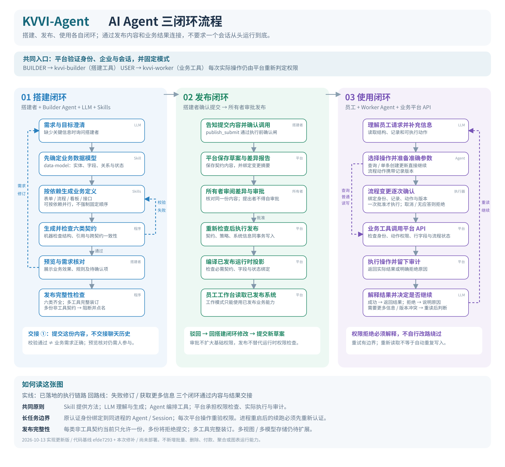

# KVVI-Agent 三闭环实现与验证

日期：2026-10-13。用户授权范围：流程图与对应实现一起更新。

保留 Builder / Worker 分工，将搭建、发布、使用画成三个闭环，并将发布完整性、流程操作确认、后台会话身份绑定落到真实调用路径。源码保存在隔离分支 `codex/three-loop-execution`，本次未部署。

## 实现

| 问题 | 实现与实际边界 |
| --- | --- |
| 多份视图、模型等契约只采用第一份，发布成功却丢内容 | Agent 与 Python CLI 在提交前拒绝多份非工具契约，错误列出全部文件；多工具仍完整聚合。当前未扩展平台多资产存储。 |
| 发布草案只按权限策略摘要复用 | 平台摘要加入全部契约正文、名称与系统代号；内容变化生成新草案，相同内容继续复用。 |
| 流程操作的确认只依赖提示词 | `workflow_act` 执行器请求逐次人工确认，绑定系统、记录、动作、版本与身份；拒绝、取消、缺确认服务或通道、信号中止均不提交。确认后重新核对身份，平台继续检查实时权限和行版本。读取及普通单记录创建、字段更新保持原行为。 |
| 原 HTTP 请求结束后，后台工具无法取得可信身份 | 认证后的 `agent/created` 绑定实际 Agent、Session 对象和冻结身份；工具及确认调用恢复原上下文。未知、跨会话、释放后或替换 Session 的调用拒绝。绑定只在当前进程有效，重启后需要经过认证的创建或恢复路径。 |

实现入口：

- `forks/dsh/变更/packages/tool/kvvi-publish/src/index.ts`、`工具/发布脚手架.py`
- `services/platform/src/publish-api.mjs`
- `forks/dsh/变更/packages/tool/kvvi-business/src/index.ts`
- `forks/dsh/变更/packages/host/kvvi-mode-router/src/index.ts`

## 验证记录

| 检查 | 结果 |
| --- | --- |
| 平台完整 Node 测试，独立临时 PostgreSQL | 505 通过，0 失败、0 跳过 |
| 发布、业务、模式路由、Loader 组合、Goal 续跑与既有 Goal 回归 | 7 个测试文件，169 通过，0 跳过 |
| Python 工具测试，包含 Agent / CLI 对拍 | 13 通过，0 跳过 |
| 三个修改包 TypeScript build | 退出码 0 |
| 固定 pnpm 11.7.0，离线 frozen-lockfile 校验 | 退出码 0；无外部依赖升级 |
| 改造点登记 | 139 个改动、34 条登记有效，文件数全部相符 |
| 固定基线重建与指纹比对 | 131 个文件摘要一致，8 条删除生效 |
| 最终图 | SVG 可解析，PNG 2970 × 2745；已检查节点、文字与实现边界 |

失败优先的回归证据：旧发布绑定器无法通过重复契约测试；旧业务执行器无法通过当前确认测试，修补后业务套件 31 项全部通过；旧发布摘要在视图、模型和元信息变化时错误复用旧草案，3 项失败，修补后通过。

独立审查发现等待确认期间释放 Agent 或替换 Session 的竞态。新增两项回归先证明旧实现仍会发出 POST，再验证修补后零 POST。重新运行上述完整回归后无剩余可操作审查问题。

后台链路包含真实 Loader / Include 组合以及实际 AgentLoop、GoalService、goal-round-driver 自动排队续跑，验证原请求结束后的身份恢复、确认拒绝不提交、会话撤销后平台拒绝且不重试。未声称验证跨进程的完整持久化恢复或 compaction 端到端往返。

本次修改未触及共享 `vendor/dsh` 源码或运行服务。运行测试使用独立源码副本和临时数据库，依赖目录只用于只读解析。指纹通过现有工具从隔离的运行时 Git 副本生成，未手工修改文件摘要；原固定基线未改变。

## 流程图

可编辑 SVG 与生成脚本均在 `docs/diagrams/`。实线代表本次已有实现；图中明确说明多资产存储和进程重启的边界。
