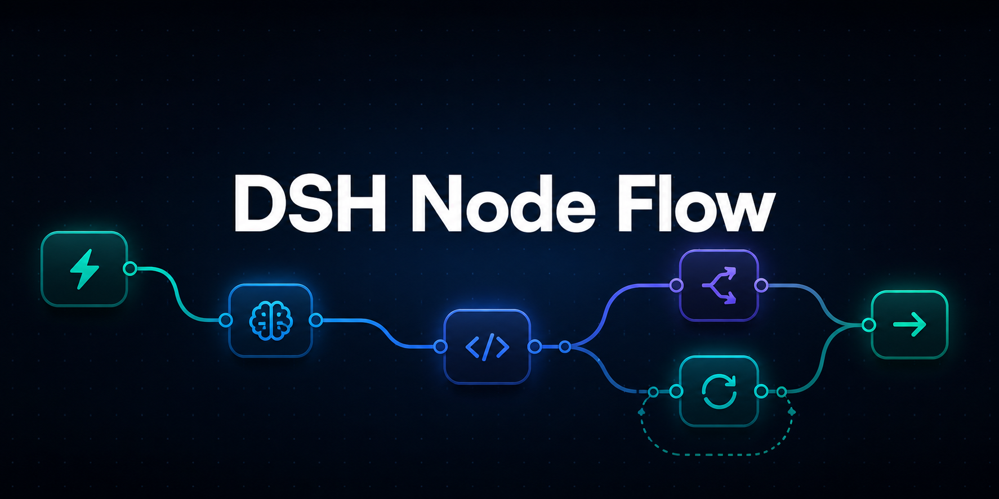
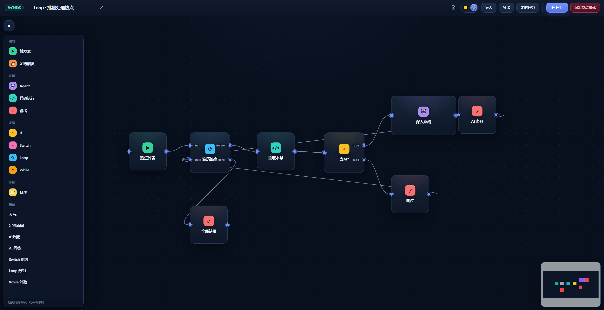
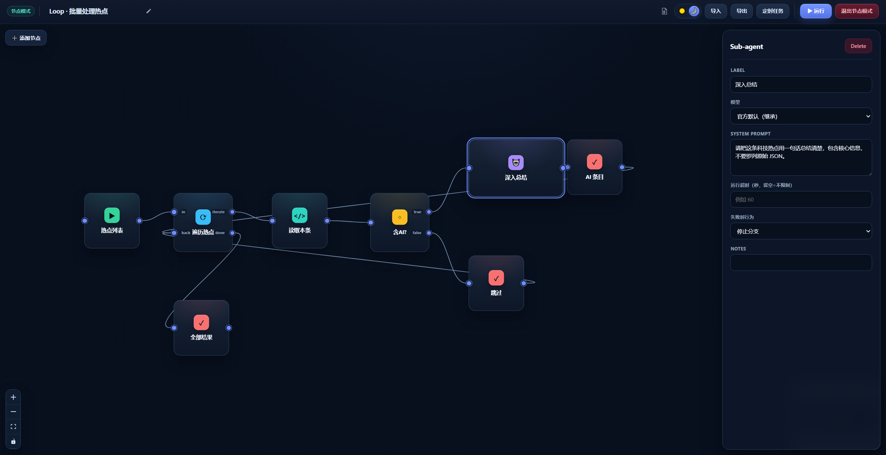
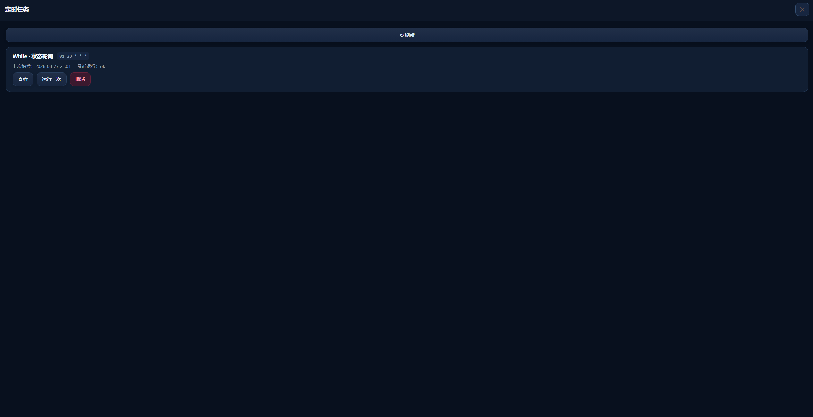

<div align="center">



[English](./README.en.md) · [简体中文](./README.md)

### DSH-native workflow automation platform

用拖拽和连线组织触发器、HTTP、子 Agent、代码、条件分支、循环与定时任务，直接在 DSH 中运行完整工作流。

[](./LICENSE)


</div>



<p align="center"><sub>从左侧节点面板添加节点，并在画布中完成拖拽编排</sub></p>

## 项目简介

DSH Workflow 是一个面向 [DeepSeek Harness（DSH）](https://github.com/deepseek-ai/deepseek-harness) 的原生工作流自动化平台。它把 Agent 调用、TypeScript / Python 代码、HTTP、触发器、条件判断、循环控制和持久化执行组合成一套可直接运行的流程系统。

仓库名是 `dsh-workflow`。为兼容已经安装的 DSH 实例、持久化数据和运行时 API，npm package、Cordis bundle ID 以及宿主 API 路径仍保留 `dsh-node-flow`；这只是兼容性标识，不影响项目作为独立仓库维护。

## 核心能力

- **可视化编排**：拖拽节点、连接端口，在画布中直观看到数据和执行路径。
- **子 Agent 调用**：Agent 节点可继承当前模型，也可选择 DSH 已配置的模型路由。
- **代码节点**：支持 TypeScript 与 Python，并提供全屏代码编辑器。
- **HTTP 自动化**：HTTP 节点支持方法、请求头、请求体、响应解析、超时和 `{{result}}` 模板。
- **Webhook 触发**：已启用流程可通过独立 token 接收外部请求，支持 HMAC-SHA256 验签、自定义成功状态码、Headers 和响应模板，并始终运行最后一次发布快照。
- **持久等待**：Wait 节点支持延迟、外部回调和人工审批；进入等待后释放执行资源，宿主重启后继续调度，到期或审批后从下游恢复。
- **连接管理**：Bearer Token、API Key、Basic Auth、OAuth2 和 Webhook Secret 在 DSH 主机使用 AES-256-GCM 加密，工作流只保存引用 ID。
- **项目变量**：普通配置与 Secret 统一保存在主机变量库，通过 `{{vars.NAME}}` 或 `vars.NAME` 引用；Secret 不回传浏览器，并在运行记录、错误和 API 响应中自动脱敏。
- **Data Store**：在 DSH 主机使用 AES-256-GCM 加密保存小型工作流状态，按工作流和命名空间隔离，支持 get、set、delete、list。
- **OAuth2 授权**：支持 Authorization Code、PKCE S256、请求体/Basic/公开客户端认证、自动刷新、401 后单次重试、连接测试与健康状态。
- **应用连接器**：内置 GitHub、Slack、Notion、Airtable、Google Sheets、Gmail、OpenAI、DeepSeek、Anthropic、HubSpot、Jira、Todoist、Stripe、Discord、Microsoft Teams 与 Asana。
- **应用事件触发**：GitHub、Slack、Todoist、Stripe 与 Asana 支持持久轮询触发；首次轮询建立基线，后续新事件各自生成独立运行。
- **节点测试**：除持久 Wait 外，每个可执行节点都能使用指定输入单独测试，结果直接显示在输出页签。
- **字段映射**：从当前测试输入、上游节点样本或历史运行输出生成 JSON 字段树，点击或拖拽即可插入嵌套字段表达式。
- **流程控制**：内置 If、Switch、Loop 和 While，覆盖分支与循环场景。
- **执行反馈**：节点展示运行状态；实际经过的连接路径会高亮，方便定位流程走向。
- **错误分支**：Code、Agent、HTTP、连接器和子工作流在重试耗尽后可从红色 `error` 端口路由到补偿或通知分支；错误事件经过脱敏，运行记录会明确标记为“错误已处理”。
- **运行控制**：画布与主页运行可主动停止，取消信号会传递到 Code、Agent、HTTP 和循环节点。
- **失败重试**：Code、Agent、HTTP、应用连接器和子工作流调用支持 0–10 次重试，可选择固定间隔或指数退避。
- **检查点恢复**：服务端运行会在节点边界持久保存恢复点；失败或宿主中断后，可从运行记录继续执行失败节点及其下游。
- **执行预算**：在编辑器“更多操作 → 运行策略”中设置单次运行最长时间和最大执行步数；超限运行会标记原因并保留安全 checkpoint，可从运行记录恢复。预算随草稿和已发布快照隔离，排队运行使用提交时的快照。
- **可靠草稿**：自动保存使用递增版本校验，多页面编辑发生冲突时不会静默覆盖。
- **并发持久化**：工作流写入在宿主进程内串行提交，长运行结束时基于最新记录合并运行时间，避免覆盖同时创建或编辑的其他流程。
- **显式发布**：已启用流程继续运行已发布快照，草稿修改需要再次发布才会影响生产调度。
- **输入契约**：可为工作流声明文本、数字、布尔值、对象、数组或任意 JSON 输入；手动运行在浏览器和宿主双重校验后才会创建运行记录。
- **版本历史**：每次创建、保存、发布、停用和回滚都会保留完整快照，支持任意两版结构 Diff、恢复为草稿或恢复并发布。
- **文件夹组织**：在主页按扁平文件夹归类、筛选和移动工作流；文件夹只管理控制面归属，不改变草稿、已发布快照、运行或版本历史。
- **错误分支**：可执行节点可在重试耗尽后走独立的红色 `error` 端口；下游只接收脱敏错误事件，运行会标为“错误已处理”。
- **审计日志**：主机侧保留有界的控制面操作记录，可追踪工作流、连接、变量、运行和审批的管理动作，不保存输入、密钥、输出或审批备注。
- **定时任务**：通过 5 段 Cron 表达式保存工作流，在任务面板中查看、立即运行或取消。
- **导入与导出**：工作流可以保存为文件，便于备份、分享和复用。
- **内置文档**：顶部帮助入口包含节点字段、连线规则、结果语义和工作流示例。

## 界面预览

### 节点属性

选中节点后，可以在右侧属性面板配置名称、模型、提示词、超时和失败处理策略。



### 定时任务

定时任务面板集中展示 Cron 计划、上次触发时间和最近运行状态，并支持查看、立即运行或取消任务。



## 快速开始

### 安装

项目尚未发布到 npm，请直接从公开 GitHub 仓库安装：

```sh
dsh plugin --profile web add git+https://github.com/luxi233/dsh-workflow.git
```

如果你是在 DeepSeek Harness 源码目录中运行 DSH，请使用：

```sh
pnpm dsh plugin --profile web add git+https://github.com/luxi233/dsh-workflow.git
```

安装完成后重启 Web UI：

```sh
dsh web
```

源码运行方式对应为 `pnpm dsh web`。

进入 DSH 后，从侧边栏打开 **节点模式** 即可使用。

### 基本使用

1. 从节点模式主页创建、搜索、复制、启停或删除多个工作流，也可以直接从模板开始；使用左侧文件夹创建、筛选和整理流程。删除文件夹时必须选择迁移目标或“未分类”，不会改动流程图、草稿、已发布快照、运行记录或版本历史。
2. 打开工作流后，从左侧工具轨进入 **节点库**，搜索并添加节点。
3. 拖动节点端口建立连接，或点击连线中间的 `+` 插入步骤。
4. 在右侧检查器的 **配置 / 输出** 标签中编辑参数并查看节点结果。
5. 可先在检查器填写 JSON 测试输入，通过字段旁的 **映射** 打开字段树；点击或拖拽字段会插入到当前光标，再点击 **测试此节点** 验证。
6. 工作流草稿会自动保存到 DSH 数据目录；点击 **发布** 后才会更新实际运行与 Cron 调度使用的快照。
7. 已发布流程继续编辑时会显示 **发布更新**；若其他页面先保存，编辑器会要求加载服务器版本或将本地画布另存为副本。
8. HTTP 节点需要认证时，先从主页 **连接** 创建凭据，再回到节点中选择；OAuth2 连接保存后点击授权，并将界面显示的回调 URL 登记到服务商应用中。密钥与 Token 不会进入工作流 JSON。
9. 在主页 **变量** 中创建普通值或 Secret；在可映射字段中选择“项目变量”即可插入 `{{vars.NAME}}`，表达式字段使用 `vars.NAME`。
10. 对容易受网络影响的 Code、Agent、HTTP、连接器和子工作流调用，可设置失败重试次数、等待间隔和退避策略。
11. 在 **更多操作 → 运行策略** 中配置并发模式、最长运行时间（最多 86400 秒）和最大执行步数（最多 100000 次节点访问）。不填写时间表示不限制；不填写步数使用默认上限。
12. 需要显式补偿、告警或降级时，选择节点的“失败时行为 → 路由到错误分支”，再从右侧红色 `error` 端口连接处理节点。
13. **运行记录** 默认只加载摘要；点击“详情”按需查看节点输入、输出、日志和耗时。超限运行会显示“超过运行时限”或“超过执行步数”，只要 checkpoint 合法仍可从失败处恢复。安全输入的手动运行可显式“重放”，重放固定使用当时保存的工作流快照而不是当前草稿，并会再次执行所有外部写操作；恢复与重放都采用至少一次语义，请让有副作用的操作支持幂等键。
14. 在工作流行点击 **版本历史**，可以比较任意两个版本；“恢复为草稿”不会改变线上快照，“恢复并发布”会立即替换生产版本。回滚本身也会形成新版本。
15. 在主页 **审计日志** 中按对象筛选和搜索最近的管理操作；日志只记录操作摘要与安全元数据，不能用于读取运行详情或连接密钥。

### 手动运行输入契约

通过编辑器“更多操作 → 输入 / 输出契约”声明输入字段后，主页和编辑器的手动运行都会显示类型化输入表单。浏览器会先解析文本、数字、布尔值、对象、数组和任意 JSON；宿主会在任何运行记录、持久队列或重放快照创建前再次验证必填字段和类型。未声明输入时，原有的一键运行行为保持不变。

已启用流程始终使用其不可变的已发布快照及对应输入契约，即使浏览器中存在未发布草稿。未启用流程使用当前草稿，适合调试和预览。运行输入不得承载密码、Token、Cookie、API Key 或项目 Secret；使用主页“连接”或项目变量的 Secret。含认证字段或 Secret 的输入不会保存为可重放数据。

### 运行策略与执行预算

编辑器“更多操作 → 运行策略”同时管理根运行并发和单次执行预算。并发策略可以允许并行、超过上限时跳过，或把触发请求持久排队；排队项保存提交时的工作流快照，宿主重启后仍按 FIFO 处理。

最长运行时间按活动执行的墙钟时间计算，最大执行步数按节点访问次数计算，循环迭代也会计入。达到任一预算后，运行状态为失败并带有 `timedOut` 与 `limitReason`（`duration` 或 `steps`）；运行中心会显示具体原因。服务端会保留当前节点的输入、冻结快照和 checkpoint，只有在恢复条件满足时才显示“从失败处恢复”。预算不会跨运行累计，恢复运行会重新使用快照中的预算。

侧栏中的 **当前空间 / 本地工作区** 是数据范围标识，不是切换按钮。当前版本只有一个本地空间，工作流统一保存在 `~/.dsh/workflow-canvas/workflows.json`；团队空间与多工作区尚未实现。

### 文件夹组织

主页文件夹是扁平的控制面元数据，工作流通过 `folderId` 归类；工作流图、草稿修订、已发布快照、执行快照、恢复检查点和版本历史都不包含文件夹内容。移动工作流只更新它的列表归属和控制面 `revision`，不会重新发布或影响已经受理的运行。

删除文件夹会原子地把其中工作流迁移到指定目标文件夹或“未分类”。创建、重命名、删除迁移和工作流移动会写入主机侧审计日志。文件夹列表不进入浏览器本地缓存；在移动工作流或删除文件夹前，先处理未同步草稿，避免旧页面缓存反向覆盖服务端归属。

## 配套 AI Skill

如果希望让 DSH 中的 AI 更准确地生成可直接导入本插件的 JSON 工作流，可以安装配套的 [`dsh-node-flow-skill`](https://github.com/luxi233/dsh-node-flow-skill)。

该 Skill 包含当前工作流文档结构、节点字段、连线端口、循环规则与完整示例，能够减少字段遗漏或端口名称错误。安装后，可以直接告诉 AI：

```text
使用 dsh-node-flow-skill，为我生成一个可导入 dsh-node-flow 的 JSON 工作流：……
```

Skill 地址：<https://github.com/luxi233/dsh-node-flow-skill>

## 节点类型

| 节点 | 用途 |
| --- | --- |
| **Trigger** | 工作流入口，将触发内容传递给下游节点。 |
| **Webhook** | 使用带随机 token 的生产 URL 接收外部 HTTP 请求并启动已发布流程。 |
| **Schedule** | 使用 5 段 Cron 表达式定时运行整个工作流。 |
| **App Trigger** | 按固定间隔轮询已声明的应用事件，新事件从该入口启动已发布流程。 |
| **Agent** | 调用 DSH 子 Agent，可继承当前模型或指定模型路由。 |
| **Code** | 在宿主运行 TypeScript 或 Python，读取上游输入并返回结果。 |
| **HTTP** | 从 DSH 主机调用 HTTP API，可引用加密连接并解析 JSON 或文本响应。 |
| **If** | 根据真值将流程分发到 `true` 或 `false`。 |
| **Switch** | 按值匹配 Case，未命中时进入 `default`。 |
| **Loop** | 遍历数组或重复 N 次，并收集每次循环结果。 |
| **While** | 条件成立时持续循环，并通过 `maxIters` 防止无限执行。 |
| **Output** | 使用 `{{result}}` 模板展示上游结果。 |
| **Note** | 在画布中添加说明，不参与执行。 |

## Code 节点 API

TypeScript 代码中可使用全局 `dsh` 对象：

```ts
const response = await dsh.fetch({
  url: "https://example.com/api",
  method: "POST",
  headers: { "Content-Type": "application/json" },
  body: { message: "hello" },
})

const previous = await dsh.input(null) // 读取上游节点输出
const now = await dsh.now(null)        // { iso, ts, local }

return response.json
```

Python 节点通过环境变量读取上游结果，并将标准输出作为节点结果：

```python
import os

previous = os.environ.get("DSH_INPUT", "")
print(previous)
```

> DSH Code Runtime 的绑定调用必须传入可无损 JSON 序列化的参数，因此应写成 `dsh.input(null)` 和 `dsh.now(null)`，不能省略参数。

## HTTP 与 Webhook

HTTP 节点中的 URL、请求头和请求体支持 `{{result}}`，也支持 `{{result.user.id}}`、`{{result.items[0].sku}}` 等嵌套路径。If、Switch、Loop 和 While 使用对应的表达式形式，例如 `result.user.active`。字段映射器可从当前测试输入、上游节点测试样本和最近运行记录中预览结构；节点测试样本只保存在浏览器本地，不会写入工作流 JSON 或发布快照。响应默认按 `Content-Type` 自动识别 JSON，最大读取 5 MB；出于认证安全考虑，节点不会自动跟随重定向。

### 错误分支与恢复

可执行节点的 `onError` 支持三种策略：`stop`（默认，停止分支并保存恢复点）、`continue`（将空值传给普通下游）和 `route`（在全部重试耗尽后进入错误分支）。选择 `route` 后，节点右侧会显示红色 `error` 输出口；必须将它连到一个处理节点，发布与手动运行会拒绝没有连线的错误分支。

错误分支收到的是固定、脱敏的 JSON 事件，而不是原始异常：

```json
{
  "type": "workflow-node-error",
  "error": {
    "message": "HTTP 503 请求失败",
    "nodeId": "request",
    "nodeLabel": "请求外部服务",
    "nodeKind": "http",
    "attempts": 2,
    "occurredAt": "2026-09-05T00:00:00.000Z"
  }
}
```

事件不会携带上游输入、HTTP 响应体、连接凭据或堆栈。失败节点仍显示为错误，但根运行会显示“错误已处理”，其 `failed` 计数为 0、`handledErrors` 计数增加，并且不会创建恢复检查点。用它编排补偿或告警时仍应给外部写操作提供幂等键。把策略切回 `stop` 或 `continue` 后，历史 `error` 连线会保留在画布中但不会执行。

### 断点调试

在可执行节点检查器中打开“调试断点”，编辑器顶部的“调试”按钮会使用当前草稿启动一次手动调试。运行面板可以在断点前暂停、继续执行、单步执行一个线性节点，或结束调试；调试记录会保留冻结快照，草稿后续修改不会改变当前会话。

调试 v1 要求工作流只有一个手动 Trigger，且所有节点位于同一条线性路径；暂不支持 Webhook、Schedule、App Trigger、Wait、条件、循环、扇出、汇合和错误分支。为了避免把敏感数据写入暂停状态，含密码、Token、Cookie、API Key 或项目 Secret 的调试输入会被拒绝。调试仍可能执行外部副作用，写操作应使用幂等键。

### OAuth2 连接

OAuth2 连接使用 Authorization Code 流程，默认启用 PKCE S256。支持将客户端凭据放在 Token 请求体、HTTP Basic Header，或使用无 Client Secret 的公开客户端模式。授权成功后，Access Token、Refresh Token 与 Client Secret 都只保存在主机加密存储中；API 与界面仅返回连接摘要。

- 授权 URL、Token URL 和连接测试 URL必须使用 HTTPS；仅 `localhost`、`127.0.0.1` 与 `::1` 允许 HTTP，便于本地开发。
- 回调 URL根据当前打开 DSH 的页面来源生成，反向代理或远程入口需要在 OAuth2 服务商中登记页面显示的完整地址。
- Access Token 到期前会自动刷新；若服务商提前撤销 Token，HTTP 节点收到 `401` 后会刷新并只重试一次。
- “测试连接”使用当前凭据向测试 URL发送 `GET`，只保存 HTTP 状态和检查时间，不保存响应正文。
- 额外授权参数和 Token 参数以 JSON 对象填写，只能放非敏感配置，不能覆盖 `state`、`client_id`、`redirect_uri`、`refresh_token` 等保留字段。

### 应用连接器

“应用连接器”节点使用声明式动作目录，不允许工作流自行覆盖目标域名。每个动作定义固定的 HTTP 方法、允许的 API Origin、字段和可用凭据类型；字段值支持与 HTTP 节点相同的 `{{result.path}}` 映射。连接器执行复用 HTTP 节点的 5 MB 响应限制、取消、超时、固定/指数重试和 OAuth2 401 刷新。

Connector SDK v2 为每个定义加入正整数版本。工作流、发布快照、版本历史、调度快照和可恢复运行都会固定 `connectorVersion`；同一 ID 的多个版本可同时注册，旧流程不会因注册表升级而静默改变。编辑器只在用户显式点击升级时切换到最新版，并尽量保留同名参数。

字段可声明受控动态选项请求。动态请求继续受固定 Origin、HTTP 方法、1 MB 请求体和凭据类型约束，复用 OAuth2 刷新；浏览器只接收去重后的 `value` / `label`，不接收响应原文、认证 Header 或密钥。当前 Slack 频道字段提供动态发现，同时保留手工 ID 和表达式映射。

内置目录当前包含 16 个应用、32 个常用动作。外部插件可从 `dsh-node-flow/connector-sdk` 导入 `defineConnector` 与 `registerConnector` 注册声明式连接器，注册函数返回生命周期清理函数。工作流只保存连接器 ID、版本、动作 ID、参数模板和凭据引用，不保存请求构造函数或密钥。

### 应用轮询触发器

“应用触发器”节点当前提供 GitHub 新 Issue、Slack 新消息、Todoist 新任务、Stripe 新事件和 Asana 新项目任务。节点只能作为入口并且必须连接一个下游节点；轮询间隔范围为 15 秒到 24 小时。发布并启用后，宿主使用单计时器调度所有触发器，也可从检查器执行一次原子的“立即轮询”。

第一次成功轮询只记录已有事件作为基线，不回放历史数据。之后按连接器定义的稳定事件键去重，每个新事件启动一条独立持久运行；响应内重复的同一键每轮最多执行一次。更换应用、事件、连接、项目或频道参数会清空旧基线并重新初始化。

轮询状态仅持久保存下次轮询时间、不可逆配置摘要、游标、最近事件键和非敏感错误摘要。游标、事件键、领取时间、配置摘要和凭据不会由 API 或 UI 返回。轮询失败至少退避 60 秒；宿主异常发生在事件执行与去重提交之间时可能重复投递，因此外部写操作仍应使用幂等键。停用、删除或重新发布工作流会同步清理或重建对应状态。

### 项目变量与 Secret

主页“变量”支持最多 100 个普通变量或 Secret。变量名保存时规范为大写，只允许大写字母、数字和下划线；值在 DSH 主机使用独立 AES-256-GCM 密钥加密。普通值会出现在变量列表与字段映射器中，Secret 的值不会由 API 或 UI 返回。

模板字段使用 `{{vars.API_HOST}}`，条件、Switch、Loop 和 While 等表达式字段使用 `vars.ENABLED`。TypeScript Code 可调用 `await dsh.vars()`，Python Code 可读取 `DSH_VARS`。HTTP、Connector 和 Code 可以在主机侧解析 Secret；Agent 提示、子工作流输入、Output、Webhook 响应和 Wait 超时输出禁止引用 Secret，发布时会直接拒绝。

工作流草稿和发布快照都只保存变量名引用。删除变量前会检查两种快照中的所有引用；缺失变量会阻止发布。Secret 即使被 Code 或外部服务响应回显，也会在节点记录、最终运行值、错误文本和 API 响应中替换为 `[secret]`。

### Data Store

`Data Store` 节点在 DSH 主机上保存工作流状态，提供 `get`、`set`、`delete` 和 `list` 四种操作。数据文件和独立密钥使用 AES-256-GCM 保护，工作流之间以及同一工作流的命名空间之间互相隔离；工作流 JSON、浏览器缓存和运行输入不会保存 Data Store 值。

键、命名空间和值模板支持 `{{result.path}}` 与 `{{vars.NAME}}` 映射。`set` 会把模板解析为 JSON 后保存，`get` 返回键和值，`list` 返回按键排序的记录数组，`delete` 返回是否删除成功。节点需要先保存工作流，启用流程还必须通过发布校验；数据存储不提供跨工作流查询能力。

单个值最大 256 KB，键最长 256 个字符，单个主机存储最多 10000 个键。删除工作流时应同时清理不再需要的状态；外部副作用仍应使用幂等键，Data Store 只负责持久化状态，不会替代业务数据库。

### 持久 Waitpoint

Wait 节点提供三种模式：

- **延迟**：按秒、分钟、小时或天暂停，最长 365 天；到期后使用进入 Wait 时的输入继续。
- **外部回调**：运行中心显式生成一次性 Token，调用固定回调地址并通过 `x-dsh-wait-token` Header 携带 Token；请求 JSON 或文本成为后续节点输入。
- **人工审批**：运行中心显示“处理审批”，通过或拒绝后将 `approved`、`decision`、`note` 和原始输入交给后续节点。

回调与审批可配置超时小时数及超时输出模板。Waitpoint 进入等待后保存不可变工作流快照、既有节点结果和下一节点位置，进程不保持长时间 Promise；宿主启动时重新扫描等待记录。回调 Token 只显示一次，持久文件仅保存 SHA-256 摘要，API 和运行历史不返回摘要；成功领取后无法重放。

### 运行详情与安全重放

运行记录列表只返回状态、时间和计数；节点输入、输出、日志和错误需要按 run ID 单独读取。详情响应不会返回工作流快照、恢复检查点、队列载荷或重放输入，并会隐藏典型认证字段。

手动运行的根输入会在不含认证字段、项目 Secret 且不超过 64 KB 时作为服务端私有数据保留。只有这类已结束运行会显示“重放”；重放使用该次不可变快照、固定的子工作流快照和安全输入，不读取当前草稿。带 `token`、`authorization`、`cookie`、`password`、`secret`、API Key 等字段的输入不会保留，因此不能重放。

当前限制：含 Wait 的工作流只能有一个触发入口，Wait 不能放在 Loop / While 迭代体内；Wait 前的普通节点不能扇出多个并行分支。这些图在发布和运行前都会被拒绝，不会生成不可恢复的等待记录。子工作流可以包含 Delay、外部回调或人工审批 Wait：子流程等待时，父运行会保存 `mode:"child"` 的等待点并释放执行资源；子流程完成、失败或取消后，父流程只从调用节点的下游继续一次，不会重复执行调用节点。子流程及其嵌套调用仍使用发布快照，并受递归检测和最大嵌套深度限制。

### 审计日志

主页“审计日志”提供本机控制面记录，覆盖工作流创建、发布、停用、删除、移动与版本恢复，文件夹创建、重命名和删除迁移，连接和项目变量的生命周期，手动运行、取消、恢复和重放，以及人工审批的通过或拒绝。记录保留最近 1000 条并在主机侧串行写入；浏览器不缓存副本。

每条记录只包含时间、操作者（本地用户或系统）、动作、目标类型/ID/名称，以及有限的安全元数据，例如版本号、连接类型或排队状态。它明确不保存工作流输入、请求/响应正文、Header、代码、Prompt、运行输出、日志、栈、凭据、Token、密码、Secret 或审批备注。审计日志用于追踪管理动作，而非排障数据；节点执行详情仍应从“运行记录”按需查看。

Webhook 节点在创建时生成不可预测的 token。发布并启用工作流后，向检查器显示的生产 URL 发起 `GET`、`POST`、`PUT`、`PATCH` 或 `DELETE` 请求即可触发流程。下游节点接收的输入结构为：

```json
{
  "method": "POST",
  "query": { "source": "example" },
  "headers": { "content-type": "application/json" },
  "body": { "message": "hello" }
}
```

认证头、Cookie、Webhook token 和验签 Header 不会传入工作流。复制工作流或将冲突草稿另存为副本时会自动生成新的 Webhook token。

需要校验调用方时，在主页“连接”中创建至少 16 字符的 **Webhook Secret**，再在 Webhook 节点中选择它。发送方必须对未经解析的原始请求体计算 HMAC-SHA256，并把 `sha256=<hex>`、纯 hex 或 base64 签名放入配置的 Header（默认 `x-dsh-signature-256`）。签名不匹配时服务端直接返回 `401`，不会创建运行记录。

成功响应可以选择运行摘要 JSON、直接输出或自定义响应。自定义模式支持 `200–599` 状态码、JSON Headers 和 `{{result.path}}` Body 模板；`Set-Cookie`、`Content-Length`、连接级 Header 和 `x-dsh-run-id` 不允许覆盖。执行失败始终返回 `500` 诊断响应。

如果配置了幂等键 Header，服务端会按工作流、Webhook 节点、请求方法、幂等键和请求内容指纹建立幂等记录。缺少幂等键返回 `400`，同一键对应不同请求返回 `409`；相同请求仍在运行或排队时返回 `409`，并在完成后重放最终响应。重放响应带有 `x-dsh-idempotent-replay: true`，缓存内容使用主机侧 AES-256-GCM 加密，保留时间可配置为 60 秒至 30 天，默认 24 小时。幂等键、签名、Token 和缓存响应不会进入工作流输入、运行记录、浏览器缓存或普通 API 响应；取消或删除工作流时会清理未完成的幂等记录。

连接密钥、OAuth2 Client Secret 与 Token 位于 `~/.dsh/workflow-canvas/credentials.json`，使用独立的 `credentials.key` 加密。备份时需要同时保存这两个文件；丢失密钥文件后，已有连接无法恢复。

## 运行环境

插件依赖 DSH 宿主提供以下服务：

- `ctx.webServer`
- `ctx.codeRuntime`（Code 节点）
- `ctx.agents` 与 `ctx.subagents`（Agent 节点）
- `ctx.llm`（模型路由列表）

React、ReactDOM 和 `@deepseek-ai/cordis` 由 DSH 作为 Peer Dependencies 提供。

## 本地开发

```sh
npm install
npm run dev       # 启动独立 Vite 预览
npm run build     # TypeScript 检查 + 客户端打包 + Demo 构建
npm test          # 运行版本、凭据、OAuth2 和 HTTP 执行协议测试
npm run test:e2e  # 双标签冲突、OAuth2 连接、字段映射、版本 Diff 与回滚浏览器回归
npm run test:runtime # 使用真实构建产物验证重试、恢复、Waitpoint、轮询触发、版本、OAuth2、子工作流、连接器和并发持久化
npm run test:live:debugger # 使用当前 DSH 验证断点、继续、单步、快照隔离与取消
npm run test:live:debugger:ui # 在当前 DSH 页面验证断点检查器、调试控制和移动端布局
npm run test:live:error-routes # 使用当前 DSH 验证错误分支、脱敏事件与无恢复点语义
npm run test:live:mapper # 使用当前 DSH 验证嵌套路径与 JSON 转义
npm run test:live:versions # 使用当前 DSH 验证版本持久化、冲突保护与历史发布
npm run test:live:versions:ui # 在当前 DSH 页面验证版本 Diff、回滚、历史发布和移动端布局
npm run test:live:oauth2 # 使用当前 DSH 对接本地 OAuth2 Provider，验证 PKCE、刷新与密钥隐藏
npm run test:live:oauth2:ui # 在当前 DSH 页面验证 OAuth2 授权、连接测试与移动端布局
npm run test:live:connectors:ui # 在当前 DSH 页面验证连接器目录、字段映射、保存与移动端布局
npm run test:live:webhooks # 使用当前 DSH 验证 HMAC 签名、自定义响应与密钥隐藏
npm run test:live:webhooks:ui # 在当前 DSH 页面验证 Webhook 安全与响应配置
npm run test:live:waitpoints # 使用当前 DSH 验证 Delay、回调、审批、超时、取消和 Token 安全
npm run test:live:waitpoints:ui # 在当前 DSH 页面验证审批、回调凭证与移动端布局
npm run test:live:folders # 使用当前 DSH 验证文件夹冲突、移动、删除迁移与审计记录
npm run test:live:folders:ui # 在当前 DSH 页面验证文件夹创建、筛选、移动、重命名、删除迁移和移动端布局
```

## 许可证

本项目基于 [MIT License](./LICENSE) 开源。
